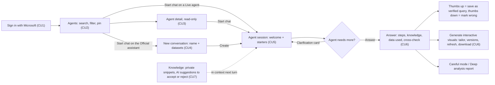
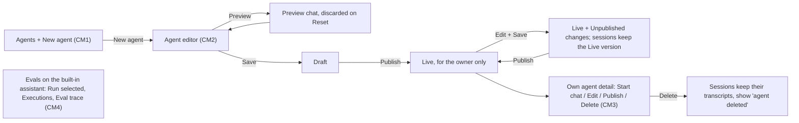
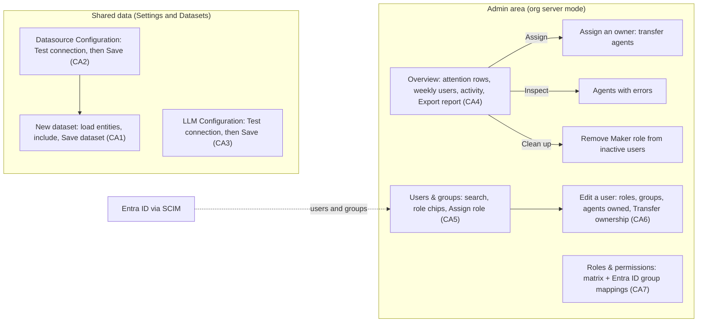

# As-built flows per role

What each role can do in the shipped app, as of v0.29.0. Screens are in [index.html](index.html). Rules and endpoints are in the capability specs and [api.md](../../specs/system/api.md); this page is the map. Update it with the pages (*Wireframe convention* in [CLAUDE.md](../../CLAUDE.md)).

**Roles:** User, Maker, Data owner, Approver and Platform admin ([admin spec](../../specs/capabilities/admin/spec.md)). The Data owner and Approver permissions guard no screen yet, so both see exactly the User UI. In local mode (the desktop app) one Demo User holds every permission, and there is no sign-in and no Admin area.

## User (also Data owner and Approver)

## Maker

Everything the User has, plus building agents. Publishing has no approval step: **Live** means usable by the owner only.

## Platform admin

Everything the Maker has, plus shared data and, in org server mode, people and roles.

## Compared with the proposed board

The Figma board's sections 1–3 are the proposal the org work started from ([BA-161 spec](../../specs/epics/BA-161/spec.md) lists what was cut).

| Proposed screen | Status in v0.29.0 | As-built page |
|---|---|---|
| M1 Describe the agent (build by chatting) | Built differently: a form editor | CM2 |
| M2 Edit, preview (Simulate / Live) and trace | Partly: a preview chat, no Simulate/Live switch or trace | CM2 |
| M3 Evaluate with a test set | Partly: evals for the built-in assistant only | CM4 |
| M4 Commit and choose audience | Not built: Publish makes the agent Live for the owner, with no audience | CM3 |
| A1 Review a publish request | Not built (out of scope for BA-161) | — |
| A2 Approve: audience, pre-install and policy | Not built | — |
| A3 Operate the registry | Not built | — |
| U1 Discover in the gallery | Built differently: Agents hub with All / Pinned / Official / Mine | CU2 |
| U2 Evaluate the profile (restricted data) | Partly: agent detail, no restricted data or access request | CU3 |
| U3 Open the agent: welcome | Built | CU5 |
| U4 Run: plan, confirm, cite, feedback | Partly: clarification, evidence and feedback; no plan approval or write confirmation, because the assistant is read-only | CU6 |
| P1 Admin overview | Built, reduced: two tiles, three attention rows | CA4 |
| P2 Users & groups | Built | CA5 |
| P3 Edit a user | Built, as a side panel | CA6 |
| P4 Roles & permissions | Built: read-only matrix plus group mappings | CA7 |
| Session flow: plan approval, inline confirm, escalate to owner | Not built | — |
