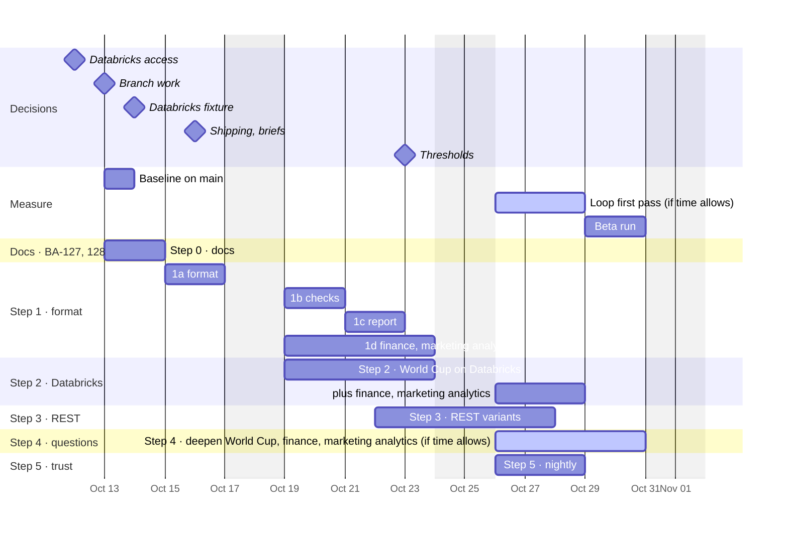
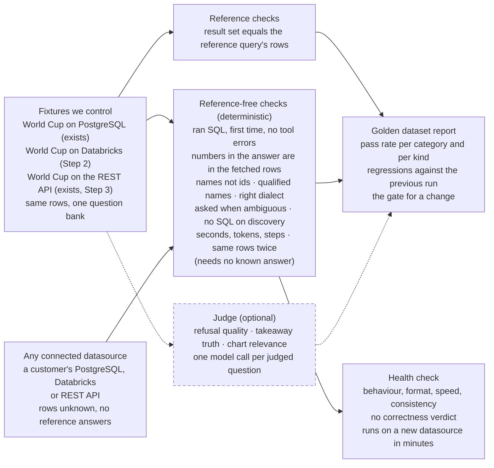
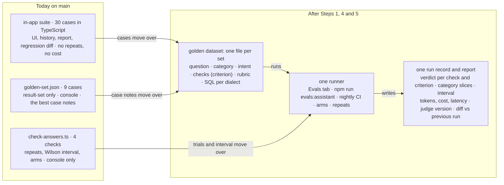
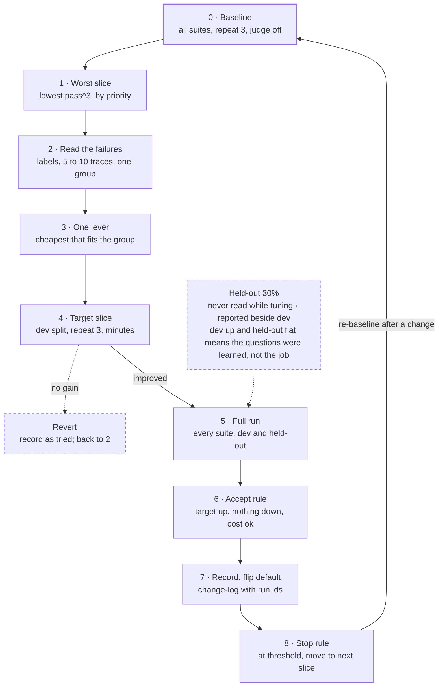
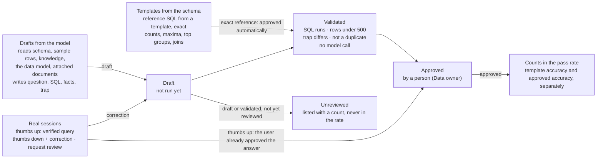

# BA-9 — Golden Dataset and Evals: execution plan

- **Jira:** [BA-128](https://halo-powered.atlassian.net/browse/BA-128) (execution plan story)
- **Epic:** [BA-9](https://halo-powered.atlassian.net/browse/BA-9)
- **Roadmap:** Milestone 1.1, feature 1.1.3 in [roadmap.md](../../roadmap.md)
- **Epic spec:** [specs/epics/BA-9/spec.md](../../specs/epics/BA-9/spec.md)
- **ADR:** ADR-0015 in [architecture.md](../../specs/system/architecture.md)
- **Status:** Draft, for team review; decisions marked open in [3.0](#30-start-here-what-to-do-first) are not yet taken
- **Source:** the artifact [Golden Dataset and Evals Plan](https://claude.ai/artifact/B5Fvcjq5kyw1U445pDkdGX), version 7 of 2026-10-12
- **Repository baseline:** `main` at `ee558d2` (v0.30.0); `main` is now `f3ef18e` (v0.31.0), whose four extra commits touch nothing eval-related (workflow mod, version bumps, BA-169 spec, delivery.md), and the status-check commands of [3.8](#38-status-check-notes) were re-run against it on 2026-10-12
- **Companion:** the research [docs/research/BA-9.md](../research/BA-9.md) (story [BA-127](https://halo-powered.atlassian.net/browse/BA-127), roadmap 1.1.2)

The one rule: this plan counts only what is on `main`. Branch work is a prerequisite with an open decision ([3.0](#30-start-here-what-to-do-first)), never an assumption.

**How to read this plan.** [3.0](#30-start-here-what-to-do-first) says what to do first, and when. [3.5](#35-the-build-step-by-step) holds the steps. [3.1](#31-how-evals-work-when-users-can-connect-any-datasource) to [3.4](#34-synthetic-domain-databases-the-right-material-with-conditions) and [3.6](#36-the-improvement-loop) are how-to material the steps use. [3.7](#37-where-things-go-the-technical-companion-in-brief) to [3.9](#39-thresholds-to-react-to-a-proposal-not-a-decision) are reference for whoever builds it. [Part 4](#part-4-evals-on-the-users-own-data-a-product-feature) continues the sequence with Steps 9 to 12, the [Story map](#story-map) ties each step to its roadmap feature and Jira story, and [Have, need, done, not now](#have-need-done-not-now) is the inventory. The findings, the market comparison, the criteria list, the categories and the sources are in the [research](../research/BA-9.md).

## Part 3. Execution plan

The steps are ordered by the manager's priority first (Databricks, then REST), then by what each later step needs. Each step is one Jira story under BA-9 and one roadmap feature under Milestone 1.1, built on the epic's single branch (the rule since October 9), after the research and the plan that BA-127 and BA-128 ask for.

### 3.0 Start here: what to do first

The plan is one sequence, Step 0 to Step 12 ([3.5](#35-the-build-step-by-step) and [4.5](#45-the-build-continued)). Everything else in Part 3 is how-to material the steps use. This section says what to do first, who does it, and when each decision is needed. Today is Monday October 12; the beta is Saturday October 31, so the last working day is Friday October 30.



*The three weeks to the beta. Plain bars are the minimum by Friday October 30; bars labelled "(if time allows)" (drawn as active) are done if time allows; milestones are decisions, on the day each is needed. The one outside dependency: Step 2 starts only when the Databricks credentials arrive.*

#### The first eight actions, in order

| # | When | Action | Who | Time | Done when |
|---:|---|---|---|---|---|
| 1 | Today, Mon Oct 12 | **Ask for Databricks access.** A workspace the team may use for tests, a serverless SQL warehouse (2X-Small, auto-stop 5 minutes), a personal access token, and a catalog where the token can create a schema. A dev or trial workspace; Free Edition's terms are non-commercial. | Sergio, to the manager | 15 minutes | Host, warehouse id, token and catalog are in hand, ideally by Wednesday. Step 2, the manager's first ask, cannot start without them. |
| 2 | Tue Oct 13 | **Open the epic branch.** `feat/BA-9-golden-dataset-evals` in `.claude/worktrees/BA-9-golden-dataset-evals`, from `main`. Since October 9 the rule is one branch, one worktree and one PR per epic: every BA-9 story is a commit on this branch, scoped to its story. Assign BA-127 and BA-128; move BA-127 to In Progress. | Sergio, with Claude | 10 minutes | `git worktree list` shows it; the stories are assigned. **Done on 2026-10-12.** |
| 3 | Tue Oct 13 | **Take the baseline on main**, from the main checkout, before any change. The World Cup set on the World Cup PostgreSQL datasource and the World Cup (REST API) set on the REST datasource, three runs each, from the Evals tab; download the six reports. Use the Evals tab, not the CLI: reading the code, `npm run evals:assistant` passes no question list, selects all three sets and is refused with "The selected questions span several samples" (Step 1a fixes it). | Sergio | About 2 hours, mostly waiting: about 60 assistant turns, roughly 2 million tokens at the branch's measured rate | The six reports are in the research story's evidence folder, with pass counts, seconds per question, and the questions whose verdict changed between runs. Every later step is compared with this. |
| 4 | Tue Oct 13 | **Decide how the branch work comes over.** The data and the recommendation are in the decisions table below. | Sergio, with whoever reviews the epic | 1 hour | One line in the plan: copy the data and rebuild the wiring, merge, or rebuild everything. |
| 5 | Tue to Wed | **Step 0a, research (BA-127).** [`docs/research/BA-9.md`](../research/BA-9.md) from Parts 1, 2 and 4.0 of the source artifact, with the baseline as its evidence and its own roadmap feature. Commit `docs(BA-127): …`. | Claude drafts, Sergio reviews | Half a day | The spec check is green; BA-127 is Done. |
| 6 | Wed Oct 14 | **Step 0b, plan (BA-128).** The epic spec rewritten to this scope and confirmed by Sergio (the October 4 waiver covered the earlier draft, not this scope); one Jira story per step under BA-9, created with confirmation; roadmap features 1.1.2 onward, one per story, with 1.1.1 split into them; the ADR; `docs/plans/BA-9.md` from Part 3. Commit `docs(BA-128): …`. | Claude drafts, Sergio confirms | Half a day to a day | The stories exist and the epic spec says Confirmed. The team's rule: no implementation story starts before this. |
| 7 | Thu to Fri | **Step 1a, format and validator** ([3.5](#35-the-build-step-by-step)). The existing questions moved into the format with no change in behaviour; `eval:validate`; a set option on the CLI. | Claude builds, Sergio reviews | 1 to 1.5 days | The validator passes on PostgreSQL and REST; a run gives the same verdicts as the baseline, within its run-to-run variation. |
| 8 | Mon to Tue, Oct 19 to 20 | **Step 1b, the deterministic checks** ([3.5](#35-the-build-step-by-step)), while the Databricks loader of Step 2 starts beside it. | Claude builds, Sergio reviews | 1 to 1.5 days | Each check has a unit test and scores on a PostgreSQL run. |

**How to take the baseline** (action 3). Load the World Cup sample from the Testing Data panel if its datasource is not there yet, then:

```bash
docker compose up -d --wait postgres          # World Cup on PostgreSQL, port 55432
cd backend && npm run worldcup:api            # second terminal: the World Cup REST API, port 55080
cd backend && npm run worldcup:rest:setup     # third terminal, with the app running: registers the REST datasource once
```

Then Agents, Questions to Insights Assistant, Evals: open World Cup and run it three times; open World Cup (REST API), pick the REST datasource and run it three times; download each run from Executions.

#### Decisions, and when each is needed

| Decision | Needed by | It blocks | Recommendation | Status |
|---|---|---|---|---|
| Databricks access: workspace, warehouse, token, catalog | Wed Oct 14 | Step 2 | Ask today (action 1). | **Decided 2026-10-13 (Sergio):** the team has access inside a VDI. Step 2 is built here without a warehouse and validated in the VDI later, from a copy of the repository. |
| How the branch work comes over | Tue Oct 13 | Step 0b's stories; Step 1 | **Copy the data, rebuild the wiring.** A simulated merge of `feat/engine-eval-loop` into `main` (`git merge-tree`, which changes nothing) conflicts in 39 files: 14 specs, 9 frontend files, and the agents, sessions and LLM modules, the parts `main` rewrote since (Agent Hub, admin, LLM settings). The smaller `docs/eval-suites-specs` conflicts in 18. None of the data conflicts: the four domain generators and their init SQL, the seven suite files, the check library, the failure labels and the Databricks loader are new files. Copy those by path on the epic branch (`git checkout feat/engine-eval-loop -- <path>`, never `-- .`), and rebuild the runner, the report and the UI on `main`'s code in Step 1, with the branch as reference. | **Decided 2026-10-13:** copy the data, rebuild the wiring ([Decisions taken](#decisions-taken-2026-10-13)). |
| Databricks fixture: World Cup loaded (A) or the samples catalog only (B) | Wed Oct 14, in Step 0b | Step 2's story | A, with `samples.tpch` as a smoke set ([2.7](../research/BA-9.md#27-databricks-and-rest-what-to-test-and-what-it-needs)). | **Decided 2026-10-13:** A, plus finance and marketing analytics on all three kinds ([Decisions taken](#decisions-taken-2026-10-13)). |
| Shipping: one PR when the epic is done (the rule since October 9), or an early PR after Step 1c | Fri Oct 16 | When BA-2, BA-4 and BA-5 can measure their changes against the suite | Ask for the early PR. The epic's purpose is that every change to the DSL, the knowledge store and the connectors is measured before the beta; with one PR at the end, the suite reaches `main` on October 30, too late for that. | open |
| Who reviews the finance and marketing-analytics briefs | Fri Oct 16 | Step 1d | Claude drafts both briefs from [3.4](#34-synthetic-domain-databases-the-right-material-with-conditions) and the 2026-10-07 product notes; someone who knows the business reviews each in about an hour. | **Decided 2026-10-13 (Sergio):** no business review. Claude creates both synthetic databases and their questions; Sergio skims them. |
| The beta thresholds | Fri Oct 23 | Step 5 | The proposal in [3.9](#39-thresholds-to-react-to-a-proposal-not-a-decision). | open |
| Who labels the judge validation set | After the beta | Step 6 | A reviewer who knows the data, using the Pass and Fail control of Step 6. | open |

#### Decisions taken (2026-10-13)

On 2026-10-13 Sergio handed the two decisions due this week to Claude, and asked that the fixture decision add two domain databases, such as finance and marketing analytics, that work on PostgreSQL, Databricks and REST alike. They are recorded here and in [`evidence/1.1.3/decisions.md`](../../evidence/1.1.3/decisions.md); Sergio can still reverse either when he confirms the epic spec.

- **How the branch work comes over: copy the data, rebuild the wiring.** As recommended in the table: the data files come over by path, the runner, report and UI are rebuilt on `main`'s code with the branch as reference.
- **Fixtures: three families, each on all three kinds.**
  - **World Cup**, loaded into Unity Catalog (option A), with `samples.tpch` as a Databricks smoke set. It stays the connector fixture.
  - **Finance**: the branch's banking domain extended to finance and wealth (accounts, transactions, portfolios, fees).
  - **Marketing analytics**: new, shaped on the marketing-insight product of the 2026-10-07 notes (carriers, sales by quarter, revenue by period, a benchmark against masked competitors), with its governance question (a user sees only their own carrier).
  - **One source of truth per fixture.** Its seeded PostgreSQL generator writes the rows and `facts.json`; a dump script exports the schema to JSON, as `scripts/worldcup-rest-api/data/` already holds for World Cup; the local REST server serves any dumped fixture with the same switches, and the Databricks loader loads the same dump into `<catalog>.<schema>`. The rows are identical on the three kinds by construction, so a difference between kinds is the connector's or the dialect's (ADR-0015).
  - **Health insurance moves from first to third.** It comes over on PostgreSQL as it is (42 questions), with genomics and supply chain, and goes to Databricks and to 100 questions after the beta. Finance and marketing analytics were asked for by name; finance already has a generator to extend; marketing analytics is the second product's domain and the only one with a governance question.
- **Databricks is validated in the VDI** (Sergio, 2026-10-13). The team's Databricks access is inside a VDI. Step 2 builds the loader, the fixtures, the Databricks references and their unit tests here, without a warehouse; the validator and the eval runs on a real warehouse happen later in the VDI, from a copy of the repository.
- **No business review of the domains** (Sergio, 2026-10-13). Claude writes the finance and marketing-analytics briefs, schemas, generators and questions, all synthetic; Sergio skims them. The questions are checked by running every reference query, not by a reviewer.
- **What it costs.** Step 1d grows from 1 to 2 days to 5 to 6 (two domains by the recipe in [3.4](#34-synthetic-domain-databases-the-right-material-with-conditions), each with a starter bank of at least 30 questions), and Steps 2 and 3 grow by about a day each for a loader and a server that take any fixture. The minimum by the beta now includes 1d: about 19 to 24 days of work against the 14 working days from October 13. It fits only if Claude runs the domain work in parallel with Steps 1b, 1c and 2. If time runs short, depth goes first (the banks stay at about 30 questions), then the three other branch domains, then marketing analytics on Databricks and REST.

#### The three weeks

| Week | Steps | What the team sees on Friday |
|---|---|---|
| Oct 12 to 16 | Actions 1 to 7: access, branch, baseline, branch decision, Step 0, Step 1a | A measured baseline on PostgreSQL and REST; the research and the plan confirmed; the stories in Jira; the questions in one format with a validator; the Databricks credentials |
| Oct 19 to 23 | 1b, 1c, 1d (finance and marketing analytics), Step 2, Step 3 started | Deterministic checks and reports by category with the judge off; finance and marketing analytics on PostgreSQL with their starter banks; World Cup on Databricks; the first REST server variants |
| Oct 26 to 30 | Step 3 finished, Step 4, the nightly part of Step 5, a first loop pass; the beta run on Thursday and Friday | Nightly runs with intervals and cost; dev and held-out side by side; the beta report on every kind |
| After the beta | The rest of Step 5, Steps 6 to 8, then 9 to 12 | Judge agreement, arms, component checks, two-turn tasks; then users' own eval sets |

> **If time runs short.** *Updated 2026-10-13: the minimum now also includes Step 1d for finance and marketing analytics, and both domains on Databricks and REST in Steps 2 and 3; the new estimate and the order in which things move are in [Decisions taken](#decisions-taken-2026-10-13). The text below is the estimate before that decision.* The minimum by Friday October 30 is Steps 0, 1a to 1c, Step 2 with World Cup on Databricks, Step 3, and the nightly run of Step 5. By the estimates in [3.5](#35-the-build-step-by-step) that is 12 to 16 working days of work against 14 left, so it fits only if Claude does most of the drafting and the code and the Databricks access arrives by Wednesday. If the access is late, Step 3 (REST, no outside dependency) goes ahead of Step 2. What moves after the beta, in this order: 1d (the four domains), health insurance on Databricks, Step 4 beyond the kind-specific cases, the rest of Step 5, then Steps 6 to 8. At the minimum, each kind runs the World Cup questions (21 from main's three harnesses, 46 if the branch's 38-question World Cup suite comes over) plus its own cases: 10 for Databricks, 12 for REST.

#### Not first

- No new domains or questions before Step 1a: they would be rewritten into the format.
- No wholesale merge of `feat/engine-eval-loop` or `feat/knowledge-learning-evals`: 39 conflicting files, and they carry expert mode, learning and memory, which belong to other epics.
- No prompt or knowledge tuning before the baseline exists: there would be nothing to compare with.
- No Part 4 (users' own eval sets) before the beta, and no judge on the nightly.

### 3.1 How evals work when users can connect any datasource

The app lets a user connect any PostgreSQL database, any Databricks warehouse or any REST API. We cannot know the right answer to a question on data we have never seen. So the evals use two kinds of check, and only one of them needs a known answer.

**Reference checks need a fixture we control.** A fixture is a dataset whose rows we know, loaded the same way every time. Today that is the World Cup sample on PostgreSQL and on the local REST API. Step 2 loads the same rows into Databricks. A question is written once and carries one reference query per dialect. A run picks one datasource kind, so the report can say "PostgreSQL 91%, Databricks 84%, REST 88%" for the same questions. This is the golden dataset.

**Reference-free checks work on any datasource, including a customer's.** They do not need to know the answer. They only read what the assistant did: did it run SQL, did the SQL run the first time, are the numbers in the answer present in the rows it fetched, did it name things instead of ids, is the SQL fully qualified and in the right dialect, did it ask when the question was ambiguous, how long did it take, how many tokens, and does asking the same question twice return the same rows. All of them are deterministic. They are what you run as a health check on a newly connected datasource, where nobody has written reference answers.

**The judge is the third kind, and it is optional** ([2.3](../research/BA-9.md#23-deterministic-checks-and-the-judge-what-the-judge-costs-and-what-you-lose-without-it)). It only runs on fixtures, only when switched on.



*Only the fixtures feed the reference checks. The reference-free checks are the same on a fixture and on a customer datasource, which is what makes a health check possible without known answers.*

| Check | Needs a known answer? | Works on a customer datasource? | Deterministic? | Exists on main? |
|---|---|---|---|---|
| Result set equals the reference query | Yes | No | Yes | Yes |
| A fact must be in the prose ("Argentina") | Yes | No | Yes | Yes |
| Ran SQL, first time, no tool errors | No | Yes | Yes | Partly (errors yes, repairs no) |
| Numbers in the answer are in the fetched rows | No | Yes | Yes | No |
| Names not ids, no HTML, rationale present, qualified names, right dialect | No | Yes | Yes | No (one of them in [`check-answers.ts`](../../backend/scripts/check-answers.ts)) |
| Asked when ambiguous, no SQL on discovery, chart only when asked | No, the category says the expected behaviour | Yes, with a small bank of generic questions | Yes | Partly |
| Seconds, tokens, steps, cost | No | Yes | Yes | Seconds only |
| Same rows when asked twice (consistency) | No | Yes | Yes | No |
| Judge: refusal quality, takeaway truth, chart relevance | Yes (a rubric) | No | No | Yes, always on |

### 3.2 How to write a question that holds up

A question "holds up" when it cannot pass by luck and cannot fail for a reason that is not the assistant's fault. The recipe below is the one the existing cases followed where they are good (the golden-set notes are the best example on `main`), written out so anyone can add a question. It is a how-to used in Steps 1 and 4, not a list of plan steps.

1. **Start from the data, not from the question.** Pick a fact you can query. Write the reference SQL first. Run it. Look at the rows. If you cannot write the query, the assistant has no chance either.
2. **Make the answer small.** The reference should return only the facts the question asks for: few rows, few columns. No dependence on row order, no `LIMIT` without a tie-break column.
3. **Look for ties.** If two teams tie at the top, do not ask "which team scored most". Ask for the tie ("which teams scored exactly four goals") or for the full breakdown. The `teams-tied-on-four-goals` case on `main` is the model.
4. **Write it the way a business user would.** No table or column names, no SQL words. Say the scope (the year, the tournament) unless the point of the question is that the scope is missing.
5. **Decide what the assistant must do.** Answer with data, ask a clarifying question, say it cannot answer, or make a chart. One behaviour per question. That is the category.
6. **Pick the checks, each tagged with a criterion.** For an "answer" question the default set is: result set matches (D1), ran SQL (D1), no tool errors and no repair (D3), names not ids (I1), numbers grounded (G1), right dialect and qualified names (I6). Add a text check only for a fact that must appear in the prose.
7. **Write a trap query.** A plausible wrong SQL: a missing filter, a wrong join, own goals counted. Its rows must differ from the reference; the validator checks that. If no plausible wrong query gives different rows, the question proves nothing and should change.
8. **Add two or three paraphrases** that share the reference and the checks. Make one casual, one with a typo. The run reports them as one question with variants.
9. **Port the reference to each dialect** (PostgreSQL, Databricks SQL, SQLite for REST) and run each one on its fixture.
10. **Validate without the model.** `npm run eval:validate` (Step 1) checks in seconds: every reference runs and returns fewer than 500 rows, the trap differs, the category is in the list, no check type is used twice, every dialect is present.
11. **Run it once with the model.** If it fails, decide whether the question or the assistant is wrong. Change the question only if two people would disagree on the verdict; the test Anthropic suggests is "two domain experts would independently reach the same pass/fail verdict".
12. **Commit it with a note** saying why the question exists and what it guards, the way `golden-set.json` (removed in Step 1a, BA-182) does today.

#### One question, end to end

```ts
{
  id: 'shootouts-2018',
  category: 'encoding',             // a shootout is stored as a non-null penalty column, not a flag
  question: 'Which matches in the 2018 World Cup were decided on penalties?',
  variants: [
    'Which 2018 games went to a shootout?',
    'list the penalty shootouts of the 2018 world cup',
  ],
  intent: 'The fact is encoded indirectly; the year filter must be applied.',
  notes: 'Guards against answering for both tournaments, and against reading home_penalties as goals.',
  checks: [
    { type: 'resultSet',    criterion: 'D1' },
    { type: 'calledTool',   args: ['run_readonly_sql'], criterion: 'D1' },
    { type: 'noToolErrors', criterion: 'D3' },
    { type: 'noRepairs',    criterion: 'D3' },
    { type: 'namesNotIds',  criterion: 'I1' },
    { type: 'numbersGrounded', criterion: 'G1' },
    { type: 'dialect',      criterion: 'I6' },
  ],
  expectedSql: {
    postgres:   "SELECT home_team, away_team, winner FROM world_cup.v_match_results WHERE tournament_year = 2018 AND home_penalties IS NOT NULL",
    databricks: "SELECT home_team, away_team, winner FROM `evals`.world_cup.v_match_results WHERE tournament_year = 2018 AND home_penalties IS NOT NULL",
    sqlite:     "SELECT home_team, away_team, winner FROM api.world_cup.v_match_results WHERE tournament_year = 2018 AND home_penalties IS NOT NULL",
  },
  // the same query without the year: returns both tournaments, so it must differ from the reference
  trapSql: "SELECT home_team, away_team, winner FROM world_cup.v_match_results WHERE home_penalties IS NOT NULL",
}
```

The query shape is the existing `shootouts` case restricted to one year. Run all three references and the trap before committing; the validator does it for you after Step 1.

**Where questions come from.** In this order, because the first source is the one the book and every practitioner put first ("20-50 simple tasks drawn from real failures"):

1. Sessions a user marked wrong (thumbs down) and sessions where the assistant asked when it should not have. Each becomes a question with the right behaviour as its category.
2. The assistant's own prompt. Every rule in it is a check; every check needs a question that exercises it.
3. The category list ([2.6](../research/BA-9.md#26-categories-of-the-golden-dataset)). Fill each category to at least five questions before adding a sixth to any.
4. Each dialect's known differences ([2.7](../research/BA-9.md#27-databricks-and-rest-what-to-test-and-what-it-needs)): one question per difference.
5. Each switch on the local REST server ([2.7](../research/BA-9.md#27-databricks-and-rest-what-to-test-and-what-it-needs)): one question per switch.

### 3.3 The metrics, deterministic first

Ten numbers, in priority order. The first three are the gate. The next three explain a failure. The next two make the numbers trustworthy and affordable. The last two exist only when the judge is on.

| # | Metric | How it is computed | Needs a fixture? | Deterministic? | Reported |
|---:|---|---|---|---|---|
| 1 | **Pass rate by category** and per kind | Share of questions where every check scored 1, grouped by category; overall as the sum | Yes | Yes | Every run; the gate |
| 2 | **Result accuracy** | Share of answer questions whose result set matched the reference | Yes | Yes | Every run |
| 3 | **Change against the previous run** | Questions that passed before and fail now (regressions), and the reverse, by category | Yes | Yes | Every run; zero regressions to merge |
| 4 | **First-try SQL** | Share of questions where the answering query ran with no repair and no tool error | No | Yes | Every run; health check |
| 5 | **Grounded numbers** | Share of answers where every number in the prose is in the fetched rows or is a ratio of two such numbers | No | Yes | Every run; health check |
| 6 | **Behaviour and format** | Share passing the no-reference checks: asked when ambiguous, no SQL on discovery, names not ids, no HTML, rationale present, qualified names, right dialect | No | Yes | Every run; health check |
| 7 | **Consistency** | Run the set three times: pass^3 is the share that passed all three; flaky is the share that passed some; on any datasource, the share where asking twice returned the same rows | No | Yes (costs three runs) | Before a merge and before a release |
| 8 | **Speed and cost** | Seconds per question at P50 and P90, tokens in and out, tool calls per question, cost per run from a pricing table | No | Yes | Every run, per kind |
| 9 | Judge-scored quality | Refusal quality, takeaway truth, chart relevance, option quality, as pass rates | Yes | No | Only when the judge is on |
| 10 | Judge agreement | How often the judge agrees with the human labels of the validation set, true positives and true negatives separately | Yes | No | When the rubric or judge model changes |

Two rules keep the numbers honest. A question that could not be scored (the judge was off and it had only judge checks, or the datasource was down) is reported as a gap, never as a pass. And an interval is printed next to every rate once repeats exist (the Wilson code already in [`check-answers.ts`](../../backend/scripts/check-answers.ts)), so "84%" reads as "84%, between 78 and 89", and a two-point change is not called an improvement.



*What the merge of the three harnesses produces. Nothing is thrown away: the 9 golden-set cases and their notes, and the trials-and-interval code, move into the one suite.*

### 3.4 Synthetic domain databases: the right material, with conditions

The question raised at the review: why not make Step 1 the creation of synthetic databases for distinct industries (health, finance, logistics, health insurance, marketing), and then run a self-improvement loop on the scores? Checked against the sources and against the repository, the answer is yes for the material and no for the order, with five conditions and one surprise: most of it already exists on a local branch.

| Claim | What the industry and the repository say | Verdict |
|---|---|---|
| **Synthetic domain databases are the best foundation for the developer suite** | tau-bench built its retail and airline domains as synthetic databases with written policies, and scores agents on them. AMBROSIA generated its databases so that the ambiguity it tests survives. BIRD and Spider 2.0 use real databases because they had them, and both name dirty data and dialect detail as the hard part. The book warns that public data gets answered from memory (pp. 197 to 199) and asks for an eval set that matches production (p. 205). Data the model never saw avoids the first problem; a schema shaped like the customer's addresses the second; and generated data has answers known by construction. The loop branch already holds four such domains (health insurance, genomics, supply chain, banking: 131 questions in 16 categories, a knowledge seed per domain), generated from a fixed seed, as new files that come over without conflict. HR and retail sit on the expert-mode branch. | **yes** The right material, and most of it exists. |
| **It should be Step 1** | Without the case format, the deterministic checks and the validator (Step 1 in [3.5](#35-the-build-step-by-step)), domain questions have no place to live and no way to be checked before they cost tokens. The branch built both together, in one commit. | **yes, as Step 1d** Not before the format; right after it. |
| **Many domains are better than few** | The sample-size rule (p. 207) and Simpson's paradox (p. 205): ten questions per domain measure nothing, a hundred per slice do. Spider 2.0's breadth comes from hundreds of databases built by a large team over months. | **depth first** Three domain families deep, then breadth. The four existing domains come along because they are already written. |
| **A self-improvement loop on the scores** | Evaluation-driven development (p. 160); the branch's improvement-loop runbook (change one lever, keep it only if its target improves with no regression elsewhere); Hamel Husain's error analysis; the 2026-10-07 notes ("loops with scorers that incorporate lessons learned"). The risk every source names: tuning against the set you report inflates it (the book's contamination logic, p. 198; Husain's held-out split). | **yes** With a held-out split and a person choosing the lever. Section [3.6](#36-the-improvement-loop) writes the loop out. |

#### Five conditions that make a synthetic domain worth its cost

1. **Shape it on a real schema.** Health insurance from a claims model (members, plans, providers, claims, claim lines, adjustments); finance from a ledger or a portfolio model; logistics from orders, shipments and stops; marketing from campaigns, leads and touches. Ten to fifteen tables, some wide, codes with lookup tables, a dimension that changes over time (plan versions), fiscal periods.
2. **Plant the traps on purpose**, one per category of [2.6](../research/BA-9.md#26-categories-of-the-golden-dataset) and of the branch's list: money in cents, a test flag, a constant column, a sparse column, a status code whose business word differs from the stored value ("approved" stored as `PAID`), a duplicate-looking column pair for the ratio trap, a tie at the top, an empty month, a multi-hop join, a business term that is not in the schema at all.
3. **Write a policy document**, as tau-bench does: one or two pages of business rules in words (what counts as a paid claim, which members are excluded, how the fiscal year runs). It feeds the knowledge store, the business-term and default-filter categories, and later the document trial of Part 4.
4. **Write the questions as the persona, not as the schema.** The glossary carries the user's words and the questions use them. At least five per category, variants, a trap query each, a reference per dialect, by the recipe in [3.2](#32-how-to-write-a-question-that-holds-up).
5. **Record the planted facts.** The generator writes a `facts.json` with the truths it planted (the three members tied at the top, the empty month, the provider with no claims), so a reference query is checked against a known number, not only against the generated rows. That is the defence against the gold-set errors FLEX found in a public benchmark.

#### Which domains, in which order

| Domain | Why | Status | Order |
|---|---|---|---|
| **Health insurance**: members, plans, providers, claims, adjustments | The core business. The branch's richest set: 42 questions, 14 categories, cents, test rows, statuses | On the branch | 3. Comes over on PostgreSQL as it is (Step 1d); Databricks and 100 questions after the beta (decided 2026-10-13; it was first) |
| **Marketing analytics** (the marketing-insight product): carriers, sales by quarter, revenue by period, a benchmark against masked competitors | The second product in the 2026-10-07 notes. Also the only domain where a data-governance rule (a user sees only their own carrier, the others masked) can be tested as an eval question | Not written | 2. New, by the recipe below, on all three kinds (Steps 1d, 2, 3); to 60 questions (Step 4) |
| **Finance and wealth**: portfolios, accounts, transactions, fees | "Wealth" in the manager's three domains. The branch's banking domain (20 questions) covers part of it | Partly on the branch | 1. Extend banking, on all three kinds (Steps 1d, 2, 3); to 100 questions (Step 4) |
| **Careers and HR**; retail | HR is the third of the manager's domains. HR (10 questions) and retail (6) were added by the expert-mode and learning commits, with fields for those features | On `feat/business-expert-learning` | 4. With those features' epics, or copied later without the fields |
| Supply chain, genomics | Already written; they add breadth of schema shapes at no writing cost | On `feat/engine-eval-loop` | Come along in Step 1d; grow only after 1 to 3 |
| World Cup, Formula 1 | The connector fixture on all three kinds, and the scale fixture (48 tables) | On `main` | Kept. Not domain fixtures |

#### How to build one domain, with Claude doing the drafting

This is a how-to used in Step 4, not a list of plan steps. About two to three days per domain, plus the reviews. Under the Epic gate each domain is a Jira story under BA-9, built on the epic branch, before any file is written. Claude's part is items 2 to 6; a person's part is item 1, the reviews, and items 7 and 8.

1. **Brief** (a person with Claude, one hour): the persona, the ten questions a real analyst asks (from the business: a Mercer analyst for health insurance, the product notes for marketing insight), the rules, the glossary with synonyms, the default filters, the metrics. Output: `docs/evals/domains/<domain>.md`.
2. **Schema** (Claude drafts, a person reviews): DDL for 10 to 15 tables, and a trap plan: a table that says which schema feature serves which category.
3. **Generator** (Claude writes, a person runs): a seeded TypeScript script under `docker/postgres/generate/`, like the branch's, that writes `docker/postgres/init/00N_<domain>.sql` and `facts.json`. Ten thousand to a hundred thousand rows. Dirty on purpose.
4. **Semantics seed** (Claude drafts): the glossary, default filters and metric definitions as knowledge entries, registered by the fixtures script (the branch's `fixture-semantics.ts` pattern).
5. **Policy document** (Claude drafts, the business edits): one or two pages of rules in words.
6. **Question bank** (Claude drafts 60 to 100 by the recipe in [3.2](#32-how-to-write-a-question-that-holds-up); a person reviews the realism of the questions, not the SQL): categories, variants, traps, references for PostgreSQL, Databricks SQL and SQLite; 30% marked held-out at creation ([3.6](#36-the-improvement-loop)).
7. **Validate and load:** `eval:validate` on PostgreSQL; the Databricks loader of Step 2 for the domains that go there; the REST dump and server for the ones that go there.
8. **Baseline:** one run at repeat 3, judge off; the per-category table recorded in evidence; the domain joins the nightly.

#### How robust, and at what cost

"As robust as possible" is a choice of where the question-writing budget goes. Robustness comes from questions per slice, representativeness, variants of a fixture, reproducibility and every kind on a shared fixture, more than from the number of domains. Three levels:

| Level | Fixtures and kinds | Questions | What it proves | Cost |
|---|---|---|---|---|
| **Beta, Oct 31** (decided 2026-10-13) | World Cup, finance and marketing analytics on all three kinds; health insurance, genomics and supply chain on PostgreSQL as they are | At least 30 each on finance and marketing analytics at the minimum, toward 100 and 60; World Cup toward 100; the branch's 111 on the other three | Connectors on every kind, on three schema shapes; two enterprise-shaped domains on every kind; the second product's domain and its governance question | Two new domains by the recipe, references in three dialects for every case, a loader and a server that take any fixture |
| **Q4** | Formula 1 for scale; fixture variants with ties, nulls and empty groups; health insurance on REST; finance and HR deepened | 100 per fixture family | Schema discovery at scale; resistance to lucky matches | A loader per kind per fixture; references per dialect |
| **Later** | Every domain on all three kinds; a masked copy of a real customer dataset if the team allows it | 100 per domain per kind | Generalisation across domains and kinds | Triple the reference work; a privacy decision |

The one source of robustness no fixture gives is real customer data, which the epic keeps out of the developer suite. [Part 4](#part-4-evals-on-the-users-own-data-a-product-feature) covers it through the user's own sets.

### 3.5 The build, step by step

Each step below answers the same questions: **why** it comes at this point, what it **takes in**, what it **gives you**, a small **example**, how to tell it is **done**, and what it **needs** first. What one step gives you is what the next step takes in. The full technical list for each step (files, scripts, specs) is in a fold under its card.

Effort is a rough estimate for one developer with Claude doing most of the drafting and the code, not a commitment. The calendar is in [3.0](#30-start-here-what-to-do-first). The minimum by the beta is Steps 0, 1a to 1c, 2, 3 and the nightly run of Step 5. The examples use the World Cup sample; figures marked *illustrative* show the shape of a result and were not measured.

#### The steps at a glance

| Step | Why now | Takes in | Gives you |
|---|---|---|---|
| **0** Research and plan | Nothing is built before the scope, the order and the stories are agreed | The source artifact; six baseline runs on `main` | The research and plan docs in the repo; a confirmed epic spec; one Jira story per step |
| **1a** One format | Today the questions sit in three harnesses, in three formats | The 31 existing questions | One file per set, and a validator that runs every reference query with no model call |
| **1b** Checks | A failed question should say which rule broke, at no token cost | The questions in the new format; the tool trace of each run | Twelve deterministic checks, each tied to a criterion of [2.5](../research/BA-9.md#25-the-criteria-list-for-this-app) |
| **1c** Report by category | A total such as "24 of 30" hides which kind of question got worse | Runs scored by the new checks | A pass rate per category and per criterion; the judge off by default |
| **1d** Domain databases | Data the model never saw, shaped like a customer's | Two briefs; the branch's generators and 131 questions | Finance and marketing analytics on PostgreSQL with starter banks and a JSON dump each; health insurance, genomics and supply chain as they are (decided 2026-10-13) |
| **2** Databricks | The manager's first ask; Databricks has no eval today | The World Cup rows; Databricks access; the Step 1 questions | World Cup on Databricks, reported side by side with PostgreSQL |
| **3** REST | The REST set tests the questions, not the connector | The local World Cup API; the Step 1 questions | API variants that page, nest, cap and fail, with a report per variant |
| **4** More questions | 30 questions cannot show a change smaller than about 30 points | Steps 1 to 3; the reviewed briefs | World Cup and finance at 100 questions, marketing analytics at 60, on all three kinds, each tagged dev or held-out (decided 2026-10-13) |
| **5** Numbers you can trust | One run is one draw; a change has to beat the noise | The full question bank; token usage; model prices | Repeats with intervals, tokens and cost, and a nightly run that fails on a regression |
| **6** Judge checked | The judge is a model and can be wrong | A reviewer's Pass or Fail on 30 answers | The judge's agreement with people, printed on the report |
| **7** Arms | To prove a change helps, run with it and without it | Two configurations: knowledge on and off, or two models | Two runs side by side by category; BA-80's acceptance as one report |
| **8** Components and two turns | A wrong answer should name the part that failed | The recorded tool trace; questions written as two turns | Checks on tables used, repairs and query time; tasks scored across both turns |

#### Step 0 · Research and plan (BA-127, BA-128) · Tue Oct 13 to Wed Oct 14

- **Why:** The team's rule is that no implementation story starts before the plan is agreed. This step turns the source artifact into files the team reviews in a pull request, and creates the stories that every later step is built under.
- **Takes in:** The source artifact; the six baseline reports from `main` (action 3 in [3.0](#30-start-here-what-to-do-first)); the decisions due this week.
- **Gives you:**
  - The epic branch `feat/BA-9-golden-dataset-evals` and its worktree.
  - [`docs/research/BA-9.md`](../research/BA-9.md) (Parts 1, 2 and 4.0) and `docs/plans/BA-9.md` (Part 3).
  - The epic spec confirmed; one Jira story per step; one roadmap feature per story; an ADR for the case format.
- **Example:** The roadmap gains a feature such as "1.1.8 Databricks fixture and set", with Intent, Scope and Acceptance filled in and a link to its Jira story under BA-9. The baseline reads like "World Cup on PostgreSQL: 8, 9 and 8 of 10 passed in three runs" (illustrative), and every later step is compared with it.
- **Done when:** The spec check is green; the stories exist in Jira; the epic spec says Confirmed.
- **Needs:** Actions 1 to 4 in [3.0](#30-start-here-what-to-do-first), and the decisions due by Wednesday.

<details><summary>Technical checklist</summary>

- The epic branch `feat/BA-9-golden-dataset-evals` and its worktree `.claude/worktrees/BA-9-golden-dataset-evals`: one branch, one worktree and one PR for the whole epic, the rule since October 9.
- Parts 1, 2 and 4.0 of the source artifact as [`docs/research/BA-9.md`](../research/BA-9.md), with the baseline as its evidence (BA-127).
- The epic spec rewritten to this scope and confirmed; one Jira story per step with parent BA-9; roadmap features 1.1.2 onward, one per story, with 1.1.1 split into them.
- An ADR for "golden dataset as data files with one reference query per dialect, Databricks as a register-only fixture kind".
- Part 3 as `docs/plans/BA-9.md` (BA-128). Each story's commits are scoped to it: `docs(BA-127): …`, `docs(BA-128): …`.

</details>

#### Step 1a · One format and a validator · 1 to 1.5 days · Oct 15 to 16

- **Why:**
  - **Three tools, three jobs.** The questions sit in three separate eval tools on `main`, each built at a different time for a different job (table below).
  - **No shared number.** Each tool has its own format and its own report, so there is no single pass rate the team can quote.
  - **Adding a question is a code change.** You edit TypeScript or JSON, and first you have to know which tool the question belongs in.
  - **Mistakes are found late.** A wrong reference query shows up only during a real run, after the model has spent tokens on the question.
  - **The objective of this step:** one format and one place to add a question, and a validator that runs every reference query in seconds without calling the model.
- **Takes in:** The 31 existing questions: World Cup 10 (5 with SQLite references), Formula 1 10, the golden set's 9 with their notes, and 2 from [`check-answers.ts`](../../backend/scripts/check-answers.ts).
- **Gives you:** One data file per set; a loader that refuses an incomplete question; `npm run eval:validate`; a set option on the CLI. The old `npm run eval` is removed.
- **Example:**

  ```text
  // one question in the new file, shortened
  { id: 'champion-2022', category: 'lookup',
    question: 'Who won the 2022 World Cup?',
    expectedSql: { postgres: 'SELECT …', sqlite: 'SELECT …' } }

  $ npm run eval:validate                                (illustrative output)
  ✓ champion-2022      postgres   1 row
  ✗ final-score-2018   sqlite     reference failed: no such table
  ```

- **Done when:** The validator passes on the PostgreSQL and REST fixtures; a run gives the same verdicts as the baseline, within its run-to-run variation; one reference broken on purpose makes the validator fail.
- **Needs:** Step 0, and the branch decision ([3.0](#30-start-here-what-to-do-first)).

##### The three tools on `main`, and what each is worth

| Tool | Its job | What it holds | Keep | Leave behind | Verdict |
|---|---|---|---|---|---|
| **In-app suite**<br>Agents → Evals tab; `npm run evals:assistant` | The regular test of the assistant. It runs from the app, stores every run and lists the questions that got worse since the last run. | 30 questions in 3 sets: World Cup on PostgreSQL (10), the same 10 on the REST API (5 with a SQLite reference), Formula 1 (10). It checks the text and the tool calls, compares rows with a reference query, and calls the judge on 12 questions. | The runner, the Evals tab, the run history and the regression list. This becomes the one tool. All 30 questions. | Questions written as TypeScript code. | **good base** Keep and extend. |
| **Golden set**<br>`backend/eval/golden-set.json` (removed in Step 1a, BA-182); `npm run eval` | Catch wrong SQL. It compares the rows behind the answer with the rows of a trusted query. | 9 World Cup questions, each with a note on the trap it guards: two ratios of two different measures, two questions with ties, a clear winner, a metric that is the same on every row, a mostly empty column, and two plain controls. | The 9 questions and their notes, the best-written cases in the repo. | The runner. It prints to the console and saves nothing, and the in-app suite already compares rows the same way. | **very good questions** Move them; drop the runner. |
| **Answer-quality gate**<br>[`backend/scripts/check-answers.ts`](../../backend/scripts/check-answers.ts); `npm run check:answers` | Prove that bugs a model once shipped stay fixed, and measure how often, by repeating the set. | 4 questions, one per past bug: a rate divided by itself (100% on every row), a tie reported as a ranking, a metric that is always 100% compared as if it varied, and "Team ID 5" instead of the team's name. It repeats the set N times and gives a pass rate with a 95% interval. | The 2 questions not in the golden set. The check logic, which becomes checks in 1b (names not ids, the ratio check). The repeat and interval code, which moves into Step 5. | The script, once Step 5 has repeats. Its other 2 questions repeat golden-set questions. | **very good checks** Move the parts; retire the script. |

##### Keep the questions, or write a golden dataset from scratch?

| Option | What you get | Cost | Verdict |
|---|---|---|---|
| **Move the 31 questions into one new format** | Questions whose answers were already checked against the data (France top on 14 goals; Belgium and England tied on 4; possession won only 2 of the 8 knockout matches in 2022), the notes on each trap, and the new format with categories and a reference per dialect | 1 to 1.5 days, mostly mechanical | **best** Recommended |
| **Write a new golden dataset from scratch** | A clean set designed around the categories of [2.6](../research/BA-9.md#26-categories-of-the-golden-dataset) | Several days to write the questions and run every reference query, and the same traps found again: four of these questions exist because a model shipped the bug | **workable** Slower, for about the same result |
| **Keep the three tools as they are** | No work now | Three numbers that never add up, no categories, no Databricks, and a code change for every new question | **not enough** Blocks every later step |

What is new in 1a is the format, the loader and the validator. The questions move over, because they are the part that took the most time to get right. New questions come later: from the branch's 38-question World Cup suite (it already holds 3 of the golden set's 9) and from the recipe in [3.2](#32-how-to-write-a-question-that-holds-up), in Step 4.

**What moving does not fix**, and which step does:

- Ten questions per set is too few to see a small change (Step 4 grows the sets toward 100).
- Some questions are scored only by the judge, such as the out-of-scope and the possession questions; they need checks that run without it (Steps 1b and 4).
- The REST set has a SQLite reference for 5 of its 10 questions (Step 3 adds the rest).
- The golden-set runner sends each question through the app's real chat path; the in-app suite calls the assistant directly, with the same setup (step budget, data orientation, knowledge). Dropping that runner gives up this one difference, which is small.

<details><summary>Technical checklist</summary>

- The case format of [3.2](#32-how-to-write-a-question-that-holds-up) (category, variants, checks with criterion, a reference per dialect, trap, split), one file per set under `backend/src/mastra/evals/sets/`, and a loader that refuses a case without a category, with a check type used twice, or with a reference missing for a dialect the set supports. The branch's `suite-loader.ts` is the reference.
- The existing questions moved over with no change in behaviour: World Cup's 10 with their 5 SQLite references, Formula 1's 10, the 9 golden-set cases with their notes, and the 2 [`check-answers.ts`](../../backend/scripts/check-answers.ts) questions not already in the golden set. That is 21 World Cup questions, or 46 if the branch's 38-question World Cup suite comes over (it already holds 3 of the golden set's 9).
- `npm run eval:validate`: every reference and trap run on the chosen datasource with no model call, failing with the case id and the reason.
- A set option on `npm run evals:assistant`, so the CLI runs one set instead of being refused for spanning several samples.
- Remove `npm run eval` and `backend/eval/` (removed in Step 1a, BA-182); keep [`check-answers.ts`](../../backend/scripts/check-answers.ts) until Step 5.
- Specs: the case shape in [`data-model.md`](../../specs/system/data-model.md); Gherkin "Validates the set without a model".

</details>

#### Step 1b · Deterministic checks · 1 to 1.5 days · Oct 19 to 20

- **Why:** Today a question passes or fails, and finding out why means reading its trace. Small programs that read the answer, the SQL and the rows give the same verdict every time, cost no tokens, and name the rule that broke. They also cover most of what the judge covers today ([2.3](../research/BA-9.md#23-deterministic-checks-and-the-judge-what-the-judge-costs-and-what-you-lose-without-it)).
- **Takes in:** The questions in the new format; the tool trace every run already records (the SQL, the rows, the answer); the rules in the assistant's prompt.
- **Gives you:** Twelve checks, such as `namesNotIds`, `numbersGrounded`, `noHtml` and `dialect`. Each is unit-tested, tagged with a criterion from [2.5](../research/BA-9.md#25-the-criteria-list-for-this-app) and attached to every question.
- **Example:** For "Which team scored the most goals in total?":
  - The answer says "Team id 5 scored the most." `namesNotIds` fails (criterion I1).
  - The answer says "France, with 16 goals", but the rows the assistant fetched say 14. `numbersGrounded` fails (G1).
  - The SQL uses a `::numeric` cast on the REST datasource, which runs SQLite. `dialect` fails (I6).
- **Done when:** The unit tests pass and one PostgreSQL run scores every check.
- **Needs:** Step 1a.

<details><summary>Technical checklist</summary>

- The check library, one file per check, each a plain function built with `createScorer` and unit-tested: `noRepairs`, `namesNotIds`, `numbersGrounded`, `rationaleOk`, `noHtml`, `dialect`, `qualifiedNames`, `optionCount`, `visualKeywords`, `sqlMatches`, `notMatches`, `usesEntities`. The branch's `eval-checks.ts` and `failure-labels.ts` are the reference.
- Attached to every moved question, each tagged with its criterion ([2.5](../research/BA-9.md#25-the-criteria-list-for-this-app)).

</details>

#### Step 1c · Report by category, judge optional · 1 to 1.5 days · Oct 21 to 22

- **Why:** A total such as "24 of 30" hides which kind of question got worse; a pass rate per category shows it. The judge costs tokens and can vary between runs, so it becomes a run option, off by default.
- **Takes in:** Runs scored by the checks of 1b; the category on every question from 1a.
- **Gives you:** A category chip on each question in the Evals tab; a table of pass rate per category and per criterion on every finished run; a run option `judge: off | categories | on`. With the judge off, a judge check shows as "not scored", never as a pass.
- **Example:**

  ```text
  World Cup · PostgreSQL · judge off               (illustrative)
  lookup          4/4
  aggregate       3/3
  join            1/2     ← the place to look
  ambiguous       1/1
  out-of-scope    not scored (judge only)
  ```

- **Done when:** The spec check and the E2E scenarios pass; one real PostgreSQL run has the table in its report and spent no judge tokens.
- **Needs:** Step 1b.

<details><summary>Technical checklist</summary>

- The run option `judge: off | categories | on`, default off; judge checks reported as not scored when off ([2.3](../research/BA-9.md#23-deterministic-checks-and-the-judge-what-the-judge-costs-and-what-you-lose-without-it)).
- The report and the Evals tab: a category chip per question, and a table of pass rate per category and per criterion on a finished run.
- Specs: the criteria and categories in [`agents-evals/spec.md`](../../specs/capabilities/agents-evals/spec.md), the option in [`api.md`](../../specs/system/api.md); Gherkin: the "Opens an agent" scenario (question count and chip) and a new "Reports pass rate by category"; the E2E impact list of workflow step 6.

</details>

#### Step 1d · Domain databases: finance and marketing analytics, plus the branch's domains · 5 to 6 days · Oct 19 to 23

*Rewritten 2026-10-13 by the fixture decision ([Decisions taken](#decisions-taken-2026-10-13)).*

- **Why:** World Cup is one small schema about a famous event. Synthetic domains the model never saw, with traps planted on purpose, test the assistant on data shaped like a customer's ([3.4](#34-synthetic-domain-databases-the-right-material-with-conditions)). Finance and marketing analytics are the two that run on every kind; three more are already written on a local branch and come over as new files, with no conflict.
- **Takes in:** The two briefs (Claude drafts, the business reviews); from `feat/engine-eval-loop`: the data generators, the init SQL, the knowledge seeds and the questions of banking, health insurance, genomics and supply chain.
- **Gives you:**
  - **Finance**: the branch's banking generator extended to finance and wealth (accounts, transactions, portfolios, fees), with `facts.json`, a policy document and a starter bank of at least 30 questions.
  - **Marketing analytics**: a new generator by the recipe in [3.4](#34-synthetic-domain-databases-the-right-material-with-conditions), with `facts.json`, a policy document, its governance question and a starter bank of at least 30 questions.
  - A dump script that exports each fixture schema to JSON, the input of Steps 2 and 3.
  - Health insurance (42 questions), genomics (49) and supply chain (20) on PostgreSQL as they are.
  - Every question in the new format, tagged dev or held-out, with a PostgreSQL reference; each domain with a baseline run.
- **Example:** A finance question: "What did wealth clients pay in fees last quarter?" It passes only if the assistant reads fees stored in cents, uses the fiscal quarter the policy document defines and leaves out the test accounts the generator planted. A marketing-analytics question asked as a carrier's user: "How do our sales compare with the market this quarter?" The answer names only that carrier; competitors appear only masked.
- **Done when:** The five domains load on the compose PostgreSQL and pass the validator; finance and marketing analytics have at least 30 questions each and a baseline run; the dump of each matches its PostgreSQL row counts.
- **Needs:** Step 1a. Claude writes the briefs; no business review (decided 2026-10-13). HR and retail stay behind, because they carry fields for expert mode and learning.

<details><summary>Technical checklist</summary>

- From `feat/engine-eval-loop`, copied by path with no conflict: the generators (`docker/postgres/generate/`), the init SQL for health insurance, genomics, supply chain and banking (`002`, `003`, `006`, `007`), the fixture registration and knowledge seeds (`bootstrap-fixtures.ts`, `fixture-semantics.ts`, `semantics/`), and their 131 questions moved into the format, each tagged dev or held-out ([3.6](#36-the-improvement-loop)).
- Banking extended into the finance fixture (new tables for portfolios, holdings and fees; fiscal periods; planted traps), its brief at `docs/evals/domains/finance.md`.
- The marketing-analytics fixture: brief at `docs/evals/domains/marketing-analytics.md`, DDL of 10 to 15 tables, a seeded generator writing `docker/postgres/init/00N_marketing_analytics.sql` and `facts.json`, the semantics seed, the policy document.
- A dump script (`backend/scripts/dump-fixture.ts --fixture <name>`) writing `scripts/fixtures/<name>/data/*.json`, the same shape as the World Cup dump.
- HR (10 questions) and retail (6) stay behind: the expert-mode and learning commits added them, with fields for those features (`expectedReasoning`, `learningScenario`).

</details>

> **After Step 1 as a whole.** A developer opens the Evals tab, sees the World Cup set and the domain sets with their categories, runs any of them on PostgreSQL or REST with no judge cost, and reads which category failed. Anyone adds a question by editing a file and running the validator.

#### Step 2 · Databricks fixtures and sets · 5 to 6 days · the first ask

*Widened 2026-10-13 to the finance and marketing-analytics fixtures ([Decisions taken](#decisions-taken-2026-10-13)).*

- **Why:** The manager asked for Databricks first, and today it has no eval at all: the preflight refuses a Databricks datasource. To tell a Databricks problem from a question problem, the same questions must run on the same rows on Databricks as on PostgreSQL.
- **Takes in:** The World Cup rows (the JSON files the local REST API already serves) and the finance and marketing-analytics dumps of Step 1d; Databricks access (workspace, warehouse, token, catalog); the questions from Step 1.
- **Gives you:** A script that loads any fixture's dump into `<catalog>.<schema>`: World Cup, finance and marketing analytics; a Databricks fixture per family that the preflight accepts; a Databricks reference query for every question of the three; ten Databricks-only questions; a report with PostgreSQL and Databricks side by side.
- **Example:** One question, two reference queries, two results:

  ```text
  Question     What was the score of the 2018 World Cup final?
  PostgreSQL   FROM world_cup.matches m JOIN …
  Databricks   FROM `evals`.world_cup.matches m JOIN …    (backticked catalog)

  Report       PostgreSQL 9/10 · Databricks 7/10           (illustrative)
  ```

  The questions and the rows are the same, so the two questions that pass on PostgreSQL and fail on Databricks point at the Databricks side: the dialect, or a timeout on a cold warehouse. A Databricks-only question: "For each tournament, which match had the highest attendance?" needs a window function written in Databricks SQL.
- **Done when (here):** the loader, the three Databricks fixtures and every Databricks reference are written, with unit tests on the loader and the preflight, and `eval:validate --dialect databricks` runs every reference against a warehouse when one is configured. **Done when (in the VDI, later; decided 2026-10-13):** a full run of each of the three families completes on a real warehouse from the Evals tab and from the CLI, with the reports and a screenshot in evidence; one cold-start and one warm run are recorded; a reference broken on purpose fails the validator on Databricks too.
- **Needs:** Step 1 (1d for the two domains). The warehouse is needed only for the VDI validation.

<details><summary>Technical checklist</summary>

- Registry entries `world-cup-databricks`, `finance-databricks` and `marketing-analytics-databricks` with kind `databricks`, register-only, with the setup script named in their description, like the REST one.
- `backend/scripts/setup-fixture-databricks.ts --fixture <name>` (World Cup first, then the two domains from the dumps of Step 1d): reads the JSON dump in [`scripts/worldcup-rest-api/data/`](../../backend/scripts/worldcup-rest-api/data/), creates `<catalog>.world_cup.<table>` for the twelve tables and the two views with `CREATE OR REPLACE`, through the `@databricks/sql` client, and registers the datasource and dataset in a running backend the way [`setup-worldcup-rest.ts`](../../backend/scripts/setup-worldcup-rest.ts) does. Idempotent.
- The preflight accepting the kind, with its own setup hint; its unit spec extended.
- `expectedSql.databricks` for every World Cup case: backticked catalog, no `::` casts, division already a double; each one run on the warehouse before commit.
- Ten Databricks-only cases from the dialect list in [2.7](../research/BA-9.md#27-databricks-and-rest-what-to-test-and-what-it-needs): a window function or `QUALIFY`, a date function, a numeric returned as text, a browse-only object, a cold-start timing.
- `expectedSql.databricks` for every finance and marketing-analytics case, each run on the warehouse before commit. Health insurance on Databricks moves after the beta (decided 2026-10-13).
- The Testing Data panel refusing to load the kind, with a message naming the script.
- Specs: fixture row in [`testing-data/spec.md`](../../specs/capabilities/testing-data/spec.md), preflight rule R20 in [`agents-evals/spec.md`](../../specs/capabilities/agents-evals/spec.md), Databricks dialect note in [`agents.md`](../../specs/system/agents.md); Gherkin: "Refuses a PostgreSQL set on a Databricks datasource" and "Runs the World Cup set on the Databricks sample".

</details>

#### Step 3 · REST connector cases · 4 to 5 days · the second ask

*Widened 2026-10-13 to the finance and marketing-analytics fixtures ([Decisions taken](#decisions-taken-2026-10-13)).*

- **Why:** Today's REST set repeats the PostgreSQL questions on the easiest API there is: flat rows, one paging style, no login. Real APIs, such as the DIGS and RSS APIs of the RFP demo, page in other ways, nest their rows, cap results and fail. Those are the connector's failures, and nothing tests them yet.
- **Takes in:** The local World Cup REST API ([`serve.ts`](../../backend/scripts/worldcup-rest-api/serve.ts)); the finance and marketing-analytics dumps of Step 1d; the questions from Step 1.
- **Gives you:** Switches on the local API, one per real-world behaviour (paging style, nested rows, rows under another key, a row cap, an endpoint that refuses, a required token); one datasource per variant; the same server serving the finance and marketing-analytics dumps, one REST datasource each; SQLite references for every question of the three families; twelve REST-only questions; a report per variant and per family.
- **Example:** "How many players are in the data?" With the paging switch serving the players endpoint in pages smaller than its 50 rows, the count is right only if the connector reads every page. (Today the server's default page is 100 rows and the REST datasource asks for 200, so the endpoint arrives in one page; see the correction under [Example 3](../research/BA-9.md#28-worked-examples) of the research.)

  ```text
  page/per_page   ✓
  offset/limit    ✓
  cursor          ✗   count too low: the connector stopped after page 1   (illustrative)
  ```

  A failure like this becomes a bug under BA-11, with the question as its test. The true count is read once from PostgreSQL, where there is no paging, because the reference query goes through the same connector and would be wrong in the same way.
- **Done when:** Each variant has a run; finance and marketing analytics each have a run on REST; every failing connector case has a bug filed under BA-11; the DIGS and RSS endpoints are checked against the switch list in writing.
- **Needs:** Step 1.

<details><summary>Technical checklist</summary>

- Switches on [`scripts/worldcup-rest-api/serve.ts`](../../backend/scripts/worldcup-rest-api/serve.ts), each an environment variable so one process serves one variant: paging style (page, offset, cursor), a nested endpoint, a rows-pointer endpoint, a row cap on one endpoint, a refused endpoint, a required bearer token.
- A setup script option per variant, so each variant is its own datasource record and its runs are reported side by side.
- `serve.ts` taking `--fixture <name>` to serve any dump from Step 1d with the same switches, and the setup script registering one REST datasource per family; `expectedSql.sqlite` for every finance and marketing-analytics case.
- `expectedSql.sqlite` for every World Cup case (27 of the ports exist on the branch).
- Twelve REST-only cases: a count over an endpoint larger than one page (the switch sets a page size below the endpoint's row count; no endpoint has more than 79 rows today), under each paging style; a question over the nested endpoint; one over the rows-pointer endpoint; one that hits the row cap and must say the figures may be partial; one that needs the refused endpoint and must say so; one SQLite dialect case.
- Specs: the switches in [`delivery.md`](../../specs/system/delivery.md), the cases in [`agents-evals/spec.md`](../../specs/capabilities/agents-evals/spec.md); Gherkin: "Runs the REST set against the cursor-paged API".

</details>

#### Step 4 · More questions: domains and question banks · about two weeks, continuous

- **Why:** The book's rule of thumb (p. 207): about 100 questions to see a 10-point change; 30 questions show only about 30 points. With too few questions, an "improvement" can be luck. This step fills each category to at least five questions and each main fixture toward 100.
- **Takes in:** The format, checks and fixtures of Steps 1 to 3; the recipe in [3.2](#32-how-to-write-a-question-that-holds-up); the reviewed briefs of Step 1d ([3.4](#34-synthetic-domain-databases-the-right-material-with-conditions)).
- **Gives you:** World Cup at 100 questions on all three kinds; finance at 100 and marketing analytics at 60, both on all three kinds (decided 2026-10-13; health insurance deepens after the beta); every question tagged dev or held-out; deterministic substitutes on the judge-only questions.
- **Example:** A question in the `non-existent` category: "How many goals did Erling Haaland score in the 2022 World Cup?" Norway did not qualify, so he is not in the data.
  - Pass: "No player named Erling Haaland is in the data. It covers the 2018 and 2022 squads."
  - Fail: "He scored 3 goals." The check that no goal count appears catches it with no judge ([Example 5 in 2.8](../research/BA-9.md#28-worked-examples)).
- **Done when:** 100 World Cup questions, 100 finance and 60 marketing analytics, each with references on all three kinds; a bootstrap over each set (draw with replacement, score, repeat) spreads less than 5 points; dev and held-out within 5 points of each other at baseline.
- **Needs:** Steps 1 to 3, and the briefs. The Formula 1 set stays at 10 until these are complete.

<details><summary>Technical checklist</summary>

- **Marketing analytics** grown from its starter bank to 60 questions and **finance** to 100: at least five per category, variants, a trap each, references in PostgreSQL, Databricks SQL and SQLite.
- **Health insurance** deepened from 42 to 100 questions, with Databricks references, after the beta (decided 2026-10-13).
- **World Cup** to 100 questions on all three kinds, with the categories of [2.6](../research/BA-9.md#26-categories-of-the-golden-dataset) filled to at least five each, and fixture variants with ties, nulls and empty groups.
- The deterministic substitutes from [2.3](../research/BA-9.md#23-deterministic-checks-and-the-judge-what-the-judge-costs-and-what-you-lose-without-it) attached to every judge case; the `non-existent`, `fuzzy-scope`, `default-filter` and `domain-semantics` categories filled, the last two with the knowledge entries each case needs seeded by the run.
- Every case tagged `dev` or `held-out` ([3.6](#36-the-improvement-loop)); every reference run on its fixtures before commit, recorded in the evidence folder.

</details>

#### Step 5 · Numbers you can trust · 3 to 4 days

- **Why:** The assistant does not give the same answer every time, so one run is one draw: 84% today can be 78% tomorrow with nothing changed. Repeats and an interval tell a real change from noise. Tokens and cost say what a question and a run cost. A nightly run catches a regression the day it lands.
- **Takes in:** The full question bank; the token usage the model reports on each call; the real prices of the configured models.
- **Gives you:** Tokens and cost per question (assistant and judge apart); seconds per question at P50 and P90; tool calls per question; a `repeats` option (1, 3 or 5) with pass^k, a flaky count and an interval per category; the thresholds of [3.9](#39-thresholds-to-react-to-a-proposal-not-a-decision) in the spec; a nightly CI run on PostgreSQL, judge off, that fails on any regression. [`check-answers.ts`](../../backend/scripts/check-answers.ts) is retired.
- **Example:** Two lines of the report; [Example 8 in 2.8](../research/BA-9.md#28-worked-examples) shows the whole report.

  ```text
  join   11/14 passed all 3 repeats · 95% interval 56–92% · 2 flaky   (illustrative)
  run    P50 21 s · P90 68 s · tokens P90 14.2k · cost $3.40
  ```

  An interval that wide says the join category needs more questions before a 5-point change means anything.
- **Done when:** A week of nightly runs is in evidence; the threshold table is in the spec and agreed.
- **Needs:** Step 1; Step 2 for the Databricks numbers.

<details><summary>Technical checklist</summary>

- Usage captured on every result from the model's own report, assistant and judge separately; `logs/pricing.json` with the real rates of the configured models.
- P50 and P90 seconds, tool calls per question.
- A `repeats` option (1, 3 or 5) on a run with pass^k, flaky count and the Wilson interval per category.
- The thresholds of [3.9](#39-thresholds-to-react-to-a-proposal-not-a-decision) in the spec.
- A scheduled CI workflow that runs the PostgreSQL set every night with the judge off and fails on any regression.
- [`check-answers.ts`](../../backend/scripts/check-answers.ts) retired, its questions already in the set.

</details>

#### Step 6 · Judge optional, human verdict, judge validation · 3 days

- **Why:** The judge is a model, and it can be wrong. Before its verdict counts, measure how often it agrees with a person, separately on the answers the person passed and the answers the person failed.
- **Takes in:** Finished runs; a reviewer's Pass or Fail on the judge-only questions.
- **Gives you:** A Pass / Fail control on a finished question in the Details panel; a 30-case validation set built from those labels; a script that prints the judge's agreement; the rubric version, judge model and temperature on every run; a weekly run with the judge on.
- **Example:** A reviewer marks 30 answers: 15 pass and 15 fail. The judge agrees on 14 of the 15 passes (93%) and on 12 of the 15 fails (80%). Overall that is 26 of 30, or 87%, but the number that matters is the 80%: the judge lets bad answers through. The rubric is rewritten and the script run again.
- **Done when:** Agreement is at least 90% on both, or the rubrics were rewritten until it is.
- **Needs:** Step 4's questions, and a labeller.

<details><summary>Technical checklist</summary>

- A Pass / Fail control on a finished question in the Details panel, stored on the run.
- A 30-case validation set built from those labels on the judge-only questions.
- A script that runs the judge on the validation set and prints agreement (true positives and true negatives).
- The rubric set version, judge model and temperature recorded on every run; a weekly run with the judge on.

</details>

#### Step 7 · Arms: knowledge on and off, model comparison · 2 to 3 days

- **Why:** To know whether something helps, such as the knowledge block or a different model, run the same questions with it and without it and compare category by category. BA-80's acceptance needs exactly this.
- **Takes in:** The question bank; two configurations to compare, each called an arm.
- **Gives you:** An `arm` option on a run, stored with it; a side-by-side report of two runs by category; the loop runner (every suite against a list of arms in one command) and `eval:diff --draft` for the change-log entry of [3.6](#36-the-improvement-loop).
- **Example:** "How many goals did defenders score in 2022?" The word "defender" is not in the schema; the knowledge block defines it as a player whose position is DF.

  ```text
  category        knowledge off   knowledge on     (illustrative)
  business-term   2/10            8/10
  lookup          10/10           10/10
  join            12/14           12/14
  ```

  Knowledge helps where it should, and no category gets worse.
- **Done when:** BA-80's acceptance ("knowledge on and off, no category gets worse") is answered by one report.
- **Needs:** Steps 4 and 5; the branch's levers ([2.4](../research/BA-9.md#24-what-exists-only-on-branches-and-the-decision-it-needs)), depending on the branch decision in [3.0](#30-start-here-what-to-do-first).

<details><summary>Technical checklist</summary>

- An `arm` option on a run (knowledge on or off; a model override), stored on the run.
- A side-by-side report of two runs by category.
- The loop runner (every suite against a list of arms in one command, the branch's Loop) and `eval:diff --draft` for the change-log entry of [3.6](#36-the-improvement-loop).

</details>

#### Step 8 · Component checks and two-turn tasks · about a week · after the beta

- **Why:** When an answer is wrong, the report should say which part failed: the tables the assistant picked, a SQL repair, a slow query, or the prose. And a clarifying question is useful only if the answer after it is right, so the two turns are scored as one task.
- **Takes in:** The tool trace each run already records; questions written as two turns.
- **Gives you:** Checks on the outputs in between (tables used, repair count, query time against the reference, the verifier's agreement in careful mode); a `turns` field on a question; at least ten tasks in the `follow-up` category.
- **Example:**

  ```text
  Turn 1   "Which team performed best?"
           must ask which measure; must not run SQL
  Turn 2   "By total goals scored, across both tournaments."
           must answer France
  Task     passes only if both turns pass
  ```

- **Done when:** A failed task names the component that failed.

<details><summary>Technical checklist</summary>

- Checks on the intermediate outputs: the entities used, the repair count, the efficiency ratio, the verifier's agreement in careful mode.
- `turns` on a case, so a clarification and its answer are scored as one task.
- At least ten tasks in the `follow-up` category.

</details>

The calendar for these steps, and what to cut if time runs short, are in [3.0](#30-start-here-what-to-do-first).

### 3.6 The improvement loop

"Self-improvement based on the scores" is a loop a person drives and the suite measures. Automatic: validating, running, reporting, diffing against the previous run, labelling each failure, drafting the change-log entry. With a person: the hypothesis, the choice of lever, the accept-or-revert decision. The branch's runbook already describes this loop; this section writes it out with the two safeguards the sources insist on: a held-out split, and one change at a time. It starts in week 3, once Step 1 gives a baseline in the new format, and keeps running after the beta.



*One iteration of the loop. Steps 0, 4, 5 and 6 are automatic; 1, 2, 3, 7 and 8 need a person. The held-out split is what makes an accepted change believable.*

#### The split

Every case carries `split: dev | held-out`, fixed when it is written, about 70 to 30 within each category. Tuning reads dev failures only. Reports show both numbers side by side. If dev climbs and held-out does not, the change taught the assistant the questions, not the job, and it is reverted. This is Hamel Husain's train, dev and test rule applied to the app, and the book's contamination argument turned inward.

#### One iteration

0. **Baseline.** Every suite, repeat 3, judge off. Record the run ids. Everything in the iteration is compared with these.
1. **Pick the worst slice.** The category with the lowest pass^3, weighted by the business priority in [3.9](#39-thresholds-to-react-to-a-proposal-not-a-decision) (lookup, aggregate, join, ranking and ratio first; out-of-scope and non-existent must be at 100%).
2. **Read the failures.** The failure label on each (no SQL, wrong table, missing join, id not name, wrong aggregate, unit, wrong filter, tool error, timeout), then five to ten traces. One sentence per failure. Group the sentences. The largest group is the hypothesis. Husain and Shankar call this open coding and then axial coding; their advice is "always start with error analysis".
3. **Choose one lever** from the table below. One. Two levers at once cannot be attributed.
4. **Run the target category** on the dev split, repeat 3. Minutes, not hours. No improvement beyond the interval: revert, record the attempt as tried, go back to step 2 with the next group.
5. **Run everything.** Every suite, dev and held-out, repeat 3, judge off. This is the side-effect check: a lever that fixes joins and breaks clarifications is not a fix.
6. **Accept only if** the target category is up by more than its interval on dev and on held-out, no category is down by more than its interval, and cost per question did not rise by more than the agreed share (cost is a criterion, C3). Otherwise revert.
7. **Record and flip the default.** The lever, before and after per category, the run ids, the cost, the failure group it addressed. `eval:diff --draft` writes the change-log entry; a person finishes it.
8. **Stop rule.** A category that reached its threshold ([3.9](#39-thresholds-to-react-to-a-proposal-not-a-decision)) is left alone; the loop moves to the next worst. This is the manager's rule from the 2026-10-07 notes, written down.

Weekly: one run with the judge on and the human verdicts on judge-only questions. After any change to the question bank, the set gets a new version and the loop re-baselines; runs on different versions are not compared.

#### The levers, and what they usually move

| Lever | Where | Categories it usually moves | Cost |
|---|---|---|---|
| A prompt rule | [`assistant.agent.ts`](../../backend/src/mastra/agents/assistant.agent.ts) instructions | clarification, discovery, id-vs-name, coverage statements, format | None |
| A tool description or error message | the dataset tools | first-try SQL, wrong table, wrong filter | None |
| A knowledge entry: a term, a default filter, an instruction | knowledge entries of the dataset | business-term, default-filter, value-vocabulary, metric-definition | None per entry; needs the person who knows the business |
| Ranking and size of the knowledge block | the branch's engine levers | the same categories when the block is long | None |
| The data model (BA-2) | one model per dataset | multi-step-join, metric-definition | Large; its own epic |
| SQL repair and the verifier (careful mode) | engine levers | first-try SQL, ratio-trap, ties | Tokens per question |
| Model and reasoning effort | LLM settings | everything, and cost and latency with it | The whole bill |
| Step budget | engine levers | timeouts, tool calls per question | Tokens per question |

The cheapest lever that fits the failure group goes first. The model is the last lever, not the first.

#### What the loop costs

From the branch's measured run: about 34,000 tokens per attempt (a genomics run of 49 questions at repeat 3 used 5.0 million). Six suites (World Cup, Formula 1 and the four domains) at about 50 questions each and repeat 3 are 900 attempts, about 30 million tokens for one full iteration. That is why step 4 runs the target slice first and the full set only before accepting, why the nightly runs one kind at repeat 1, and why the judge stays off inside the loop.

#### Automating the loop, later

After the beta, the step a model can take over is step 2 and a draft of step 3: an agent that reads the failure labels and traces of the worst slice, proposes one change (a prompt line, a knowledge entry, a tool description) and opens a pull request with the eval diff attached. A person still accepts. That keeps the knowledge-as-code rule (changes by review) and avoids the failure mode every source warns about, a loop that optimises the number instead of the behaviour. The held-out split is what makes that review possible, because it is the number the agent never saw.

### 3.7 Where things go (the technical companion, in brief)

- **Cases:** stay next to the suite as TypeScript until Step 1, then one data file per set under `backend/src/mastra/evals/sets/` loaded by the suite, so a case can be reviewed in a pull request without reading code. The shape: `{ id, category, tags, question, intent, checks: [{ type, args, criterion }], judgeRubric, expectedSql: { postgres, databricks, sqlite }, resultSetOptions, knowledge, turns }`. The ADR in Step 0 records the choice.
- **Fixtures:** `SampleFixture.datasourceKind` gains `'databricks'`; the registry entry mirrors the REST one (register-only, placeholder defaults, a setup script named in the preflight message). Loader: `backend/scripts/setup-fixture-databricks.ts --fixture <name>`, reading the JSON dump in [`scripts/worldcup-rest-api/data/`](../../backend/scripts/worldcup-rest-api/data/). Since 2026-10-13 the loader and the REST server take any fixture's JSON dump (World Cup, finance, marketing analytics), written by `backend/scripts/dump-fixture.ts` ([Decisions taken](#decisions-taken-2026-10-13)).
- **Preflight:** `assistantEvalDatasetError` gets a third kind label and setup hint; its spec gets the Databricks rows.
- **Checks:** new scorers in `backend/src/mastra/evals/checks/` built with `createScorer`: `sqlMatches`, `sqlNotMatches`, `noRepairs`, `usesEntities`, `rationaleIsBusinessWords`, `notMatches` (if the installed `@mastra/evals` lacks it). Each carries a `criterion`.
- **Run record:** `eval_runs` gains `repeats`, `arm`, `judge` (off, categories or on, plus model and rubric version), per-result `humanVerdict`, per-result `usage { inputTokens, outputTokens, cost }`, `toolCallCount`, and per-check `criterion`; recorded in [`data-model.md`](../../specs/system/data-model.md) 3.8. Old runs have none of these and compare only on verdicts, as today.
- **API:** `POST /agents/:key/evals/run` takes `repeats` and `arm`; the report endpoint renders the category and criterion tables; [`api.md`](../../specs/system/api.md) updated.
- **UI:** the Evals tab shows the category chip and a per-category summary on a finished run; the Executions row shows pass rate with the interval and the arm; [`ui.md`](../../specs/system/ui.md) and the Gherkin in [`agents-evals/spec.md`](../../specs/capabilities/agents-evals/spec.md) updated, with the step-6 E2E impact list.
- **CI:** a scheduled workflow on PostgreSQL only (Docker Postgres, a key from secrets, `EVAL_DATASETS`), publishing the report as an artifact; Databricks stays on demand because of cost.

### 3.8 Status-check notes

| Check | Command or file | Baseline on main (2026-10-12) | Last check (2026-10-12, `f3ef18e`) |
|---|---|---|---|
| Question count per set | `grep -c "id: '" backend/src/mastra/evals/assistant.evals.ts` | 30 (10 + 10 + 10) | The command prints 23, as it already did at `ee558d2`: 20 literal case ids plus 3 set ids. The 10 REST questions are generated by `restVariants` and carry no literal `id: '`. The question count is unchanged at 30 (10 + 10 + 10). |
| Fixture kinds | `grep -n "datasourceKind" backend/src/modules/testing-data/fixtures/registry.ts` | `'postgres' \| 'rest'` | `'postgres' \| 'rest'` (unchanged) |
| Categories on cases | `grep -c "category:" backend/src/mastra/evals/assistant.evals.ts` | 0 | 0 (unchanged) |
| Usage on results | <code>grep -n "usage&#92;&#124;inputTokens" backend/src/mastra/evals/assistant.evals.ts</code> | no match | no match (unchanged) |
| Repeats in the suite | <code>grep -n "repeats&#92;&#124;trials" backend/src/mastra/evals backend/src/modules/agents</code> | no match (only `scripts/check-answers.ts`) | no match (unchanged); the two paths are folders, so the re-run used `grep -rn`; in `backend/scripts` only `check-answers.ts` matches |
| Older harnesses present | `ls backend/eval backend/scripts/run-eval.ts backend/scripts/check-answers.ts` | all present | all present (unchanged) |
| Eval ADRs | `grep -n "ADR-" specs/system/architecture.md` | none for evals | none for evals (ADR-0001 to ADR-0012, unchanged) |
| Jira stories under BA-9 | `.claude/skills/jira/scripts/jira.sh issue BA-9` and a JQL for `parent = BA-9` | BA-127, BA-128, both To Do | BA-127, BA-128, both To Do and unassigned; no other child of BA-9 (unchanged). Later the same day, action 2: both assigned to Sergio, BA-127 In Progress |

Commands and full output of the last check: [evidence/1.1.3/status-check.txt](../../evidence/1.1.3/status-check.txt).

### 3.9 Thresholds to react to (a proposal, not a decision)

The book asks for a usefulness threshold tied to the business (p. 203). The product claim this app makes is that a business user can ask a question in words and act on the answer without reading the SQL. A proposal for the beta gate, per datasource kind, on the categories a business user asks most (lookup, aggregate, join, ranking, ratio): pass rate at least 85% with the lower bound of the interval at least 75%; on the safety categories (out-of-scope, non-existent): 100%; on ambiguous: at least 90%; no category below 60% in any kind; zero regressions against the previous completed run. Below those, the beta ships with the categories named as known limits. The numbers are for the review to change; what should not change is that they exist before the next prompt change does.

## Part 4. Evals on the user's own data: a product feature

Part 4's introduction (how a user gets a trustworthy number on their own datasource, in three pieces) and the verdict on the approach, idea by idea, are in the research: [Part 4](../research/BA-9.md#part-4-evals-on-the-users-own-data-the-verdict) and [4.0](../research/BA-9.md#40-is-the-approach-good-the-verdict-idea-by-idea).

### 4.1 Three ways a question gets into a user's eval set



*The trust ladder. A question counts only once a person approved it, or once its reference is exact by construction. Everything else is visible but kept out of the number.*

#### A. Templates from the schema: exact answers on any source, no human cost

The harness already holds each datasource's inventory (tables, columns, types, foreign keys) and can sample rows. From that it can write questions whose reference SQL comes from a template, not from a model: how many rows a table has, how many distinct values a column has, the largest value of a numeric column, the top group by a sum, a count filtered by a value seen in the sample rows, a count across a foreign key join, and a pair "total" and "by group" whose sum must agree. The question text is rendered from column names and the knowledge glossary, so a column `cust_seg` with a term "customer segment" is asked as a business user would say it. These questions are easy, but their answers are exact on any datasource, in any dialect, at zero human cost. They are the correctness half of the health check. About 20 per dataset is enough; the generator respects a REST endpoint's row cap and marks a count over a capped endpoint as partial.

#### B. Drafts from the model: schema, knowledge, and the documents the user attaches

An **eval-bootstrap agent**, built like the existing knowledge-bootstrap agent, reads the schema, sample rows, the knowledge entries, the data model when BA-2 lands, and documents the user attaches: a data dictionary, a glossary, a past report, a dashboard export. It drafts cases: the question, its intent and category, the reference SQL in the datasource's dialect, the expected facts when they come from a document ("Q2 revenue was 12.3M"), and a trap query. Every draft is then executed without the model: the SQL must run and return fewer than 500 rows, the trap must return different rows, a duplicate of an existing question is dropped. What survives is shown to a person with the SQL and the rows it returned, and the person approves, edits or rejects it. This is the Databricks pattern: `generate_evals_df` synthesises an evaluation set from documents into expected facts and expected context, with guidelines to steer the questions. Two differences on purpose: their documentation does not say the synthesised set is reviewed, and ours is, because a model-written answer can be wrong (FLEX found that most "false negatives" in a public benchmark were errors in the gold answers); and a draft from a document carries facts, not SQL, so the review screen is where the SQL is confirmed.

#### C. Real sessions: the best source, and mostly built

Every practitioner source puts real usage first ("20-50 simple tasks drawn from real failures is a great start"). The app already has the mechanics. A thumbs up ("Save as verified query") stores the question, the SQL and the datasource: that is an approved case, and the plan promotes it into the dataset's eval set automatically. A thumbs down with a correction (the reviewer fixes the SQL or writes the right answer) becomes a draft that the corrector approves. Genie's Request Review flow is the same idea with roles: a user asks for a review, the space admin confirms or modifies the SQL on the History page, the user is notified. The admin panel (BA-161) already has a Data owner role per datasource, which is the natural reviewer here. Genie's guidance on what to add also applies: "The Benchmarks you add should reflect the different phrasings and versions of the common questions your users ask", which is the paraphrase rule of [3.2](#32-how-to-write-a-question-that-holds-up).

### 4.2 Metrics that mean the same thing on any datasource

The user sees a small set of numbers, each labelled with where it comes from. Deterministic ones first; none of them needs the judge.

| Number | What it says | Needs | Available |
|---|---|---|---|
| **Health** | First-try SQL, grounded numbers, behaviour and format, speed, same rows when asked twice ([3.3](#33-the-metrics-deterministic-first) rows 4 to 8) | Nothing but the datasource and a small bank of generic questions | After Part 3, Step 1 |
| **Template accuracy** | Pass rate on the templated questions: does the assistant get exact, easy facts right on this data | The inventory | Step 10 |
| **Approved accuracy** | Pass rate on the questions a person approved (sessions and reviewed drafts): the number that means "on your data" | Approved cases | Step 9 |
| **Paraphrase agreement** | Variants of one question return the same result set. The assistant is compared with itself, so no reference is needed | Variants | Step 9 |
| **Decomposition agreement** | A total equals the sum of its parts when both are asked (template pairs); a filtered count is not larger than the unfiltered one | Template pairs | Step 10 |
| **Coverage** | How many tables and columns the approved set touches, and how many drafts are waiting for review | The set | Step 9 |
| **Change** | Regressions and improvements against the previous run on this datasource, by category | Two runs | Exists (R40), per set after Step 9 |

Three rules keep these honest. Every rate shows its interval, and under 30 approved questions the screen says "too few questions to tell" instead of a percentage. Drafts never enter a rate. And template accuracy and approved accuracy are never added together, because one is easy by construction.

### 4.3 Where it lives in the product

- **A dataset's Evals.** On the Agents → Evals tab, a "Your sets" section beside the built-in sets, one set per dataset: the questions with their state (draft, validated, approved) and source (template, model, session, manual); the buttons *Generate from schema*, *Draft with AI* (with document attachment), *Review*, *Run*; the same run history, report and Details panel as the built-in sets. Running needs the Use agents permission; approving needs Manage datasources and datasets or the Data owner role of the datasource ([admin spec](../../specs/capabilities/admin/spec.md) R21, R22).
- **Storage.** One collection, `eval_sets`, one document per dataset. It holds cases in the Part 3 format plus the fields of the ladder. A verified query stays where it is; the set references it, so deleting the verified query retires the case.
- **Governance.** The manager's rule for business meaning applies here unchanged: a question that counts is a reviewed artefact. Approval is an action with a name and a date; the app proposes, a person approves.
- **The agent bundle.** The 2026-10-09 notes ask for an export of an agent definition (prompt plus knowledge) that Insight Agents can consume, and list "SME agents built with specialized system prompts, evals, datasets and harnesses" as the differentiator against custom GPTs. The eval set is the third thing in that bundle. An imported set arrives as drafts, never approved, and an agent card can show "91% on 40 approved questions on your data".

```ts
eval_sets: {
  id, ownerId, datasetId, datasourceId, dialect,          // dialect fixed by the datasource kind
  cases: [{
    id, question, variants, category, intent, notes,
    checks: [{ type, args, criterion }],
    expectedSql, expectedFacts, trapSql,                   // facts come from documents, SQL from templates or review
    source: 'template' | 'model' | 'session' | 'manual',
    provenance: { templateId?, documentId?, sessionId?, messageId?, verifiedQueryId? },
    state: 'draft' | 'validated' | 'approved' | 'retired',
    validatedAt, approvedBy, approvedAt,
  }],
}
```

### 4.4 What the industry does, and what this plan takes from it

| Practice | Who | What we take | What we do differently |
|---|---|---|---|
| User-authored benchmark questions with a SQL answer, scored by result set, accuracy tracked over time | Databricks Genie benchmarks | The whole shape of a user eval set; result-set scoring; a history per space | Three dialects, not one warehouse; the trust ladder with explicit states |
| Request Review: a user asks, an admin confirms or corrects the SQL, the user is notified | Databricks Genie | The thumbs-down-plus-correction flow and the Data owner as reviewer | The corrected pair becomes a case automatically; Genie's docs leave adding benchmarks manual |
| Synthesise an evaluation set from documents into expected facts and context, with question guidelines | Databricks `generate_evals_df` | Draft with AI from attached documents; expected facts as a check | Every draft is executed and reviewed before it counts; their docs do not mention review |
| Generate synthetic inputs across features and scenarios; look at the data | Hamel Husain | Templates across categories and datasources; the review screen shows SQL and rows | Templates give exact references, not only inputs |
| Tasks from real failures first; a good task is one two experts would grade the same way | Anthropic | Sessions as the first source; approval by a person | |
| Gold answers contain errors; test on several fixtures; a wrong query must not match | FLEX, Spider test suites | Execution validation of drafts; the trap query | |
| Meaning changes only by review, never by in-app edits | The manager's rule for the knowledge store | The approved state and the reviewer role | |

### 4.5 The build, continued

Steps 9 to 12 follow Part 3's steps and use its runner, checks and report. All of them are after the beta, except that Step 9's first half (verified queries become cases) is small enough to fit if Steps 1 to 5 land early.

#### Step 9 · Verified queries become cases; a user eval set per dataset · about a week

- **Create:** the `eval_sets` collection and its repository; automatic promotion of every verified query (existing and new) into its dataset's set as an approved case with source `session`, in the datasource's dialect; the thumbs-down correction flow that stores a draft; the "Your sets" section on the Evals tab with Run on the dataset's datasource through the same runner; the report with approved accuracy, paraphrase agreement, coverage and the interval rule; specs: [`data-model.md`](../../specs/system/data-model.md) (the collection), [`api.md`](../../specs/system/api.md) (list, review, run), [agents-evals rules](../../specs/capabilities/agents-evals/spec.md) (user sets beside the built-in sets on the assistant's Evals tab; R10, "Only the assistant SHALL have eval sets", changes only in Step 12), the [verified-queries spec](../../specs/capabilities/verified-queries/spec.md); Gherkin: "Saving a verified query adds an approved case to my set", "Runs my set on my datasource", "Too few questions to tell".
- **After this:** a user who approved twenty answers gets a pass rate on their own data with one click, and sees it move after a prompt or knowledge change.
- **Done when:** the E2E scenarios pass; a run completes end to end on a database that is not a fixture (the Formula 1 sample stands in for "unseen data").
- **Needs:** Part 3 Steps 1 and 5.

#### Step 10 · Templates for any datasource · 3 to 4 days

- **Create:** a generator over the inventory snapshot and sample rows: about 20 cases per dataset from a fixed list of templates (row count, distinct count, max and min, top group by sum, filtered count on a sampled value, join count over a foreign key, a total-and-by-group pair); reference SQL per dialect from the templates; question wording from column names and the knowledge glossary; a *Generate from schema* button; cases stored with source `template`, approved by construction and reported as template accuracy; the health check run defined as templates plus the reference-free checks.
- **After this:** a newly connected datasource gets a correctness number in minutes, with no one writing a question.
- **Done when:** the generator runs on the World Cup fixtures on all three kinds and on one database it has never seen; every template's SQL runs in every dialect; a capped REST endpoint produces a case marked partial, not a wrong count.
- **Needs:** Step 9.

#### Step 11 · Draft with AI from schema, knowledge and documents · 1 to 2 weeks

- **Create:** the eval-bootstrap agent (registered like the other agents, model from `resolveAgentModel`, an entry in [`agents.md`](../../specs/system/agents.md)); document attachment on the Evals tab (PDF, Word, Markdown, CSV to text, stored in the dataset's own file area, never sent to the model until the user clicks Draft); draft generation with category, trap, expected SQL in the datasource's dialect and expected facts from documents; execution validation and de-duplication; the review screen (approve, edit, reject, each draft shown with its SQL and the rows it returned); provenance `model` with the document and the schema snapshot it was drafted from; a cap on drafts per click and a cost line before the click; a privacy sentence on the screen saying that sample rows and the attached documents are sent to the configured model, as chat already does.
- **After this:** a user attaches a data dictionary and last quarter's report and gets thirty draft questions with answers to review, half an hour of work instead of a day.
- **Done when:** on the World Cup fixture with its glossary attached, at least 70% of drafts survive validation and a reviewer approves at least half without edits (targets to confirm in the first trial); screenshots and the drafted set in evidence.
- **Needs:** Steps 9 and 10; the knowledge-bootstrap agent as the template.

#### Step 12 · The eval set travels with the agent · 3 to 4 days

- **Create:** the agent bundle export carrying the prompt, the knowledge and the eval set; import that creates drafts, never approved cases; the approved accuracy on the agent card and in the detail view; evals for user agents, not only the assistant.
- **After this:** an SME agent can be handed to Insight Agents with its own evals, which is the differentiator the meeting notes ask for.
- **Needs:** Step 9; the bundle format from the Agent Hub work.

**Later:** approval by more than one reviewer (a pull-request-like flow, matching the knowledge store's governance); a draft suggested from every thumbs-down automatically; export of a set as a Genie benchmark file for teams that also run Genie; evals on documents the agent reads, once agents read documents.

### 4.6 Limits to say out loud

- **A model-written answer can be wrong.** That is why a draft never counts until it ran and a person approved it, and why the review screen shows the rows, not only the SQL.
- **A document can disagree with the data.** A report's figure may use a filter the data does not encode. The draft shows the SQL and its rows next to the document's fact, so the reviewer sees the gap and decides.
- **Small sets have wide intervals.** Twenty questions cannot tell 80% from 90%. The screen says so instead of printing a percentage.
- **Templates are easy.** A high template accuracy means the engine works on this schema, not that it understands the business. The two rates stay separate.
- **Cost is bounded by design.** Templates and validation cost no model tokens; drafting is capped per click; the judge is off unless switched on.
- **Privacy.** Sample rows and attached documents go to the configured model, as chat does today. The screen says so, and nothing is sent before the user clicks.
- **Moving a dataset to another datasource kind** invalidates its references, because the SQL is written in one dialect. The set returns to validated and must be re-run.

## Story map

Every step of [3.5](#35-the-build-step-by-step) and [4.5](#45-the-build-continued), with its roadmap feature under Milestone 1.1 and its Jira story under BA-9. Estimates, calendar and needs are the ones the steps and [3.0](#30-start-here-what-to-do-first) give.

| Step | Roadmap feature | Jira story | Estimate | Calendar (from 3.0/3.5) | Needs |
|---|---|---|---|---|---|
| [0a · Research](#step-0--research-and-plan-ba-127-ba-128--tue-oct-13-to-wed-oct-14) | 1.1.2 | [BA-127](https://halo-powered.atlassian.net/browse/BA-127) | Half a day | Tue to Wed, Oct 13 to 14 | Actions 1 to 4 in 3.0, and the decisions due by Wednesday |
| [0b · Plan](#step-0--research-and-plan-ba-127-ba-128--tue-oct-13-to-wed-oct-14) | 1.1.3 | [BA-128](https://halo-powered.atlassian.net/browse/BA-128) | Half a day to a day | Wed Oct 14 | Actions 1 to 4 in 3.0, and the decisions due by Wednesday |
| [1a · One format and a validator](#step-1a--one-format-and-a-validator--1-to-15-days--oct-15-to-16) | 1.1.4 | [BA-182](https://halo-powered.atlassian.net/browse/BA-182) | 1 to 1.5 days | Thu to Fri, Oct 15 to 16 | Step 0, and the branch decision (3.0) |
| [1b · Deterministic checks](#step-1b--deterministic-checks--1-to-15-days--oct-19-to-20) | 1.1.5 | [BA-182](https://halo-powered.atlassian.net/browse/BA-182) (was BA-183) | 1 to 1.5 days | Mon to Tue, Oct 19 to 20 | Step 1a |
| [1c · Report by category, judge optional](#step-1c--report-by-category-judge-optional--1-to-15-days--oct-21-to-22) | 1.1.6 | [BA-182](https://halo-powered.atlassian.net/browse/BA-182) (was BA-184) | 1 to 1.5 days | Wed to Thu, Oct 21 to 22 | Step 1b |
| [1d · Domain databases: finance and marketing analytics, plus the branch's domains](#step-1d--domain-databases-finance-and-marketing-analytics-plus-the-branchs-domains--5-to-6-days--oct-19-to-23) | 1.1.7 | [BA-182](https://halo-powered.atlassian.net/browse/BA-182) (was BA-185) | 5 to 6 days | Oct 19 to 23, in parallel with 1b and 1c (decided 2026-10-13) | Step 1a and the two briefs |
| [2 · Databricks fixtures and sets](#step-2--databricks-fixtures-and-sets--5-to-6-days--the-first-ask) | 1.1.8 | [BA-186](https://halo-powered.atlassian.net/browse/BA-186) | 5 to 6 days | World Cup on Databricks Oct 19 to 23; finance and marketing analytics Oct 26 to 28 | Step 1 (1d for the domains), and the Databricks access |
| [3 · REST connector cases](#step-3--rest-connector-cases--4-to-5-days--the-second-ask) | 1.1.9 | [BA-186](https://halo-powered.atlassian.net/browse/BA-186) (was BA-187) | 4 to 5 days | Oct 22 to 27: started in week 2, finished in week 3; goes ahead of Step 2 if the access is late | Step 1 |
| [4 · More questions](#step-4--more-questions-domains-and-question-banks--about-two-weeks-continuous) | 1.1.10 | [BA-188](https://halo-powered.atlassian.net/browse/BA-188) | About two weeks, continuous | From Oct 26, if time allows; beyond the starter banks, after the beta | Steps 1 to 3, and the briefs |
| [5 · Numbers you can trust](#step-5--numbers-you-can-trust--3-to-4-days) | 1.1.11 | [BA-188](https://halo-powered.atlassian.net/browse/BA-188) (was BA-189) | 3 to 4 days | The nightly run Oct 26 to 28; the rest after the beta | Step 1; Step 2 for the Databricks numbers |
| [6 · Judge optional, human verdict, judge validation](#step-6--judge-optional-human-verdict-judge-validation--3-days) | 1.1.12 | [BA-190](https://halo-powered.atlassian.net/browse/BA-190) | 3 days | After the beta | Step 4's questions, and a labeller |
| [7 · Arms](#step-7--arms-knowledge-on-and-off-model-comparison--2-to-3-days) | 1.1.13 | [BA-190](https://halo-powered.atlassian.net/browse/BA-190) (was BA-191) | 2 to 3 days | After the beta | Steps 4 and 5; the branch's levers (2.4), depending on the branch decision in 3.0 |
| [8 · Component checks and two-turn tasks](#step-8--component-checks-and-two-turn-tasks--about-a-week--after-the-beta) | 1.1.14 | [BA-190](https://halo-powered.atlassian.net/browse/BA-190) (was BA-192) | About a week | After the beta | — (its step card names none) |
| [9 · Verified queries become cases](#step-9--verified-queries-become-cases-a-user-eval-set-per-dataset--about-a-week) | 1.1.15 | [BA-193](https://halo-powered.atlassian.net/browse/BA-193) | About a week | After the beta; its first half fits before it if Steps 1 to 5 land early | Part 3 Steps 1 and 5 |
| [10 · Templates for any datasource](#step-10--templates-for-any-datasource--3-to-4-days) | 1.1.16 | [BA-193](https://halo-powered.atlassian.net/browse/BA-193) (was BA-194) | 3 to 4 days | After the beta | Step 9 |
| [11 · Draft with AI](#step-11--draft-with-ai-from-schema-knowledge-and-documents--1-to-2-weeks) | 1.1.17 | [BA-193](https://halo-powered.atlassian.net/browse/BA-193) (was BA-195) | 1 to 2 weeks | After the beta | Steps 9 and 10; the knowledge-bootstrap agent as the template |
| [12 · The eval set travels with the agent](#step-12--the-eval-set-travels-with-the-agent--3-to-4-days) | 1.1.18 | [BA-193](https://halo-powered.atlassian.net/browse/BA-193) (was BA-196) | 3 to 4 days | After the beta | Step 9; the bundle format from the Agent Hub work |

1.1.1 ("Golden dataset and eval suite", which mirrored the whole epic) is split into these features. The Jira stories for Steps 1a to 12 were created on 2026-10-13, after the user confirmed the epic spec ([3.0](#30-start-here-what-to-do-first), action 6), and compacted from 15 to 5 the same day at the user's request: BA-182 (Steps 1a-1d), BA-186 (Steps 2-3), BA-188 (Steps 4-5), BA-190 (Steps 6-8), BA-193 (Steps 9-12). The merged issues are closed as duplicates and out of the epic.

## Have, need, done, not now

| Item | Have on main | Need | Complete when | Not necessary now |
|---|---|---|---|---|
| Criteria list | No | [2.5](../research/BA-9.md#25-the-criteria-list-for-this-app) in the spec, criterion per check | Step 1 | |
| Categories (slices) | No (intent sentences only) | [2.6](../research/BA-9.md#26-categories-of-the-golden-dataset) on every case; per-category report | Step 1, 5 | |
| Result-set check | Yes | Dialect-keyed reference queries | Step 1 | |
| LLM judge | Yes (pass/fail, temp 0) | Validation set, agreement score, version on the run | Step 6 | Pairwise judging; a second judge model |
| Judge optional, human verdict | No: the judge always runs on its cases | Run option (off, categories, on), gap reporting, a Pass / Fail control on a result | Steps 1, 6 | A judge from a different model family (later, if J1 shows self-preference) |
| Synthetic domain fixtures | None on main; four on the loop branch (131 questions, knowledge seeds), HR and retail on the expert-mode branch | Finance (from banking) and marketing analytics (new) on all three kinds, toward 100 and 60; health insurance, genomics and supply chain over as they are (1d); `facts.json` and a policy document per domain (decided 2026-10-13) | Steps 1d, 2, 3, 4 | Ten domains with ten questions each |
| Improvement loop | A runbook and a loop runner on the branch; trials and intervals in [`check-answers.ts`](../../backend/scripts/check-answers.ts) | The held-out split on every case, the lever table, the acceptance and stop rules, the loop runner and `eval:diff --draft` | Steps 4, 5, 7 | An automatic loop that changes prompts without review |
| Databricks fixture and set | No; preflight rejects the kind | Registry entry, loader script, ported queries, `dbx:*` cases | Step 2 | A Databricks CI run (cost) |
| REST set | 10 shared questions | Server switches and `rest:*` connector cases | Step 3 | Recording real DIGS/RSS responses as fixtures (needs data access and masking) |
| Golden dataset size | 30 + 9 + 4 across three harnesses | About 100 per kind, one format | Step 4 | 1,000 (3-point sensitivity) before the beta |
| Repeats and intervals | In [`check-answers.ts`](../../backend/scripts/check-answers.ts) only | In the suite and the report | Step 5 | |
| Tokens, cost, latency | `durationMs` only | Usage on results, pricing table, P50/P90 per kind | Step 5 | Time-to-first-token (the eval path is not streamed) |
| Arms (knowledge on/off, model) | `knowledgeBlock` parameter exists; no arm on a run | Arm on the run, side-by-side report | Step 7 | |
| Component checks, multi-turn | Full tool trace recorded | Checks on the trace; `turns` on a case | Step 8 | Evaluating deep analysis |
| Run history, report, regression diff | Yes | Category and criterion tables in both | Step 1, 5 | |
| Traces (Phoenix) | Yes, behind the developer setting | Link from a failed question to its trace | Later | Phoenix evals; the suite stays in-app |
| User eval set per dataset, fed by verified queries | No; verified queries exist (R35, R36) | `eval_sets`, promotion of verified queries, correction flow, "Your sets" on the Evals tab | Step 9 | A form for users to write evals by hand |
| Templates from the schema | No; the inventory and sampling exist | A generator over the inventory, about 20 exact cases per dataset | Step 10 | |
| Draft with AI from documents and schema | No; the knowledge-bootstrap agent is the pattern | Eval-bootstrap agent, document attachment, execution validation, review screen | Step 11 | Trusting a draft without review |
| Eval set in the agent bundle; evals for user agents | No (assistant only, R10) | Export and import, approved accuracy on the card | Step 12 | Multi-reviewer approval; Genie export |
