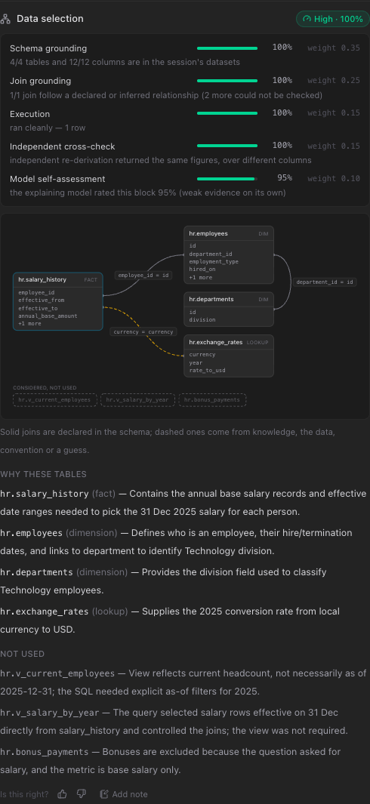
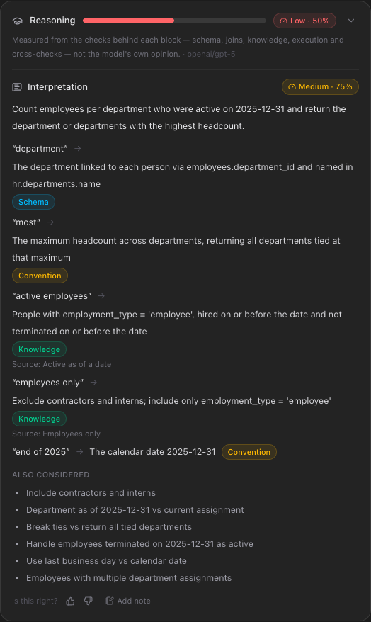

# Business expert mode, explained

Date: 2026-09-29.

This describes a new mode for the chat assistant, called Business expert
mode. It is off by default and turned on per question with a chip in the
composer, next to the existing "Careful" chip.

## What the mode shows, and why

When expert mode is on, the assistant still gives its normal answer. Below
the answer it also shows a short explanation of how it got there, broken into
five parts. Each part can be rated with a thumbs up or down and a short
comment, separately from the others.

Take the question "What is the average salary of tech employees in 2025?"
This is a good example because it looks simple and is not. Here is what the
five parts would show for it.

**1. Interpretation.** A one-sentence restatement of the question the way the
assistant is about to answer it, plus a list of the words in the question and
what they were turned into. "Tech employees" would map to "employees in the
Technology division." This matters because "tech" could also mean job title,
and the two definitions give different answers in this data.

**2. Data selection.** Which tables were used, drawn as a small diagram with
boxes and connecting lines, not as a paragraph. For this question it would
show the employees table, the department table, and the salary history table,
connected by the columns that link them. Tables that were considered and set
aside are shown too, greyed out, with a one-line reason.

**3. Assumptions.** The judgment calls made along the way, stated in plain
business language, each with a note on what would change if the assumption is
wrong. For this question there are three worth naming out loud:

- Only regular employees are counted, not contractors or interns.
- "Salary in 2025" means the salary in effect on 31 December 2025, not any
  salary paid at some point during the year.
- Salaries are converted to US dollars using that year's exchange rate,
  because employees are paid in different local currencies.

**4. Metric definition.** The exact calculation, written out: average of the
base salary, converted to dollars, for employees active on 31 December 2025
in the Technology division. This is the same wording, every time the same
question is asked, because it either comes from a definition the business has
already approved or is stated plainly enough to check.

**5. SQL.** The actual database query that ran, with short notes attached to
the parts that matter, for example the note pointing at the part of the query
that restricts the calculation to 31 December. This is always the real query
that produced the answer, never a version rewritten afterward to look tidier.

## What "confidence" means, and how it is computed

Each of the five parts gets its own confidence score, shown as a percentage
and a color. The score is not the assistant guessing how sure it feels. It is
computed by the system, after the fact, from several separate checks:

- **Did the query actually run without errors**, return rows, and not need to
  be silently repaired or cut short.
- **Do the tables and columns the explanation mentions actually exist** in
  the data, rather than being plausible-sounding names.
- **Do the joins between tables match a real relationship** in the data,
  rather than an guessed connection between two columns that happen to share
  a name.
- **How much of what is said is backed by something written down** (an
  approved business term, an approved metric definition, a previously
  approved query, or the data itself) **versus how much is a guess** with
  nothing behind it.
- **Did an independent, second attempt at the same question agree.** When
  this check runs, it re-derives the answer from scratch, without seeing the
  first attempt's query, and compares the results.
- **Does the query match a query a person has already reviewed and approved**
  for this kind of question.
- **How sure the model itself says it is.**

That last one, the model's own stated confidence, counts for very little in
the final score. Independent research has found that language models tend to
say they are 80 to 100 percent sure regardless of whether they are actually
right, so a model's own claim of confidence is not trustworthy evidence on
its own. It is included, at low weight, mostly so a genuinely low
self-assessment is not ignored.

Each of the checks above only counts when it could actually be measured. A
check that could not be run (for example, no independent second attempt was
made) is left out of that part's score rather than counted as a failure.

## What "almost sure" means

Every confidence score falls into one of three bands: high, medium, or low,
shown as a color (green, amber, red) and a label like "High, 86%." The lines
between the bands are fixed and defined in exactly one place in the code, so
every block in every answer uses the same cutoffs. As of this plan: high
starts at 80%, medium starts at 55%, and anything below that is low.

## What thumbs up and down do today, and what they will feed later

Each of the five parts can be rated separately, with an optional written
comment. Today, that rating is saved, attached to the question it was about
and to a copy of exactly what that part said at the time. It is visible again
if you come back to that answer later.

Today the ratings do not change how the assistant answers future questions.
They are being collected so a later piece of work can use them to improve the
explanations, for example by learning which kinds of assumptions people
disagree with most often. That later step is not built yet.

## What we measure

One headline number and one minimum bar, both computed by running a fixed set
of test questions against a test database with known correct answers:

- **Headline metric**: how well the confidence score tells apart correct
  answers from wrong ones, across all the test questions. A model that is
  reliably more confident on its correct answers than its wrong ones scores
  well here, regardless of the exact percentages it uses.
- **Minimum bar**: when the assistant reports high confidence, it needs to
  actually be right at least 90% of the time. High confidence that is wrong
  more often than that is worse than no confidence signal at all, because it
  invites trust it has not earned.

## What was tested

A synthetic HR database was built for this purpose: departments, employees,
salary history, bonuses, performance reviews, and related tables, with made-up
but internally consistent data. It was built specifically to contain the kind
of traps that make this salary question hard: employees who could be
miscounted as "tech" by job title, employees with more than one salary change
in the same year, contractors mixed in with employees, and salaries in more
than one currency. Ten questions were written against this database,
covering the salary question above plus headcount, bonuses, attrition,
promotions, and top performers, each with a hand-checked correct answer.

## What it costs

Turning on expert mode adds one extra call to the language model per answer,
to produce the explanation, on top of the call that produces the answer
itself. When the independent second-attempt check also runs, that is a
second additional call. Both add some delay and some cost to every question
asked in this mode; it is meant to be turned on deliberately, not left on for
every question.

## What the evidence says

- Verbalized confidence from language models is weakly related to whether
  they are actually correct, and clusters between 80 and 100 percent almost
  regardless of difficulty. ("Wired for Overconfidence," 2026.) This is why
  the model's own stated confidence carries little weight in the score above.
- Snowflake's Cortex Analyst reports back to the user whether an answer
  matched a query a person had already reviewed and signed off on, treating
  that match as a strong trust signal. (Snowflake Cortex Analyst
  documentation, 2025.) The same idea is behind the "matches an approved
  query" check described above.
- Databricks' Genie feeds user ratings and corrections back into the
  system's instructions and examples over time. (Databricks, "Tune Genie
  Agent quality," 2025/2026.) The thumbs up/down and comment feature in this
  plan is built with the same future loop in mind, though that feedback loop
  is not built yet.
- ThoughtSpot's Spotter shows its interpretation of a question as visible,
  editable steps rather than a single opaque answer, so a person can see and
  correct the reasoning, not just the result. (ThoughtSpot, "Introducing
  Spotter," 2025.) The five-part trace described above follows the same
  idea.
- Several recent papers on confidence for database-question-answering systems
  recommend measuring how well a confidence score separates correct from
  incorrect answers (a measure called AUROC), rather than only checking how
  close the stated percentage is to the true accuracy, especially with a
  modest number of test questions. (Confidence Estimation for Text-to-SQL in
  LLMs, August 2025; What Predicts Correctness in Text-to-SQL, 2026.) This is
  why AUROC, not a raw accuracy percentage, is the headline number above.

## What it looks like

Screenshots from the HR test run on 29 September 2026 (GPT-5), taken in the app:

The data-selection block for "What is the average salary of tech employees in 2025?", with its confidence badge opened to show the measured signals. Solid lines are joins the schema declares; the dashed currency join is one the assistant reasoned about. The greyed strip lists tables and views it considered and did not use, with the reason on hover.

A low-confidence example: "Which department had the most active employees at the end of 2025?" is a planted tie. The answer named both departments correctly, but the independent second opinion returned only one, so the whole answer is marked Low and the interpretation block lists "break ties vs return all tied departments" among the readings considered.

## Lessons from the first run

Two things the first test run taught us, both fixed before the second run:

- The system used to explain and check the *last* query the assistant ran. Often that is a small supporting query (for example a count of the people behind an average), not the query that produced the answer. Now it explains the query whose numbers the answer actually quotes.
- The independent second opinion used to re-derive the answer without the business rules (employees only, salary as of 31 December, convert to US dollars). On every question where those rules matter it disagreed with a correct answer, which pushed the confidence down for the wrong reason. It now works under the same rules, while still never seeing the assistant's query.
