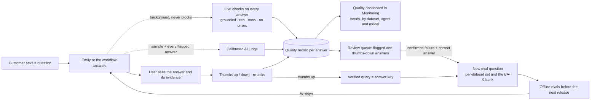

# Production evals: measuring answer quality on customers' data

Plan requested on 2026-11-19, after the BA-9 full-bank runs. The BA-9 evals are **offline**: an exam on our own datasets, where every question has a known answer (a reference query). They decide what ships. They do not run when a customer asks a question about their own data, because nobody knows the right answer there. This plan covers that second half: **online evals**, which watch real answers, and the loop that turns what they find into new exam questions.

Status: proposal. Nothing here is built yet, apart from what the *Have* column of the inventory lists. The stories at the end go into [roadmap.md](../../roadmap.md) only when the user confirms them.

## 1. What industry practice says

| Practice | What it means for us | Source (type) |
|---|---|---|
| Four separate parts: offline evals before merge, online evals on sampled live traces, runtime guardrails that act on one answer, and judge calibration against people | BA-9 built the first. This plan adds the other three. | Practitioner field guide (dev.to, 2026) |
| In production there is no reference SQL, so quality is read from reference-free signals | Use the checks that need no answer key, plus user signals. | Research paper (arXiv 2604.28049) |
| Execution success is not correctness, and an empty result needs its own handling | Track "the query ran", "it returned rows" and "the answer is grounded" as separate metrics. | Vendor guide (Braintrust) |
| User flags, rejected answers and rephrased follow-ups are the best signal of real failures | Thumbs down and re-asks feed the review queue first. | Practitioner framework (Bag of Words, dev.to) |
| The eval set is a living artifact that grows from production cases | Every confirmed production failure becomes a new eval question. | Vendor guide (W&B); practitioner guide (Datadog) |
| An LLM judge runs on a sample, with a versioned prompt, audited regularly against people | The judge runs only after BA-9 phase 2 calibrates it, on a sample plus every flagged answer. | Practitioner field guide (dev.to, 2026) |
| Live scoring runs in the background, never blocks the answer, and samples deterministically per trace so scorers judge the same answers | Mastra's live scorers do this (`sampling.rate`, results in `mastra_scorers`). | Framework docs (Mastra scorers overview) |
| GenAI traces follow the OpenTelemetry GenAI conventions (agent spans still in development) | Keep Mastra's trace export, and attach scores to the answer's trace id. | Standard (OpenTelemetry semconv) |

## 2. What we have and what we need

| Piece | Have (on this branch or main) | Need |
|---|---|---|
| Traces of every answer | Mastra writes them to `observability.duckdb`; **Monitoring** shows calls, time, tokens, cost and failures (monitoring spec) | A per-answer record that joins the trace to quality verdicts |
| Checks that need no answer key | The deterministic checks (numbers grounded, no tool errors, names not ids, no HTML, repairs) are a pure module that already scores a live turn (`turnFromScorerRun`) | Running them after every real answer, in the background |
| User labels | Thumbs up saves a verified query; thumbs down marks the answer wrong (agent-answers R36, workflows R22) | A review queue for thumbs downs, and their reasons |
| An answer key on customer data | Verified queries | A per-dataset eval set built from them: roadmap 1.1.15 (BA-193), planned |
| Live checks inside the answer | The workflow's Validate step; the query inspector shows the evidence | Validate checks the figures, not only the structure (BA-9 finding: it passed all 26 wrong results it saw) |
| AI judge | Exists offline, off by default | Calibration against about 40 labelled answers (BA-9 phase 2), then sampled live use |
| Cross-user view | Org server foundation (self-hosted, opt-in, roadmap 2.1.2) | Opt-in upload of metrics only, never data rows |

## 3. How it works

Three rules:
- **Nothing blocks the user.** Live checks and the judge run after the answer is shown. Only a guardrail (phase 4) may add a warning to the answer.
- **Nothing leaves the machine by default.** Quality records stay in the local data dir like the traces. The org server, when someone opts in, receives metrics and verdicts, never data rows or answer text.
- **A flag is not a verdict.** A failed live check marks an answer "to review". It counts as a failure only once a person confirms it. The numbers check showed why: 115 of its 184 failures were the check's fault.

## 4. Metrics

Every metric is computed per answer, then shown by day, by dataset, by agent or workflow, and by model.

**Quality, with no answer key (every answer)**

| Metric | Definition | Starting alert line |
|---|---|---|
| Grounded answer rate | Answers whose figures all come from a query result (`check-numbers-grounded`) | Down 5 points week on week |
| Clean execution rate | Answers whose queries all ran without an error or an automatic repair | Below 90% |
| Empty-result rate | Answers built on a query that returned no rows | Up 5 points week on week |
| Ask-back rate | Answers that ended in a clarifying question | Up 10 points week on week |
| Validate rejection rate (workflow) | Runs where Validate sent the result back | Tracked; no alert yet |
| Judge score (sample) | Calibrated judge pass rate on the sampled answers | Down 5 points week on week |

**User signals**

| Metric | Definition |
|---|---|
| Thumbs-down rate | Answers marked wrong, out of answers with data |
| Verified rate | Answers saved as verified queries (thumbs up) |
| Re-ask rate | The same question asked again, reworded, in the same session within 2 turns |
| Confirmed failure rate | Reviewed answers confirmed wrong, out of answers reviewed |

**Correctness on the customer's data (with an answer key)**

| Metric | Definition |
|---|---|
| Dataset eval pass rate | pass^3 on the dataset's own eval set (verified queries). Shown only from 30 questions up, as roadmap 1.1.15 says |
| Coverage | Share of the dataset's tables that its eval set touches |

**Operations**

| Metric | Definition |
|---|---|
| Answer time | Median and 95th percentile per answer |
| Cost | Per answer and per day, from the Monitoring price table |
| Failure rate | Answers ended by a model or tool error (rate limit, spend limit, timeout) |

## 5. Build order

| Phase | What | Cost to run | Size |
|---|---|---|---|
| 1. Live checks | Run the reference-free checks after every answer in the background, and store one quality record per answer, keyed by trace id. Start from Mastra's live scorers, and offer three approaches before building, as CLAUDE.md requires. | $0 (code) | M |
| 2. Quality dashboard | A **Quality** tab in Monitoring: the metrics above over time, filters by dataset, agent and model, and the list of flagged answers, each opening its query inspector. | $0 | M |
| 3. Review queue and dataset eval sets | Thumbs down asks why (wrong number, wrong table, misunderstood). A reviewer confirms or dismisses each flag. A confirmed failure with its correct query becomes an eval case. Roadmap 1.1.15 builds the per-dataset sets from verified queries, and they run when the model, prompt or LLM settings change. | One eval run per change | L |
| 4. Judge and guardrails | The calibrated judge on a sample (start at 10%) and on every flagged answer. Guardrails: a visible "check this figure" warning when the numbers check fails, and a spend guard that stops eval and batch runs on the first limit error. | About 1.3¢ per judged answer (estimate: Sonnet 5.5, about 5,000 tokens in and 300 out) | M |
| 5. Org view | Opt-in upload of metrics to the org server; a cross-user dashboard and alerts. | $0 | M, after 2.1.2 |

Phases 1 and 2 need nothing else and give the first production numbers. Phase 3 is where most of the value lies: it is the only way to measure correctness on a customer's data.

## 6. Open questions for the user

1. Who reviews flagged answers in a customer organisation: the data owner, the analyst who asked, or us?
2. Is "Mark answer as wrong" enough, or should a thumbs down always ask for a reason?
3. Should the "check this figure" warning (phase 4) show to every user, or only to makers?
4. When the org server exists, may metrics go to it by default inside the organisation, or only after an admin opts in?

## Sources

- Practitioner guides: [LLM Evals in 2026: A Practitioner's Field Guide](https://dev.to/lamingsrb/llm-evals-in-2026-a-practitioner-s-field-guide-26if); [Running LLM evals in production, the 2026 guide](https://dev.to/raxxostudios/running-llm-evals-in-production-the-2026-guide-29an); [Building reliable AI analysts: an observability framework for text-to-SQL](https://dev.to/bagofwords/building-reliable-ai-analysts-an-observability-framework-for-text-to-sql-systems-25ln)
- Vendor guides: [Braintrust, how to evaluate SQL queries that return wrong answers](https://www.braintrust.dev/articles/how-to-evaluate-sql-queries-that-return-wrong-answers); [W&B, evaluating LLMs in production](https://wandb.ai/site/articles/evaluating-llms-in-production/); [Datadog, LLM evaluation framework best practices](https://www.datadoghq.com/blog/llm-evaluation-framework-best-practices)
- Research: [arXiv 2604.28049, evaluating production text-to-SQL without reference queries](https://arxiv.org/pdf/2604.28049)
- Framework docs: [Mastra scorers overview (live evaluations, sampling)](https://mastra.ai/docs/evals/overview)
- Standards: [OpenTelemetry semantic conventions for GenAI agent spans](https://opentelemetry.io/docs/specs/semconv/gen-ai/gen-ai-agent-spans/)
- This repository: [Monitoring spec](../../specs/capabilities/monitoring/spec.md), [agent-answers R36](../../specs/capabilities/agent-answers/spec.md), [roadmap 1.1.15](../../roadmap.md), [BA-9 plan](BA-9.md)
