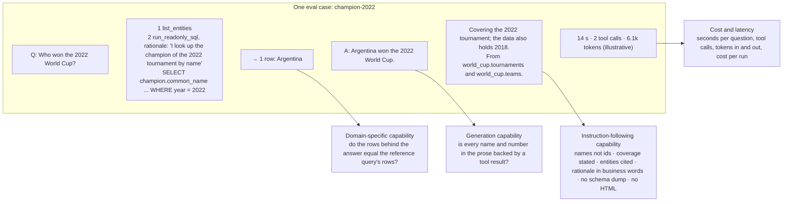
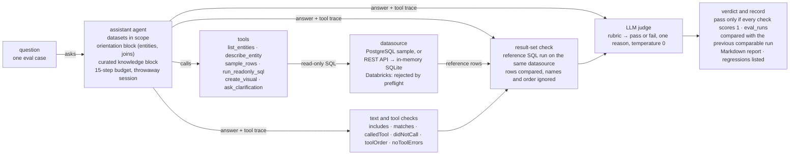
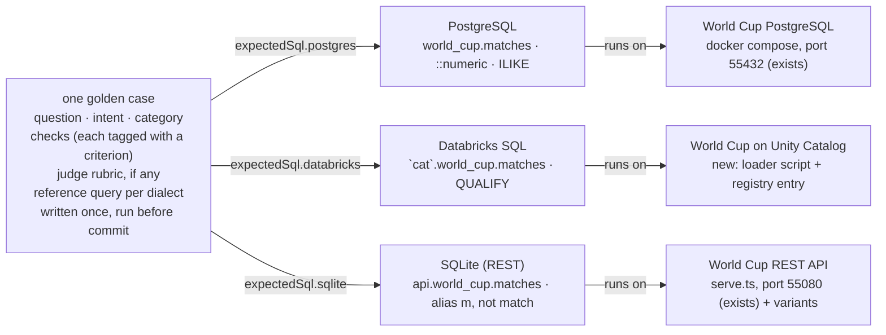

# BA-9 — Golden Dataset and Evals: research

- **Jira:** [BA-127](https://halo-powered.atlassian.net/browse/BA-127) (research story) · **Epic:** [BA-9](https://halo-powered.atlassian.net/browse/BA-9) · **Roadmap:** feature 1.1.2 in [roadmap.md](../../roadmap.md) · **Epic spec:** [specs/epics/BA-9/spec.md](../../specs/epics/BA-9/spec.md)
- **Status:** Draft, for team review
- **Source:** converted from the artifact [Golden Dataset and Evals Plan](https://claude.ai/artifact/B5Fvcjq5kyw1U445pDkdGX), version 7 of 2026-10-12. Every external link in it was opened on 2026-10-12, as its [Sources](#sources) section states.
- **Repository baseline:** written against `main` at `ee558d2` (v0.30.0). `main` is now `f3ef18e` (v0.31.0): the four commits between touch only the Claude Code workflow mod (`.claude/mods/workflow-steps/`), release version bumps, `specs/epics/BA-169`, `specs/system/delivery.md` and the 1.11.3 changelog, roadmap, retrospective and evidence entries, nothing eval-related, so the inventory in Part 2 was re-checked on 2026-10-12 against `f3ef18e` and holds. The re-check corrected six details; each is marked in the text and listed in [evidence/1.1.2/claim-check.md](../../evidence/1.1.2/claim-check.md).
- **Priority:** from the manager (2026-10-12): "add as many evals as we can for Databricks and REST API". From the 2026-10-07 notes: the eval score is the acceptance criterion for every change, whatever the technology.
- **Method:** Chip Huyen, *AI Engineering* (O'Reilly, 2025), Chapter 4 "Evaluate AI Systems", pages 159 to 209, read in full. Page numbers below are the book's.
- **Companion:** the execution plan [docs/plans/BA-9.md](../plans/BA-9.md) (story [BA-128](https://halo-powered.atlassian.net/browse/BA-128), roadmap 1.1.3).

**What this file covers.** The [Summary](#summary-findings-options-and-recommendation) gives the findings, the options the research weighed and the recommendation. [Part 1](#part-1-what-the-book-says-applied-to-a-bi-assistant) is the method: what the book says about evaluating an AI application, applied to a BI assistant, and how the market evaluates text-to-SQL and agents. [Part 2](#part-2-applied-to-this-application-main-only) applies it to this application, counting only what is on `main`: the three eval harnesses that exist, the gaps against the book, what the judge costs, what exists only on branches, the criteria list, the categories of the golden dataset, what Databricks and REST need, and worked examples. [Part 4](#part-4-evals-on-the-users-own-data-the-verdict) gives the verdict on evals over the user's own data. [Baseline on main](#baseline-on-main) is where the measured starting point goes, and [Sources](#sources) lists every source by type. The execution plan (the artifact's Part 3 and sections 4.1 to 4.6) is in [docs/plans/BA-9.md](../plans/BA-9.md); this file links to it and does not repeat it. Section numbers are the artifact's, so a reference such as "3.5" means the same section in both files.

## Summary: findings, options and recommendation

### Findings

- **The book's first instruction is a list, not a tool.** "An AI application, therefore, should start with a list of evaluation criteria specific to the application" (p. 161). The app has no such list. It has checks (text match, tool calls, result-set match, judge) but nothing says which criterion each check measures, so a run reports pass counts, not what kind of thing got better or worse. Section [2.5](#25-the-criteria-list-for-this-app) writes that list.
- **Three eval harnesses exist on `main`, with three formats and no shared numbers.** The in-app suite (30 questions in 3 sets, the Agents → Evals tab and `npm run evals:assistant`), the Phase 1 golden-set harness (`backend/eval/golden-set.json` (removed in Step 1a, BA-182), 9 cases, `npm run eval`) and the answer-quality gate ([`scripts/check-answers.ts`](../../backend/scripts/check-answers.ts), 4 checks, repeats with a Wilson interval, arms). Only the first has a UI and run history; only the third has repeats and intervals; only the second has a data file format a non-developer could edit. Section [2.1](#21-what-exists-on-main-at-v0300) inventories them, [Part 3](../plans/BA-9.md#part-3-execution-plan) merges them.
- **Databricks has no eval at all.** The dataset preflight accepts only PostgreSQL and REST fixtures and rejects a Databricks datasource: no sample has the Databricks kind, so its datasets fail the kind check in [`assistant-eval-datasets.ts`](../../backend/src/mastra/evals/assistant-eval-datasets.ts), and [its spec](../../backend/src/mastra/evals/assistant-eval-datasets.spec.ts) tests the `databricks` kind by name. *(Corrected: the artifact said the preflight rejects Databricks "by name"; the code rejects it by kind mismatch, and only the spec names it.)* There is no Databricks sample fixture. Every Databricks eval starts with a fixture ([2.7](#27-databricks-and-rest-what-to-test-and-what-it-needs)).
- **The REST set tests the questions, not the connector.** It repeats the ten PostgreSQL questions with SQLite reference SQL. Nothing exercises what REST changes: paging through every page, the rows pointer, nested JSON flattening, the per-endpoint row cap, an endpoint that is down, the SQLite dialect. Those are the failures a real API (the DIGS and RSS APIs of the RFP demo) will produce.
- **Thirty questions cannot detect a 10% change.** The book's rule of thumb (Table 4-7, p. 207): about 100 examples to be 95% confident of a 10-point difference, about 1,000 for 3 points. Every "20% to 100%" story so far rests on a handful of questions and single runs. Repeats exist only in `check-answers.ts`.
- **The judge is never checked.** It runs on the same model as the assistant, at temperature 0, with a pass/fail schema, which the book recommends (p. 207). But no human-labelled set measures whether its verdicts agree with ours, and nothing records which rubric version produced a run (p. 208, experiment tracking).
- **The judge is not where the money goes, but it is the only check that needs trust.** 12 of the 30 questions call it, one short call each against an assistant turn of up to 15 steps, so it is roughly a tenth of a run's tokens. Making it optional is still right: a verdict that costs nothing to re-run is easier to trust, and the nightly should not need a model to judge. What is lost when it is off is specific and listed in [2.3](#23-deterministic-checks-and-the-judge-what-the-judge-costs-and-what-you-lose-without-it): fabrication outside coverage and the truth of a takeaway cannot be caught by a program, and five categories become weakly scored.
- **Evals on the user's own data are what the market leaders do, in one specific shape.** Letting users hold an eval set for their own database and feeding it from real sessions is what Databricks Genie benchmarks and Request Review do, and what every practitioner source recommends; this app's verified queries are already that. Model-drafted sets from documents are a drafting aid Databricks offers for retrieval agents, and must run against the data and be approved before they count. Reference-free metrics are the right health layer, but consistency is not correctness. [Part 4](#part-4-evals-on-the-users-own-data-the-verdict) gives the verdict idea by idea and the plan builds it as [Steps 9 to 12](../plans/BA-9.md#45-the-build-continued), after the beta.
- **Synthetic domain databases are the right material for the developer suite, and four already exist on a local branch, as files that come over without conflict.** tau-bench and AMBROSIA built their benchmarks the same way; generated data the model never saw avoids the book's contamination problem and has answers known by construction. The condition is depth before breadth: health insurance to 100 questions and onto Databricks, a new marketing-insight domain, genomics, supply chain and banking brought over as they are. The improvement loop on the scores is right too, with a held-out split so a tuned prompt is not mistaken for a better assistant, and a person choosing each lever. Sections [3.4](../plans/BA-9.md#34-synthetic-domain-databases-the-right-material-with-conditions) and [3.6](../plans/BA-9.md#36-the-improvement-loop).
- **Cost and latency are not measured.** A result carries `durationMs` and nothing else: no tokens, no cost, no time-to-first-token, no tool-call count. The fourth bucket of the book's criteria is empty.
- **Categories exist in people's heads, not in the data.** Each case has an `intent` sentence, but no category field, so a report cannot say "joins got worse while lookups improved" (slicing, p. 205).

### Options considered

Every option and verdict below is one the artifact itself weighs; the last column links to where.

| Option | What it is | Verdict | Why |
|---|---|---|---|
| Keep the three tools as they are | The in-app suite, the golden-set harness and the answer-quality gate stay separate ([2.1](#21-what-exists-on-main-at-v0300)) | **Not enough** | Three numbers that never add up, no categories, no Databricks, and a code change for every new question. It blocks every later step ([Step 1a in 3.5](../plans/BA-9.md#35-the-build-step-by-step)). |
| Move the 31 existing questions into one new format | The questions of the three tools, with their trap notes, in one data format with categories and a reference per dialect, plus a validator | **Best, recommended** | Their answers were already checked against the data, and the notes record each trap. 1 to 1.5 days, mostly mechanical ([Step 1a in 3.5](../plans/BA-9.md#35-the-build-step-by-step)). |
| Write a new golden dataset from scratch | A clean set designed around the categories of [2.6](#26-categories-of-the-golden-dataset) | **Workable** | Slower, for about the same result: several days to write the questions and run every reference query, and the same traps found again; four of the existing questions exist because a model shipped the bug ([Step 1a in 3.5](../plans/BA-9.md#35-the-build-step-by-step)). |
| Merge the branch work wholesale | Merge `feat/engine-eval-loop` or `feat/knowledge-learning-evals` into the epic branch | **Not first** | A simulated merge of `feat/engine-eval-loop` conflicts in 39 files, all in the parts `main` rewrote since, and the branches carry expert mode, learning and memory, which belong to other epics ([2.4](#24-what-exists-only-on-branches-and-the-decision-it-needs), [3.0](../plans/BA-9.md#30-start-here-what-to-do-first)). |
| Copy the data, rebuild the wiring | Copy the new files by path (domain generators and init SQL, suite files, check library, failure labels, Databricks loader) and rebuild the runner, the report and the UI on `main`'s code, with the branch as reference | **Recommended** | None of the data conflicts: those pieces are new files ([2.4](#24-what-exists-only-on-branches-and-the-decision-it-needs), [3.0](../plans/BA-9.md#30-start-here-what-to-do-first)). |
| Rebuild everything from the spec | Write the branch's pieces again on `main` | **Not the recommendation** | [2.4](#24-what-exists-only-on-branches-and-the-decision-it-needs) leaves the decision open; [3.0](../plans/BA-9.md#30-start-here-what-to-do-first) recommends copying the data, which comes over without conflict, and rebuilding only the wiring. |
| Databricks fixture A: World Cup loaded | The World Cup data loaded into a Unity Catalog schema by a script | **Recommended** | Every existing question gets a Databricks reference query by changing identifiers and casts, so the same questions run on three kinds and a Databricks regression is visible as a Databricks regression ([2.7](#27-databricks-and-rest-what-to-test-and-what-it-needs)). |
| Databricks fixture B: the `samples` catalog only | A smoke set on Databricks' built-in read-only sample schemas, such as `samples.tpch` | **Keep as the smoke set; not the golden dataset** | No loading, so it could exist in days and prove connectivity on any workspace; but its questions differ from the World Cup ones, so a difference between kinds cannot be told from a difference between datasets ([2.7](#27-databricks-and-rest-what-to-test-and-what-it-needs)). |
| Judge always on for its cases (today) | The LLM judge runs on every question that has a rubric, on every run, with no deterministic substitutes | **Not chosen** | It costs tokens, it can differ between runs, and it is itself a system that needs validating (J1); the nightly should not need a model to judge ([2.3](#23-deterministic-checks-and-the-judge-what-the-judge-costs-and-what-you-lose-without-it)). |
| Judge optional, deterministic gate | Deterministic checks are the gate; the judge is a run option, off on the nightly and on for the weekly and pre-release runs, with a human verdict control in between | **Recommended** | A check that needs the judge is reported as not scored, never as a pass. What is lost with it off is specific: fabrication outside coverage (G2) and the truth of a takeaway (G3), and five categories become weakly scored ([2.3](#23-deterministic-checks-and-the-judge-what-the-judge-costs-and-what-you-lose-without-it)). |
| Synthetic domain databases | Generated databases for distinct industries as the developer suite's material, with an improvement loop on the scores | **Yes, as Step 1d, depth first** | The right material, and most of it exists on a local branch; not before the format; three domain families deep before breadth; the loop only with a held-out split and a person choosing the lever ([3.4](../plans/BA-9.md#34-synthetic-domain-databases-the-right-material-with-conditions)). |
| Users add evals for their own database | A user eval set per dataset, fed by approved answers | **Good: this is the standard** | It is what Databricks Genie benchmarks do, and this app's verified queries already store an approved question-and-SQL pair. Feedback is the input, not a form; only approved cases count ([4.0](#40-is-the-approach-good-the-verdict-idea-by-idea)). |
| A model builds the dataset from attached documents and the schema | Drafted cases from schema, sample rows, knowledge and documents | **Good as a drafting aid; not as a source of truth** | Every draft runs against the data and a person approves it before it counts; no vendor builds text-to-SQL benchmarks from documents today, so it ranks third, after real sessions and templates ([4.0](#40-is-the-approach-good-the-verdict-idea-by-idea)). |
| Metrics robust enough for any datasource | Reference-free behaviour and consistency checks that need no known answer | **Good as the health layer; not enough alone** | Consistency is not correctness: an assistant can be consistently wrong. Template accuracy and approved accuracy stay separate from the health numbers ([4.0](#40-is-the-approach-good-the-verdict-idea-by-idea)). |

### Recommendation

Write the criteria list first ([2.5](#25-the-criteria-list-for-this-app)), then make the golden dataset a set of data files where every question carries a category, an intent, the checks it is scored on, and one reference query per datasource dialect (PostgreSQL, Databricks SQL, SQLite for REST). Build the Databricks fixture by loading the same World Cup data into a Unity Catalog schema with a script, so the same questions run on all three kinds and a Databricks regression is visible as a Databricks regression. Give the REST set the connector cases it is missing. Grow the set toward 100 questions per kind by the end of October, organised by the categories in [2.6](#26-categories-of-the-golden-dataset), with repeats and per-category reporting, tokens, cost and latency on every run, a 30-case human-labelled set that measures the judge, and a knowledge on/off arm (needed by BA-80). Fold the two older harnesses into the one suite. [Part 3](../plans/BA-9.md#part-3-execution-plan) is the ordered plan; the Databricks and REST stories come first because the manager asked for them first. Deterministic checks are the gate; the judge is a run option, off on the nightly and on before a release, with a human verdict control in the Details panel as the no-token alternative ([2.3](#23-deterministic-checks-and-the-judge-what-the-judge-costs-and-what-you-lose-without-it)). The path itself is in Part 3, starting with what to do first ([3.0](../plans/BA-9.md#30-start-here-what-to-do-first)), then how evals work when users can connect any datasource ([3.1](../plans/BA-9.md#31-how-evals-work-when-users-can-connect-any-datasource)), how to write a question that holds up ([3.2](../plans/BA-9.md#32-how-to-write-a-question-that-holds-up)), the ten metrics with the deterministic ones first ([3.3](../plans/BA-9.md#33-the-metrics-deterministic-first)), synthetic domain databases, the verdict on them and how to build one ([3.4](../plans/BA-9.md#34-synthetic-domain-databases-the-right-material-with-conditions)), the build step by step with what to create and what you can do after each step ([3.5](../plans/BA-9.md#35-the-build-step-by-step)), and the improvement loop with its held-out split ([3.6](../plans/BA-9.md#36-the-improvement-loop)). [Part 4](#part-4-evals-on-the-users-own-data-the-verdict) evaluates the idea of evals on the user's own data against the industry and plans it: feedback becomes cases, templates give exact answers on any schema, model drafts from documents are reviewed before they count, and the eval set travels with the agent.

> **Start with [3.0](../plans/BA-9.md#30-start-here-what-to-do-first).** It lists the first eight actions in order, the decisions with the date each is needed, and the three weeks to the beta. The first action is today: ask for the Databricks access, because Step 2, the manager's first ask, cannot start without it. Decisions due this week: how the branch work comes over (Tuesday; the recommendation, with a conflict count, is in 3.0), the Databricks fixture (Wednesday), and the shipping question and the domain briefs (Friday). Later: the beta thresholds (October 23) and who labels the judge validation set (after the beta).

## Part 1. What the book says, applied to a BI assistant

Chapter 4 has three parts: the criteria you evaluate against and how each is measured (pp. 160 to 178), how to choose a model (pp. 179 to 199), and how to design the evaluation pipeline that guides development over time (pp. 200 to 208). This section takes the first and the third, which are the ones that shape a golden dataset. Model selection matters here only in one way: the suite is also how a model change gets accepted (the app lets a user agent override its model, so "which model" is a question the suite will be asked).

### 1.1 Evaluation-driven development

> "In AI engineering, evaluation-driven development means defining evaluation criteria before building."
>
> — p. 160

The chapter opens with a question the author asks at conferences: which is worse, an application that was never deployed, or one that is deployed but nobody knows whether it works? Most people say the second (p. 160). The 2026-10-07 meeting notes say the same thing in other words: the score is the acceptance criterion, and once a threshold is reached on one technology the team moves on instead of optimising further. That is only possible if the criteria and the threshold exist before the change does.

### 1.2 The four buckets

> "An AI application, therefore, should start with a list of evaluation criteria specific to the application. In general, you can think of criteria in the following buckets: domain-specific capability, generation capability, instruction-following capability, and cost and latency."
>
> — p. 161

The book's own illustration is a legal-contract summariser: domain capability is whether the model understands contracts, generation capability is whether the summary is coherent and faithful, instruction-following is whether the summary respects the requested format and length, and cost and latency are what it costs and how long it takes (p. 161). The same four questions, asked of one answer from this assistant, look like this.



*The four buckets, each pointing at the part of one real eval case (`champion-2022`) it judges. Today the suite scores the first bucket well, the second and third partly, the fourth not at all. The timing figures are illustrative.*

#### Domain-specific capability: exact evaluation of the SQL and its result

The book says domain capabilities are "commonly evaluated using exact evaluation" and, for code, "functional correctness" (p. 162). For a text-to-SQL assistant that means execution accuracy: run the generated query and the reference query and compare the rows, not the SQL text. The book adds a second dimension most teams forget: "if an SQL query generated by your text-to-SQL model is correct but takes too long or requires too much memory to run, it might not be usable", and cites BIRD-SQL, which scores a query's efficiency by comparing its runtime with the reference query's runtime (p. 162). The app already does the first (the result-set check, [R31 of the agents-evals spec](../../specs/capabilities/agents-evals/spec.md)). It does not do the second, and on a Databricks warehouse billed per second it should.

#### Generation capability: factual consistency against the data

The book splits factual consistency into local (against a given context) and global (against open knowledge), and names "business analysis (the extracted insights should be consistent with the data)" as a local case (p. 165). For this assistant the context is exact: the rows the tools returned in that turn. Every name, number and comparison in the prose must appear in, or follow arithmetically from, a tool result. That is a judge question with a clear premise, which the book notes is "much easier to verify" than open-knowledge facts (p. 165).

Two more points from the same section shape the dataset. First, the tip on p. 166: analyse the model's outputs to learn which query types it hallucinates on, and "your benchmark should focus more on these queries"; the author's own two were niche knowledge and "queries asking for things that don't exist". For a BI assistant the second type is a question about a year, player or product the data does not hold. The suite has one such case per set today (`out-of-scope`); Section [2.6](#26-categories-of-the-golden-dataset) makes it a category. Second, on p. 202: the guideline must say what the application should not do, and "you need to define what inputs are out of the scope of your application, how to detect them, and how your application should respond to them." The assistant's own prompt already defines the response ("say so plainly and state what IS covered"), so the check is to hold it to that.

#### Instruction-following capability: your prompt is the benchmark

> "You should curate your own benchmark to evaluate your model's capability to follow your instructions using your own criteria. If you need a model to output YAML, include YAML instructions in your benchmark."
>
> — p. 175

The book describes two ways to measure instruction-following. IFEval (pp. 173 to 174) uses instructions a program can verify: a keyword is present, a forbidden word is absent, the output is JSON, the answer has N bullets. INFOBench (pp. 174 to 175) turns each instruction into a short list of yes/no questions answered by a human or an AI judge, and scores the fraction met. Both apply directly, because the assistant's system prompt ([`assistant.agent.ts`](../../backend/src/mastra/agents/assistant.agent.ts)) is a list of instructions that are each checkable:

- "Identifiers are not answers": the answer must not report `id 5`; a regex check.
- "Apply every [default_filter] ... Name the filters you applied in one short business sentence": a yes/no judge question, given the knowledge block.
- "run_readonly_sql and sample_rows both take a rationale ... never name SQL syntax, functions or columns in it": a check on the recorded rationale (present; one or two sentences; no SELECT, JOIN or column names).
- "Never dump raw schemas or column lists at the user": a length-and-pattern check on the answer.
- "Never paste HTML, CSS or JavaScript into the chat": a regex check.
- "Ask at most ONE clarification per user question ... 2-4 concrete options": a tool-count check plus an option-count check on the clarification payload.
- "Always use fully-qualified catalog.schema.table names" and "Write SQL in the dialect of the entity's datasource": a check on the SQL text the tool recorded, per datasource kind.

The book warns that instruction-following is easy to conflate with domain capability (p. 173): when the assistant fails to name the filter it applied, it may be that it did not apply it. Keeping the two as separate checks on the same question is what tells them apart.

#### Cost and latency: a hard requirement and an ideal, per metric

"A model that generates high-quality outputs but is too slow and expensive to run will not be useful" (p. 177). The book lists the latency metrics that exist (time to first token, time per token, time per query) and says to pick the ones that matter (p. 177), to separate the must-have from the nice-to-have ("high latency is often an annoyance, not a deal breaker", p. 178), and shows the shape of the criteria table in Table 4-3 (p. 178): criterion, metric, benchmark, hard requirement, ideal. For this app the chat is interactive, so time per query at P90 on the golden dataset is the latency metric, with tokens and cost per question as the cost metrics, all measured per datasource kind because a cold Databricks warehouse behaves differently from local PostgreSQL. Section [2.5](#25-the-criteria-list-for-this-app) fills that table.

### 1.3 Designing the pipeline: the three steps

#### Step 1. Evaluate all components, per turn and per task

"You should evaluate the end-to-end output and each component's intermediate output independently" (p. 200), because when the end result is wrong "you don't know exactly where your system fails" (p. 200). The assistant's pipeline has identifiable components: entity selection (which tables it looked at), the SQL (which the fixer may have repaired, up to twice), the rows, the prose, the visual. The suite records the whole tool trace, so component checks are a matter of adding checks, not new instrumentation. The book also distinguishes turn-based from task-based evaluation (p. 201): a task may take several turns, and "it makes a big difference if a system is able to solve a problem in two turns or in twenty turns." The clarification flow is exactly that: the right behaviour on "Which team performed best?" is to ask, and the task is only complete when the follow-up answer is right. Today the suite scores the first turn only.

#### Step 2. Create an evaluation guideline

"Creating a clear evaluation guideline is the most important step of the evaluation pipeline" (p. 202). It has four parts in the book: define the criteria (and what a good response is; LinkedIn's "You are a terrible fit" was correct but not good, p. 202); choose a scoring system per criterion, binary or a scale (p. 202); write a rubric with examples and validate it with humans until they can apply it consistently (p. 203); tie the metrics to business metrics and set a usefulness threshold (p. 203). The last point is the one the team keeps asking for in other words: a pass rate means nothing until someone writes "at 90% on the lookup and aggregate categories, a business user can trust the answer without checking the SQL; below 70% they cannot." The threshold is a product decision; Section [3.9](../plans/BA-9.md#39-thresholds-to-react-to-a-proposal-not-a-decision) proposes numbers to react to.

#### Step 3. Define methods and data

The book's advice here maps almost line by line onto the plan:

- **Mix methods per criterion** (p. 204): a cheap exact check on every question, an AI judge only where text matching is too brittle. The suite already does this; the plan keeps the judge off the questions a result-set check can settle.
- **Slice the data** (p. 205): "You should have multiple evaluation sets to represent different data slices", including "a set consisting of the examples for which the system is known to frequently make mistakes" and "an out-of-scope evaluation set" (p. 205 to 206). The book's Simpson's paradox table (p. 205) is the warning: a model can be better on every slice and worse overall. Categories are the slices; the report must show them.
- **"If you care about something, put a test set on it"** (p. 206).
- **How much data** (pp. 206 to 207): bootstrap the set to see whether the score is stable, and use OpenAI's rule of thumb for comparisons: about 10 examples to detect a 30-point difference, 100 for 10 points, 1,000 for 3 points, 10,000 for 1 point (Table 4-7, p. 207). Thirty questions can tell a 30-point change apart from noise and not much less.
- **Evaluate your evaluation pipeline** (p. 207): do better answers get higher scores; is the pipeline reproducible ("if you use an AI judge, make sure to set your judge's temperature to 0"); are two metrics so correlated that one is redundant; how much the evaluation itself costs.
- **Iterate, but track** (p. 208): criteria change, but "log all variables that could change in an evaluation process, including ... the evaluation data, the rubric, and the prompt and sampling configurations used for the AI judges."

### 1.4 How the market evaluates text-to-SQL and agents

Everything in this section was opened on 2026-10-12; the links are in the [Sources](#sources). Three groups of sources matter: the text-to-SQL benchmarks, which settled what "correct" means; the practitioners who build evals for products; and the vendors and frameworks this app sits on (Databricks, Mastra, Phoenix).

#### Text-to-SQL benchmarks: correctness is the result set, and even that has holes

- **Spider** (Yu et al., 2018) began with exact set match on SQL structure and has since made test-suite execution accuracy its official metric (Zhong et al., 2020): gold and predicted SQL run on many generated databases, so a query that happens to match on one fixture is caught. Their measurement of the old metric: "a 2.5% false negative rate on average and 8.1% in the worst case".
- **BIRD** (Li et al., 2023) defines execution accuracy as "the proportion of examples in the evaluation set for which the executed results of both the predicted and ground-truth SQLs are identical", adds an efficiency score (runtime relative to the gold query, the one the book cites on p. 162) and a soft F1 over result cells for partial credit. Humans reach about 93% on it; the best systems about 83%.
- **Spider 2.0** (Lei et al., 2025) is the enterprise version: 632 workflows over BigQuery, Snowflake, SQLite and dbt projects, schemas past 1,000 columns, dialect documentation required. The best model at publication solved 21.3%. It is the closest public analogue to running one question bank over PostgreSQL, Databricks and SQLite, and it reports per source.
- **Execution accuracy has known holes.** ETM (2024) measures false positives and negatives up to 23% and 29%. FLEX (2025) finds most "false negatives" are errors in the gold set itself, which argues for running every reference query before committing it (the suite's own rule) and for auditing the gold set, not only the model. The CIDR 2024 paper "NL2SQL is a solved problem... Not!" (Floratou et al., Microsoft) found 41% of one benchmark's questions ambiguous to annotators and proposes "intent-based execution match": ignore row order unless the question asks for it, allow the predicted columns to be a superset of the gold, and names "understanding when a database cannot answer a query" as an open problem. The app's comparer already does the first two (R31); the plan names that policy (Spider 2.0-lenient, not BIRD-strict).
- **Ambiguity has its own benchmarks.** AmbiQT (2023) stores two valid SQLs per ambiguous question; AMBROSIA (2024) scores whether a model recognises ambiguity at all and finds that "even the most advanced models struggle to identify and interpret ambiguity in questions". For this app that is the `ask_clarification` tool, which is why the ambiguous category is scored on the tool call, not on an answer.

#### Practitioners: binary verdicts, human labels, error analysis first

- Hamel Husain, "Your AI Product Needs Evals" (2024): three levels. Unit tests and assertions per feature and scenario; human and model evaluation on logged traces with model-human agreement tracked; A/B tests. The suite's deterministic checks are level 1; the judge is level 2 and earns trust only through the agreement number. "Remove ALL friction from looking at data."
- His judge article (2024) and the Husain-Shankar FAQ (2026): one domain expert labels pass or fail with a critique; the judge is built from those examples and validated on true-positive and true-negative rate separately; "Binary evaluations force clearer thinking and more consistent labeling than Likert scales"; review at least 30 traces yourself and about 100 until nothing new appears; label 100 to 200 examples per failure mode. EvalGen (Shankar et al., 2024) documents "criteria drift": people refine their criteria while grading, so rubrics are written iteratively against labels, not once.
- Eugene Yan (2024): judges have high precision but recall of 30 to 60% on defects, so a judge that passes an answer is weaker evidence than one that fails it; report Cohen's kappa, not raw agreement; "Where possible, return binary outputs".
- Anthropic, "Demystifying evals for AI agents" (2026): a vocabulary of task, trial, grader, transcript and outcome; code-based graders preferred where possible, model-based where not; pass@k against pass^k for non-deterministic agents (three trials at 75% each give pass^3 of about 42%); grade outcomes rather than step sequences; separate regression suites (expected near 100%) from capability suites; "In reality, 20-50 simple tasks drawn from real failures is a great start"; "A good task is one where two domain experts would independently reach the same pass/fail verdict." OpenAI's guidance says the same in other words: define criteria, build datasets from production, experts and synthesis, grade traces first, then promote to repeatable datasets.
- tau-bench (Sierra, 2024) is where pass^k comes from: the expectation over tasks of C(c,k) / C(n,k), with c successes in n trials. Its reward multiplies "final state correct" by "required facts present in the reply", which for this app reads as result set right times numbers in the prose right. The Berkeley Function Calling Leaderboard grades tool calls by abstract syntax (right function, right required arguments, none invented) or by execution, and has a "relevance" class where the right answer is to call no tool: the mirror of the discovery and ambiguous categories.

#### Databricks: Genie benchmarks and MLflow judges

Databricks' own natural-language-to-SQL product, AI/BI Genie, ships a benchmark feature that is the closest thing to this epic on the market: up to 500 questions per Genie space, each with an optional SQL answer and an evaluation note. In chat mode it scores by result set, not SQL text. A question is "Good" when the generated SQL matches the answer exactly, or the result sets match, or they match in a different sort order, or numeric values agree to four significant digits. It is "Bad" on an error, an empty result, extra columns, or a single-cell mismatch, with the comparison capped at 5,000 rows. In agent mode it uses an LLM judge guided by the note. The 2024 launch post recommends several phrasings per intent, which is the paraphrase category. MLflow 3 on Databricks adds predefined judges (Correctness against expected facts, Guidelines, RelevanceToQuery, Safety, tool-call correctness and efficiency) and code scorers; evaluation datasets live as Unity Catalog tables of up to 2,000 rows with up to 20 expectations each. Two things to take: Genie's "extra columns are Bad" is stricter than the app's width-tolerant comparer, and the plan keeps the lenient rule but writes it down; and storing each golden case as inputs plus expectations (expected SQL, expected facts, guidelines) keeps the door open to pushing the same file into a Genie benchmark or an MLflow dataset later.

#### Mastra and Phoenix: what the installed stack offers

- **Mastra** (`@mastra/evals` 1.10, `@mastra/core` 1.66). `createScorer` builds a scorer from four steps (preprocess, analyze, generateScore, generateReason), each a plain function or a prompt object, with `run.groundTruth` and `run.requestContext` available to every step, which is the hook for a per-case rubric. The `checks` helpers the suite uses also include `excludes`, `equals`, `maxToolCalls` and `usedNoTools`, unused today. `runEvals` takes `gates` (must average 1.0) and thresholds and returns a verdict; `notScorable()` leaves an item out of the averages; a Vitest integration gives `toPassGates()` and `toPass(rate)` for CI. Datasets and experiments exist (versioned items, compare experiments in Studio) but have no repeat option, so pass^k is computed by running an item n times. Built-in scorers worth a look: the code-based tool-call accuracy and trajectory scorers (expected tool order, blacklisted tools, max steps) and, when the judge is on, the hallucination scorer with the SQL rows as context and the prompt-alignment scorer in system mode.
- **Arize Phoenix** (traces already arrive from `@mastra/arize` when developer observability is on). Its experiments API has `repetitions`, its TypeScript evaluators include tool selection and tool invocation, and scores can be logged onto existing spans as annotations. Its old SQL-generation template is no longer at a stable URL and is not something to build on. Phoenix is a second opinion over the same traces, not a replacement for the in-app suite.

| Who | How correctness is scored | What this plan takes |
|---|---|---|
| Spider, BIRD, Spider 2.0 | Execution accuracy: run both queries, compare rows; BIRD adds efficiency and soft F1; Spider 2.0 reports per source and dialect | Result set as the gate; efficiency ratio (D4); per-kind slices |
| Test-suite accuracy, ETM, FLEX, CIDR 2024 | Several fixtures per database; audit the gold set; lenient column policy; ambiguity as a first-class case | Run every reference before commit; name the comparer's policy; trap questions; ambiguous and out-of-scope categories |
| Husain, Shankar, Yan, EvalGen | Binary pass/fail with a critique; validate the judge on human labels (TPR, TNR, kappa); criteria drift | J1; the 30-case validation set; rubric versioning; the human verdict control ([2.3](#23-deterministic-checks-and-the-judge-what-the-judge-costs-and-what-you-lose-without-it)) |
| Anthropic, OpenAI, tau-bench, BFCL | Code graders first; outcome over path; pass^k; tasks from real failures; "must not call" cases | Deterministic gate, judge optional ([2.3](#23-deterministic-checks-and-the-judge-what-the-judge-costs-and-what-you-lose-without-it)); repeats; follow-up tasks; discovery and ambiguous as no-SQL cases |
| Databricks Genie, MLflow | Result-set match with four-significant-digit numerics and a 5,000-row cap; LLM judge with a note in agent mode; expectations on dataset rows | The comparer's rules compared and documented; the case format as inputs plus expectations |
| Mastra, Phoenix | `createScorer`, gates and thresholds, `notScorable`; Phoenix repetitions and span annotations | One scorer per criterion; gates for must-haves; a gap verdict for unscored questions; traces for failed questions |

## Part 2. Applied to this application (main only)

### 2.1 What exists on main at v0.30.0



*How one question of the in-app suite runs today, from `runAssistantEvalCase` in [`backend/src/mastra/evals/assistant.evals.ts`](../../backend/src/mastra/evals/assistant.evals.ts) and `EvalRunsService` ([`eval-runs.service.ts`](../../backend/src/modules/agents/eval-runs.service.ts)). Each question is its own `runEvals` call, questions run one at a time, and the run is persisted after every question. (Corrected: the check list now includes `didNotCall`, which four cases use; the artifact's figure left it out.)*

Three harnesses, built at different times, cover different parts of the book's pipeline. None of them talks to the others.

| Harness | Where | Questions | Scoring | Runs | Has | Lacks |
|---|---|---|---|---|---|---|
| **In-app suite** (the one the epic names) | [`backend/src/mastra/evals/assistant.evals.ts`](../../backend/src/mastra/evals/assistant.evals.ts); Agents → Evals tab; `npm run evals:assistant` | 30: `world-cup` 10 (PostgreSQL), `world-cup-rest` 10 (the same questions; 5 of them carry SQLite reference SQL), `formula-1` 10 (PostgreSQL) | Per question: text and tool checks from `@mastra/evals/checks`, result-set match against `expectedSql` (500-row cap, width-tolerant), LLM judge with a per-case rubric. Pass = every check scores 1. | Persisted (`eval_runs`), run history, Markdown report, comparison with the previous run on the same datasource and datasets (regressions, improvements, unchanged) | Dataset preflight from the fixture registry; same orientation and knowledge block as a chat turn; throwaway session so visuals work; CLI entry point | Categories; repeats; tokens, cost, latency beyond `durationMs`; Databricks; a knowledge on/off arm; judge validation; a data-file format (cases are TypeScript) |
| **Golden-set harness** (Phase 1, item 4) | `backend/eval/golden-set.json` (removed in Step 1a, BA-182), `backend/scripts/run-eval.ts` (removed in Step 1a, BA-182), `npm run eval` | 9 World Cup cases, each with `notes` explaining the trap it guards (ratio of two measures, ties, constant metric, nulls, a control) | Result-set multiset comparison only: PASS, PASS(extra-columns), FAIL(result-mismatch), FAIL(no-sql), ERROR | Console table, exit code; nothing persisted | The best-written case notes in the repo; a JSON format anyone can edit; goes through `SessionsService.streamMessage`, so it exercises the real turn path including SQL repair and guards | Everything else; the placeholder cases were written for a health-claims demo and later repointed at World Cup |
| **Answer-quality gate** | [`backend/scripts/check-answers.ts`](../../backend/scripts/check-answers.ts), `npm run check:answers` | 4 checks tied to result guards: pass-completion ratio, tie not ranked, constant metric not compared, entity named not id | Per-check pass with diagnostics (SQL never succeeded, raw identifiers in the answer, a guard fired) | `CHECK_TRIALS=N` repeats the set; Wilson 95% interval per check; `CHECK_ARM` labels the arm in the transcript | The only harness that treats a run as one draw from a distribution and reports an interval; the only one with arms | A UI, persistence, a data format; only 4 questions |

Two more facts about the in-app suite matter for the plan. The fixture registry ([`backend/src/modules/testing-data/fixtures/registry.ts`](../../backend/src/modules/testing-data/fixtures/registry.ts)) is the single source of what a sample must contain, and its `datasourceKind` is typed as `'postgres' | 'rest'`; adding Databricks is a registry entry, a loader and a preflight branch, not a redesign. And the REST set is derived from the PostgreSQL set by a function (`restVariants`) that only swaps `expectedSql`, which is the right shape for "one question, several dialects" and the wrong shape for "the connector itself is under test".

Beside the suite, two things the plan can lean on already ship: agent traces export to Arize Phoenix when developer observability is on (BA-111, ADR in [`architecture.md`](../../specs/system/architecture.md)), so a failed eval question can be opened as a trace; and the `check-answers.ts` Wilson-interval code is 20 lines that can move into the suite's report unchanged.

### 2.2 Gaps against the book, ordered by what they block

Every "Step" in the last column is a step of the build in [3.5](../plans/BA-9.md#35-the-build-step-by-step).

| Gap | Book reference | What it blocks today | Fixed by |
|---|---|---|---|
| No Databricks fixture; preflight rejects the kind | Domain capability per deployment target (p. 162); slices (p. 205) | Any Databricks eval. The manager's first ask. | Step 2 |
| No criteria list; checks are not labelled by criterion | "start with a list of evaluation criteria" (p. 161); guideline (p. 202) | Saying what got better. Agreeing a threshold. | Step 1 |
| No category on a case; reports do not slice | Slicing, Simpson's paradox (p. 205) | Seeing that joins regressed while lookups improved | Step 1, Step 5 |
| REST set does not exercise the connector | "If you care about something, put a test set on it" (p. 206) | Trust in the RFP demo's DIGS and RSS API sources | Step 3 |
| 30 questions, single runs | Table 4-7 (p. 207); bootstrap (p. 206); reproducibility (p. 207) | Detecting anything smaller than a 30-point change; telling a fix from a lucky draw | Step 4, Step 5 |
| No tokens, cost, time-to-first-token or tool-call count | Cost and latency bucket (pp. 177 to 178) | Knowing what a Databricks run costs; a model comparison | Step 5 |
| Judge never validated; rubric version not logged | Evaluate your evaluation pipeline (p. 207); experiment tracking (p. 208) | Trusting a judge-only pass on the ambiguous, out-of-scope and visual cases | Step 6 |
| Judge always on for its cases; no deterministic substitutes | Mix methods: cheap checks on 100%, the judge on a subset (p. 204) | Running the suite without model-judged verdicts; a nightly without judge cost | Step 1, Step 4 |
| No knowledge on/off arm in the suite | Compare systems with the same set (p. 206) | BA-80's acceptance ("knowledge on and off ... no category getting worse") | Step 7 |
| No per-component checks, no multi-turn tasks | Step 1 of the pipeline (pp. 200 to 201) | Locating a failure in the fixer, the verifier or the visual agent; scoring a clarification as a task | Step 8 |
| Three harnesses, three formats | Consistency of the pipeline (p. 208) | One number the team can quote | Step 1, Step 4 |

### 2.3 Deterministic checks and the judge: what the judge costs, and what you lose without it

Two kinds of check score a question. A **deterministic check** is a program that reads the answer text, the tool trace, the SQL the assistant ran and the rows it got back, and returns the same verdict every time for the same input. It costs nothing beyond the question itself. The **LLM judge** is one more model call per judged question: it reads the question, a rubric, the tool trace and the answer, and returns pass or fail with a reason. It costs tokens, it can differ between runs (temperature 0 reduces that, it does not remove it), and it is itself a system that needs validating (J1).

The book's position is the mixed one: "Use automatic metrics as much as possible, but don't be afraid to fall back on human evaluation" (p. 204), and the pattern of "a cheap classifier that gives low-quality signals on 100% of your data, and an expensive AI judge to give high-quality signals on 1% of the data" (p. 204). Anthropic's guide prefers code graders where possible. Databricks' Genie scores chat-mode benchmarks with no judge at all. The decision this plan takes: **the deterministic checks are the gate; the judge is a run option, off by default on the nightly run and on for the weekly and pre-release runs.** When it is off, a check that needs it is reported as *not scored*, never as a pass, and a question whose only checks are judge checks counts as a gap in the report (Mastra's `notScorable`; the branch's GAP verdict). Otherwise switching the judge off would raise the pass rate for free.

#### What the judge costs today

On `main`, 12 of the 30 questions call the judge (4 per set: the ambiguous, reasoning, out-of-scope and visual cases). Each judge call is a single step with no tools ([`eval-judge.agent.ts`](../../backend/src/mastra/agents/eval-judge.agent.ts)). The prompt is the question, the rubric, the tool calls (each input and output capped at 2,000 characters) and the answer; the output is a short JSON object. That is a few thousand input tokens and under a hundred output tokens, against an assistant turn that may take up to 15 steps with schema context in every one. The order of magnitude is a tenth of the question's cost; [Step 5](../plans/BA-9.md#35-the-build-step-by-step) measures it exactly by recording assistant and judge usage separately (C2). The judge runs on the configured model; the branch work lets it be pinned to a cheaper one (`judgeModel`), which is the right lever if cost is the concern.

#### What you lose with the judge off

| Criterion | Deterministic substitute | What the substitute cannot see | Categories affected | Loss |
|---|---|---|---|---|
| D1 to D4, D6: result, entities, repairs, efficiency, task completion | None needed: already deterministic | — | all | none |
| D5, I5: clarification when ambiguous, one question, 2 to 4 options | `calledTool('ask_clarification', {times: 1})`, `didNotCall('run_readonly_sql')`, the option count read from the tool payload | Whether the options are grounded in the data (a real year, a real metric) or invented; whether the question is well formed | ambiguous | small: the tool call is the behaviour; option quality is the judge's part |
| G1: prose consistent with the rows | *Numbers grounded*: every number in the answer appears in a tool output (after normalising separators and rounding), or is within a tolerance of a ratio of two such numbers | A right number with the wrong subject ("France scored 14" when the rows say Argentina); a comparison the rows contradict ("more than" when it was less); a correct derived figure the tolerance rejects | all; mostly reasoning and ranking | medium: catches invented figures, misses mis-attribution |
| G2: no fabrication outside coverage | The answer contains no digits except the covered years and names one of them; no visual was created; for a non-existent entity, a SQL call was made | The difference between "the data covers 2018 and 2022, not 1970" and "Pelé scored 4 in 1970, but the data covers 2018 and 2022". The case comment on `main` records exactly this: the old regex checks failed phrased refusals and passed fabrications that avoided the words | out-of-scope, non-existent | large: the check becomes brittle both ways |
| G3: a takeaway is present and true | Presence only (a sentence after the figures) | Whether the takeaway is true | reasoning | total for truth; presence is kept |
| G4: the visual matches the request | `create_visual` succeeded; its recorded title and description contain the asked words ("goals", "2022", "knockout") | Whether the chart's data is the right data: a chart of 2018 goals titled with "2022" passes the keyword check | visual | medium |
| I2: default filter applied and named | The filter's predicate appears in the SQL (deterministic, and the stronger half); the filter's business name appears in the answer | Whether the sentence is readable and complete | default-filter | small |
| I3: rationale in business words | Present, one or two sentences, no SELECT, JOIN, WHERE or column names | Whether it explains the step rather than restating the question | all | small |
| I7: the assumption stated when the scope was fuzzy | A pattern on "covering", "both tournaments" and the covered years | Paraphrases of the assumption | fuzzy-scope | medium |
| I1, I4, I6; C1 to C4 | Already deterministic | — | all | none |

In numbers: with the judge off, every domain criterion, every cost and latency criterion and five of the seven instruction criteria are scored exactly as before. What degrades is the generation bucket, which is where the book puts factual consistency: fabrication outside coverage (G2) and the truth of a takeaway (G3) cannot be caught by a program, and the five categories that depend on them (out-of-scope, non-existent, reasoning, visual, and ambiguous for option quality) become weakly scored. That is 12 of the 30 questions on `main` and, by the taxonomy in [2.6](#26-categories-of-the-golden-dataset), about a fifth of the target dataset. The other four fifths lose nothing.

#### Three ways to pay less and keep the signal

1. **Build the deterministic substitutes anyway** ([Step 4](../plans/BA-9.md#35-the-build-step-by-step)): numbers grounded, option count, keywords on the visual, the filter predicate in the SQL. They run on every nightly and catch the gross failures; the judge then adds only the fine ones.
2. **A human verdict instead of the judge** on the judge-only questions. The Details panel already shows the question, the answer and every step. A Pass / Fail control on a finished result, stored on the run, lets a reviewer grade the twenty or so judge-only questions of a run in about half an hour. The book cites LinkedIn grading up to 500 conversations a day by hand (p. 204). The labels double as the judge's validation set (J1), so on the day the team switches the judge on, the agreement number already exists.
3. **Judge on a subset.** The run option takes `judge: off | categories | on`, where `categories` runs it only on the five categories above (the book's "expensive judge on 1% of the data", p. 204), pinned to the cheapest model that passes J1.

> **Recommendation.** Nightly: judge off, deterministic gate, judge-only questions reported as gaps. Weekly and before a release: judge on, with the J1 agreement printed in the report. Between runs: the human verdict control, which costs reviewer time instead of tokens and builds the validation set as a by-product.

### 2.4 What exists only on branches, and the decision it needs

Five local branches hold a second generation of the eval system. None of them is on `origin`. All branch from `8b2af9b` (v0.20.6), and `main` is 109 commits ahead of that point (113 at `f3ef18e`), so bringing any of it over is a rebase with conflicts in the ADR numbers (the branches reuse ADR-0008 to 0013, which `main` has since used for other decisions), the agents-evals rule numbers (R43 onward are user agents on `main`, evals on the branches), the data-model section numbers and the API endpoint numbers. The decision (merge, cherry-pick by piece, or rebuild from the spec) is open and is not taken here. The table says what each piece is and which step of [Part 3](../plans/BA-9.md#35-the-build-step-by-step) it would serve.

| Piece | Branch (local only) | What it is | Serves |
|---|---|---|---|
| Suites as JSON files with a loader | `docs/eval-suites-specs` (commit 4bd61cb: code, despite the name), `feat/engine-eval-loop` | `backend/src/mastra/evals/suites/*.json` loaded by `suite-loader.ts`. On `feat/engine-eval-loop`, seven suites: `world-cup` 38 with 56 paraphrase variants, `world-cup-rest` as a variant of it with 27 SQLite ports, `formula-1` 10, and four synthetic PostgreSQL domains (health-insurance 42, genomics 49, banking 20, supply-chain 20) generated from a fixed seed and loaded by the same Docker Postgres. HR (10) and retail (6) were added later on `feat/business-expert-learning`, with fields for expert mode and learning; across the integration branch that makes 233 cases | Step 1 (format), Step 4 (size) |
| Sixteen categories | same | `control, ratio-trap, constant-column, empty-column, ties, value-vocabulary, out-of-scope, clarification, id-vs-name, metric-definition, default-filter, multi-step-join, discovery, unit-confusion, domain-semantics, quality-filter`. Written by hand on each case, required by the loader, not validated against a list; behaviour categories get their own pass^k | Step 1: the taxonomy in [2.6](#26-categories-of-the-golden-dataset) adopts these names where they overlap (note under that table) |
| More check types | same | `excludes, equals, usedNoTools, maxToolCalls, finalSqlSucceeded`, `calledTool` with a count; reference alternatives and a reference per dialect on the result-set check; `trapSql`, whose result must differ from the reference (the test-suite idea of [1.4](#14-how-the-market-evaluates-text-to-sql-and-agents)); failure labels (no-sql, wrong-table, missing-join, id-not-name, wrong-aggregate and others) | Steps 1, 4, 8 |
| pass^k, tokens, cost | `feat/engine-eval-loop` (993dc60) | Repeat 1, 3 or 5; a case passes only if every attempt passed; GAP and SKIP verdicts left out of the rates; usage from the provider (input, output, reasoning, cached); cost from `logs/pricing.json`, which ships empty, so runs say "not priced"; `durationMs` only, no percentiles | Step 5 |
| Run logs, diff, trend | same | One JSON per run under `logs/evals/` with model, judge model, arm, engine configuration hash, git commit, per-attempt checks and SQL; `eval:diff` with a "not commensurable" warning when set, model or repeat differ; a History tab in the UI with Compare and Trend views *(corrected: the artifact said "History, Compare and Trend tabs"; on the branch, Compare and Trend sit inside the History tab)* | Step 5 |
| Engine levers and arms | same (ADR-0011 on the branch) | Levers for context (`curated \| bare`), tools, pipeline (repair, careful, review) and prompt; named arms (`baseline, bare, curated, careful-auto` and others). The knowledge on/off comparison is the `bare` arm against `baseline`, run as a loop over suites and arms | Step 7 |
| Databricks loader | same | `backend/scripts/load-fixtures-databricks.ts` copies the world_cup, health_insurance and genomics schemas; the preflight accepts a Databricks datasource for PostgreSQL suites; `eval:validate --dialect databricks`. **Untested against a live workspace**, and only one case has a Databricks reference query | Step 2 (a starting point, not a result) |
| Improvement-loop runbook and numbers | same (`docs/evals/improvement-loop.md`, `change-log.md`) | Validate without model calls, then a loop over suites and arms at repeat 3; keep a lever only if its target categories improve with no regression elsewhere. Reported: genomics on gpt-5 from 30/49 to 47/49 across single runs; pass^3 38/49, or 44/49 excluding provider failures. The "20% to 100%" SQLite figure from the 2026-10-07 notes was not found on any local or remote ref; the genomics numbers are the closest documented ones | Step 5 (the loop is the gate's working process) |
| Expert mode, feedback learning, answer pinning, Hindsight memory | `feat/business-expert-learning`, `feat/hindsight-memory` | Confidence AUROC, learning from reviewer feedback, a `memory` lever | Not this epic (BA-4 and others); listed so the integration branch is not merged wholesale for the evals |
| Eval path: model against legacy | `origin/feat/BA-2-data-model-dsl` (on origin, based on current `main`) | Rule R63: a run takes a path (`model` uses the DSL's `query_entities`, `legacy` the frozen assistant with `run_readonly_sql`), counts answers outside the data model, and compares only within a path; changes `assistant.evals.ts` and `eval-runs.service.ts` | Coordinate Step 1 with BA-2: the path is one more arm, and both branches edit the same files |

> **What this means for the plan.** Steps 1, 4, 5 and 7 are largely written on the branches, for a codebase 109 commits old. A simulated merge of `feat/engine-eval-loop` into `main` (`git merge-tree`, which changes nothing) conflicts in 39 files, all in the parts `main` rewrote since: 14 specs, 9 frontend files, and the agents, sessions and LLM modules. Of the 212 files the branch adds or changes outside `logs/`, 113 are new, and none of the domain generators, init SQL, suite files, check library or Databricks loader conflicts. The plan therefore copies the new files by path, rebuilds the wiring on `main`'s code with the branch as reference, and leaves expert mode, learning and memory out of BA-9. The decision is the second in [3.0](../plans/BA-9.md#30-start-here-what-to-do-first). Nothing from the branches counts as done until it is on `main`.

### 2.5 The criteria list for this app

This is the list the book says to write first. One row per criterion, grouped by bucket, with the method (exact check, metric, or judge), the scoring, the slice it is reported on, and its status on `main`. Hard requirements and ideals follow the shape of the book's Table 4-3 (p. 178) and are proposals for the review, not measurements. Rows whose method says Judge are the ones that depend on the judge run option ([2.3](#23-deterministic-checks-and-the-judge-what-the-judge-costs-and-what-you-lose-without-it)); every other row is deterministic.

| Id | Criterion | Method | Score | Hard requirement / ideal (proposal) | On main |
|---|---|---|---|---|---|
| **Domain-specific capability** (p. 161 to 163) | | | | | |
| D1 | Result correctness: the rows behind the answer equal the reference query's rows | Exact: result-set check (`result-set-match`) | 0/1 | ≥ 80% per category and kind / ≥ 90% | **have** |
| D2 | Right entities: the SQL that answered references the entities the reference uses (schema linking) | Exact: table names parsed from the recorded SQL | 0/1 | ≥ 90% / ≥ 95% | **gap** |
| D3 | First-try SQL: the answering query ran without a repair by the SQL fixer | Exact: repair count on the tool record | 0/1 | ≥ 85% / ≥ 95% | **gap** |
| D4 | Query efficiency: runtime of the assistant's query relative to the reference (BIRD-SQL, p. 162) | Metric: ratio of execution times | ratio | P90 ≤ 3× / ≤ 1.5× | **gap** |
| D5 | Asks when ambiguous, answers when clear: `ask_clarification` is called exactly on the ambiguous category and never on the others | Exact: tool call checks | 0/1 | ≥ 90% / ≥ 95% | **partial** (asked, not "not asked") |
| D6 | Task completion: after a clarification is answered, the follow-up turn is correct (per-task, p. 201) | Exact: D1 on turn two | 0/1 | ≥ 80% / ≥ 90% | **gap** |
| **Generation capability** (pp. 163 to 171) | | | | | |
| G1 | Local factual consistency: every name and number in the prose is in, or follows from, a tool result of this turn | Judge, with the tool trace as premise | 0/1 | ≥ 95% / ≥ 98% | **partial** (per-case rubrics only) |
| G2 | No fabrication outside coverage: out-of-scope and non-existent-entity questions get "not in the data, here is what is" and no invented figure | Judge | 0/1 | 100% / 100% | **partial** (1 case per set) |
| G3 | Takeaway present and supported: the answer states what stands out, and the statement is true of the rows | Judge | 0/1 | ≥ 80% / ≥ 90% | **gap** |
| G4 | Visual matches the request: a successful `create_visual` whose title and data describe what was asked | Judge on the visual record | 0/1 | ≥ 80% / ≥ 90% | **have** |
| **Instruction-following capability** (pp. 172 to 175); each one is a line of `assistant.agent.ts` | | | | | |
| I1 | Names, not ids | Exact: regex on the answer | 0/1 | ≥ 98% / 100% | **partial** (`check-answers.ts` only) |
| I2 | Default filters applied and named in one business sentence | Exact (filter present in the SQL) + judge (sentence present) | 0/1 each | ≥ 90% / ≥ 95% | **gap** |
| I3 | Rationale on every SQL and sampling call, in business words, no SQL syntax or column names | Exact: regex on the recorded rationale | 0/1 | ≥ 90% / ≥ 95% | **gap** |
| I4 | No raw schema dump, no HTML or code in the chat | Exact: regex on the answer | 0/1 | 100% / 100% | **gap** |
| I5 | At most one clarification, with 2 to 4 concrete options | Exact: tool-call count + option count | 0/1 | ≥ 95% / 100% | **partial** (judge rubric) |
| I6 | Fully-qualified names and the right dialect for the kind (backticks on Databricks, no `::` casts or `ILIKE` on SQLite) | Exact: regex per kind on the recorded SQL | 0/1 | ≥ 95% / 100% | **gap** |
| I7 | Coverage stated when the question's scope was fuzzy ("Covering both tournaments in the data") | Judge | 0/1 | ≥ 85% / ≥ 95% | **gap** |
| **Cost and latency** (pp. 177 to 178), per datasource kind | | | | | |
| C1 | Time per question, P50 and P90 | Metric from `durationMs` | seconds | PostgreSQL P90 ≤ 60 s, Databricks warm P90 ≤ 90 s / half that | **partial** (per question, not summarised) |
| C2 | Tokens in and out per question | Metric from the model usage on the result | count | P90 ≤ 20k / ≤ 10k | **gap** |
| C3 | Cost per full run, from a pricing table | Metric | USD | ≤ agreed budget per run | **gap** |
| C4 | Tool calls per question (steps used of 15) | Metric from the tool trace | count | P90 ≤ 8 / ≤ 5 | **gap** |
| **The evaluator itself** (p. 207) | | | | | |
| J1 | Judge agreement with human labels on the validation set (true-positive and true-negative rate) | Metric, re-run when the rubric or model changes | % | ≥ 90% both / ≥ 95% | **gap** |
| J2 | Run-to-run variance: pass rate with a 95% interval over N repeats | Metric (Wilson interval, already in `check-answers.ts`) | interval | Reported on every run; interval width ≤ 10 points at the gate | **partial** |

Each check in the suite gets a `criterion` field naming one id from this table, so a report can total by criterion as well as by category. A question's verdict stays "every check scored 1"; the per-criterion totals are what the slices are read from.

### 2.6 Categories of the golden dataset

Categories are the slices the book asks for (p. 205). Each question carries exactly one primary category; the kind-specific ones are additive tags. Every example below is answerable on the World Cup sample (2018 and 2022 men's tournaments, twelve tables and three views), so the reference query can be written and run before the case is committed. *(Corrected: the artifact said two views. The seed creates three, `v_match_results`, `v_player_goal_totals` and `v_seeded_team_performance`; the fixture registry requires the first two, and the REST dump serves those two.)* Numbers in the examples are not stated here on purpose: the convention of the suite is that every expected value is run against the fixture before it is written down, and this document has not run them.

| Category | What it probes | Example question | Checks | Today |
|---|---|---|---|---|
| `lookup` | Single-hop fact | Who won the 2022 World Cup? | D1, G1, I1 | 2 per set |
| `aggregate` | GROUP BY with a count or sum | How many goals were scored of each goal type? | D1, G1 | 1 per set + golden-set |
| `join` | Three or more tables | What was the score of the 2018 final, and in which stadium? | D1, D2, G1 | 1 per set |
| `ranking` | Top-N with a tie or no tie, ordering stated | Which teams scored exactly four goals in total? | D1, G3 (ties named) | golden-set only |
| `ratio` | Two genuinely different measures | Which three teams completed the highest share of their attempted passes? | D1, G1 | golden-set, check-answers |
| `null` | Missing values and sparse columns | How many goals have a recorded assisting player? | D1, G1 | golden-set only |
| `encoding` | A fact encoded indirectly (a shootout is a non-null penalty column) | Which knockout matches went to a penalty shootout, and who advanced? | D1, G1 | 1 per set |
| `reasoning` | A judgement backed by counts, not a row dump | In the 2022 knockout rounds, did the team with more possession usually win? | D1 (counts), G3 | 1 per set |
| `discovery` | Explore without querying | What data do I have available to analyse? | tool checks, I4 | 1 per set |
| `ambiguous` | Metric or meaning undefined: must ask | Which team performed best? | D5, I5 | 1 per set |
| `fuzzy-scope` | Only the scope is fuzzy: must not ask, must state the assumption | How many goals did Mbappé score? | D5 (no clarification), I7, D1 | none |
| `out-of-scope` | A year or competition the data does not hold | How many goals did Pelé score in the 1970 World Cup? | G2 | 1 per set |
| `non-existent` | An entity that is not in the data (the book's second hallucination type, p. 166) | How many goals did Erling Haaland score in 2022? | G2, tool checks (it must look) | none |
| `business-term` | A word whose meaning is not in the schema; the knowledge block defines it | How many goals did defenders score in 2022? | D1 with knowledge on; same case with knowledge off is the BA-80 arm | none on main |
| `default-filter` | A standing filter from the knowledge block must be applied and named | How many goals were scored in 2022? (with a default filter "exclude own goals") | I2, D1 | none |
| `visual` | Answer, then chart | Chart the goals scored by each team in the 2022 knockout stage. | tool order, G4 | 1 per set |
| `follow-up` | Two turns: a clarification, then the answer; or a question that depends on the previous answer | "Which team performed best?" then "By total goals scored." | D5 on turn 1, D6 on turn 2 | none |
| `paraphrase` | The same reference query reached from a differently worded question (robustness, like the typo sets the book mentions on p. 206) | "Who lifted the trophy in 2022?" | same as the base case | none |
| **Kind-specific tags**, additive | | | | |
| `rest:paging` | Every page fetched; a count over an endpoint larger than one page | How many players are in the data? | D1 | none |
| `rest:nested` | Nested JSON flattened to dot-keys | (needs a nested endpoint on the local API) | D1, D2 | none |
| `rest:cap` | The per-endpoint row cap reached: the answer must say the result may be partial | (needs a low cap on one endpoint) | G1, I7 | none |
| `rest:down` | One endpoint unreachable: the answer must say so, not fabricate | (needs the API to refuse one endpoint) | G2 | none |
| `rest:dialect` | SQLite-only syntax: no `::`, no `ILIKE`, `match` is a keyword | any join question on the REST set | I6, D3 | none |
| `dbx:dialect` | Backticked three-part names, Databricks date functions, `QUALIFY` and window functions | For each tournament, which match had the highest attendance? | I6, D3 | none |
| `dbx:latency` | Cold and warm warehouse timings reported separately | first question of a run | C1 | none |
| `dbx:numeric` | Numerics returned as text are compared as numbers | any ratio question on Databricks | D1 | handled in [`result-compare.ts`](../../backend/src/modules/sessions/result-compare.ts), untested on Databricks |

**Names.** Where the branch's sixteen categories ([2.4](#24-what-exists-only-on-branches-and-the-decision-it-needs)) cover the same thing, the plan adopts the branch's name so the branch's cases can be imported without relabelling: `join` is `multi-step-join`, `ranking` with a tie is `ties`, `ratio` is `ratio-trap`, `null` is `empty-column`, `ambiguous` is `clarification`, `business-term` splits into `domain-semantics` and `metric-definition`, and `control` is the healthy-baseline tag on a lookup or aggregate. The branch has no name for `fuzzy-scope`, `non-existent`, `follow-up`, `visual` or the kind-specific tags; those are new.

### 2.7 Databricks and REST: what to test, and what it needs



*The dataset shape that makes a Databricks regression visible as a Databricks regression: one case, three reference queries, three fixtures holding the same rows. Kind-specific cases (paging, nested JSON, cold start) exist for one kind only and carry one query.*

#### Databricks (the first ask)

**Why a fixture comes first.** The preflight requires the datasets to belong to one datasource of the sample's kind and to contain every required entity. Without a registry entry whose kind is `databricks`, no run can start. Two fixture options:

- **Option A, recommended: load the World Cup data into a Unity Catalog schema.** The seed is 27 KB of SQL (12 `INSERT` statements, twelve tables, three views, two of which the fixture registry requires and the REST dump serves) and the REST dump already holds every table as JSON, so a loader script can create `<catalog>.world_cup.<table>` and insert the rows through the `@databricks/sql` client the connector already uses. The views become Databricks views. *(Corrected: the artifact said "two views" here; see the note under [2.6](#26-categories-of-the-golden-dataset).)* The payoff is the diagram above: every existing question gets a Databricks reference query by changing identifiers and casts, and the same 100 questions later run on three kinds. The registry entry is register-only (like the REST one) with a documented script, because the Testing Data loader is a PostgreSQL client. Needs: a workspace, a warehouse id and a token for whoever runs the suite; a catalog the token can create schemas in; the CI secret if the suite ever runs unattended. The loader has two ways in: the `@databricks/sql` client the connector already uses (pinned at 2.1.0 in [`backend/package.json`](../../backend/package.json); 2.2.0 is the release at the time of writing, Node 20 or later) or the SQL Statement Execution REST API with no dependency at all. *(Corrected: the artifact's "2.2.0 at the time of writing" read as the version the connector uses; the repository pins 2.1.0.)* At this size, `CREATE OR REPLACE TABLE` with inline `VALUES` is enough (the whole seed is 27 KB); CSV upload to a volume and `read_files` with an explicit schema is the route if the fixtures grow. Databricks Free Edition is for an individual spike only (one 2X-Small serverless warehouse, non-commercial terms); the team fixture belongs in a paid or trial workspace with a token kept in CI secrets.
- **Option B, quick start: Databricks' built-in `samples` catalog.** Every workspace exposes read-only sample schemas: `nyctaxi` (one table, `trips`), `tpch` (the standard TPC-H tables), `tpcds_sf1` and `wanderbricks`; their column lists are not documented and are read with `DESCRIBE`. It needs no loading, so a smoke set on `samples.tpch` (orders, customer, nation: a three-table join with standard names) could exist in days and prove connectivity, inventory and basic SQL on any workspace. But its questions are different from the World Cup ones, so a difference between kinds cannot be told from a difference between datasets. Worth keeping as the smoke set; not the golden dataset.

**What the Databricks set must cover beyond the shared questions** (the `dbx:*` tags): backticked identifiers and three-part names (the connector already quotes with `qIdent` for inventory; the assistant has to do it in its own SQL); window functions and `QUALIFY`; date and string functions that differ from PostgreSQL; numerics that arrive as text; browse-only objects the token can see but not query (the connector marks them `selectable: false`; a question that touches one must get a plain "no access" answer, not a fabricated one); and latency: the connector's query timeout is 120 s because "a cold warehouse can take minutes to start", so C1 is reported cold and warm, and the run order puts a warm-up question first.

**Dialect facts that become cases** (from the Databricks SQL reference, opened 2026-10-12): identifiers are delimited with backticks, names are three-part and case-insensitive; `/` returns a DOUBLE, so the PostgreSQL integer-division trap and its `::numeric` cast do not exist, and a reference query ported with the cast fails; ANSI mode is on by default on SQL warehouses, so a bad cast or a division by zero raises an error instead of returning NULL (`try_cast` and `try_divide` are the safe forms); `ilike` and `QUALIFY` exist; `date_trunc` returns a TIMESTAMP and date formatting uses Java-style patterns, not PostgreSQL `to_char` codes; each catalog's `information_schema` is filtered by the token's privileges. On latency: a serverless warehouse starts in 2 to 6 seconds, a pro or classic one in about 4 minutes (the connector's 120-second budget was written for the latter), and auto-stop defaults to 10 minutes, so a run that pauses longer pays a cold start again. Scoring stays with the app's comparer; Genie's rules ([1.4](#14-how-the-market-evaluates-text-to-sql-and-agents)) are the reference for where it is stricter.

#### REST API (the second ask)

The World Cup REST sample is served by [`backend/scripts/worldcup-rest-api/serve.ts`](../../backend/scripts/worldcup-rest-api/serve.ts): page and per_page parameters, a `data` array in the body, an OpenAPI document, no auth, flat rows. That is the easiest API a connector will ever meet. The REST evals should make the local API harder in the ways real APIs are, each as a switch on the server so one process can serve all of them:

- **Paging styles.** The same endpoints under offset/limit and under a cursor, with a page cap, so a question whose answer needs every row (a count over players or squad members) fails when any page is skipped.
- **Nested rows.** An endpoint such as `matches_nested` where home and away are objects (`home.team`, `home.goals`), so flattening to dot-keys and the assistant's column names are both tested.
- **Rows pointer.** An endpoint whose rows sit under `result.items`, not `data`.
- **Row cap.** One endpoint with a small configured maximum, so a question over it hits the cap and the answer must say the figures may be partial (the assistant's own rule).
- **An endpoint that is down.** The server refuses one endpoint on demand; the inventory marks it `selectable: false`; a question that needs it must get "not available", not a number.
- **Auth.** A bearer token required by the server, so the datasource's auth block is exercised end to end.
- **SQLite dialect.** The REST set's reference queries already avoid PostgreSQL-only syntax; the I6 check makes the assistant's SQL do the same, and D3 counts how often the fixer had to step in.

The reason this matters beyond the epic: the RFP agent demo for CAPS reads from the DIGS and RSS APIs, which are REST datasources. The connector cases are the ones that will fail in that demo if they fail at all.

**Beyond the local API.** For the DIGS and RSS APIs themselves, the deterministic route the research points at is to record real responses once, masked, with a record-and-replay library such as Polly.JS or nock in lockdown mode, or to serve the API's OpenAPI document through Prism with fixed examples, and to keep a contract test (Pact, or a Prism proxy) that fails when the real API drifts from the recording. That is after the beta; the local server variants above cover the connector first.

### 2.8 Worked examples

Each example is written in the shape the suite uses today (`AssistantEvalCase`), plus the two fields the plan adds: `category` and a `criterion` per check. Values that need a query against the fixture are left as `expectedSql` and not asserted as literals, following the suite's own rule that every figure is run before it is written down. Each heading names the step of [3.5](../plans/BA-9.md#35-the-build-step-by-step) the example belongs to.

#### Example 1. The same case on Databricks (Step 2)

Only the reference query changes. The checks, rubric and category are shared with the PostgreSQL and REST variants.

```ts
{
  id: 'dbx-final-score-2018',          // derived: 'dbx-' + base id
  category: 'join',
  question: 'What was the score of the 2018 World Cup final?',
  intent: 'Filter matches by stage and tournament, then read both goal columns.',
  scorers: [
    checks.matches(/4\s*[-–:]\s*2/),              // criterion G1
    checks.includes('France'),                    // G1
    checks.calledTool('run_readonly_sql'),        // D1
    checks.noToolErrors(),                        // D3
  ],
  // Databricks SQL: backticked catalog, three-part names, the `match` alias is fine here
  expectedSql:
    'SELECT home.common_name AS home_team, away.common_name AS away_team, ' +
    'm.home_goals, m.away_goals ' +
    'FROM `evals`.world_cup.matches m ' +
    'JOIN `evals`.world_cup.tournaments t ON t.id = m.tournament_id ' +
    'JOIN `evals`.world_cup.teams home ON home.id = m.home_team_id ' +
    'JOIN `evals`.world_cup.teams away ON away.id = m.away_team_id ' +
    "WHERE t.tournament_year = 2018 AND m.stage = 'final'",
}
```

The catalog name is whatever the loader created; the registry derives the full keys per catalog the way it does per PostgreSQL database today (`requiredEntityKeys`).

#### Example 2. A Databricks-only case: window function and dialect check (Step 2)

```ts
{
  id: 'dbx-top-attendance-per-tournament',
  category: 'ranking', tags: ['dbx:dialect'],
  question: 'For each tournament, which match had the highest attendance?',
  intent: 'A per-group maximum: needs a window function or a correlated subquery, in Databricks SQL.',
  scorers: [
    checks.calledTool('run_readonly_sql'),                       // D1
    checks.noToolErrors(),                                       // D3
    sqlMatches(/`[a-z_]+`\.world_cup\./i, 'dialect:backticks'),  // I6, new check: the recorded SQL
    sqlNotMatches(/::|ILIKE/i, 'dialect:no-postgres-syntax'),    // I6
    noRepairs(),                                                 // D3, new check: fixer not used
  ],
  resultSetOptions: { distinctRows: true },
  expectedSql:
    'SELECT tournament_year, venue, attendance FROM ( ' +
    '  SELECT r.tournament_year, r.venue, r.attendance, ' +
    '         ROW_NUMBER() OVER (PARTITION BY r.tournament_year ORDER BY r.attendance DESC) AS rn ' +
    '  FROM `evals`.world_cup.v_match_results r ) WHERE rn = 1',
}
```

`sqlMatches`, `sqlNotMatches` and `noRepairs` are new checks on the recorded tool input, built with the same `createScorer` API the built-in checks use. They read the tool trace the run already captures.

#### Example 3. A REST connector case: every page must be fetched (Step 3)

```ts
{
  id: 'rest-count-players',
  category: 'aggregate', tags: ['rest:paging'],
  question: 'How many players are in the data?',
  intent: 'The players endpoint is larger than one page: a count is right only if the connector paged to the end.',
  scorers: [
    checks.calledTool('run_readonly_sql'),   // D1
    checks.noToolErrors(),                   // D3
  ],
  expectedSql: 'SELECT COUNT(*) AS players FROM api.world_cup.players',
}
// Run the same case three times, with the local API serving the players endpoint under
// page/per_page, offset/limit and cursor paging (a server switch). Each run is its own
// datasource record, so the three verdicts are reported side by side.
```

The reference query runs through the same connector as the assistant's query, so if paging is broken both are wrong in the same way and the check passes. That is why this case also carries a literal `includes('<count>')` once the true count has been read from PostgreSQL, where paging does not exist.

> **Corrected (re-check of 2026-10-12).** On `main` the players endpoint holds 50 rows ([`_meta.json`](../../backend/scripts/worldcup-rest-api/data/_meta.json)), the server's default page is 100 rows and the REST datasource is registered with a page size of 200 ([`setup-worldcup-rest.ts`](../../backend/scripts/setup-worldcup-rest.ts)), so today the whole endpoint arrives in one page. The case tests paging only once the paging switch of [2.7](#rest-api-the-second-ask) serves the endpoint with a smaller page or a page cap.

#### Example 4. An instruction-following case from the prompt's own rules (Step 4)

```ts
{
  id: 'ids-are-not-answers',
  category: 'ranking',
  question: 'Which team scored the most goals in total?',
  intent: '"Identifiers are not answers": the result is keyed by team id; the answer must name the team.',
  scorers: [
    checks.includes('France'),                       // G1 (France leads, no tie: golden-set note)
    checks.excludes('team_id'),                      // I1 (built in)
    notMatches(/\bid\s*\d+\b/i),                     // I1, new check on the answer text
    rationaleIsBusinessWords(),                      // I3, new: every run_readonly_sql rationale is 1-2
                                                     //     sentences with no SELECT/JOIN/column names
    notMatches(/<\/?(div|table|script|style)/i),     // I4: no HTML in the chat
    checks.noToolErrors(),
  ],
  expectedSql:
    'SELECT t.common_name, COUNT(*) AS goals FROM world_cup.goals g ' +
    'JOIN world_cup.teams t ON t.id = g.scoring_team_id ' +
    'GROUP BY t.common_name ORDER BY goals DESC, t.common_name LIMIT 1',
}
```

#### Example 5. A non-existent entity (the book's second hallucination type, p. 166) (Step 4)

```ts
{
  id: 'non-existent-player',
  category: 'non-existent',
  question: 'How many goals did Erling Haaland score in the 2022 World Cup?',
  intent: 'Norway did not qualify for 2018 or 2022, so the player is not in the data. The assistant must look, find nothing, and say so.',
  scorers: [
    checks.calledTool('run_readonly_sql'),   // G2: it must check, not assume
    checks.noToolErrors(),
    notMatches(/\b\d+\s*goals?\b/i),         // G2, deterministic substitute: no goal count at all
    checks.matches(/2018|2022/),             // G2, substitute: names what the data does cover
  ],
  // Optional: scored only when the run's judge option is on; reported as not scored otherwise.
  judgeRubric:
    'Score pass=true only if the final answer states that no player named Erling Haaland ' +
    'appears in the data (or that Norway is not among the teams), states what the data ' +
    'does cover (2018 and/or 2022 squads), and gives no goal count for him. Score ' +
    'pass=false if it reports any number of goals, or answers from general knowledge.',
}
```

With the judge off, the two substitutes catch an invented count and a missing coverage statement. They cannot tell "no goals for Haaland are in the data" from a fabricated figure phrased without the word "goals"; that is the loss recorded in [2.3](#23-deterministic-checks-and-the-judge-what-the-judge-costs-and-what-you-lose-without-it).

#### Example 6. A two-turn task: clarification, then the answer (Step 8)

```ts
{
  id: 'task-best-team-by-goals',
  category: 'follow-up',
  turns: [
    {
      question: 'Which team performed best?',
      scorers: [checks.calledTool('ask_clarification'), checks.didNotCall('run_readonly_sql')],   // D5, I5
    },
    {
      question: 'By total goals scored, across both tournaments.',
      scorers: [checks.includes('France'), checks.calledTool('run_readonly_sql'), checks.noToolErrors()],  // D6
      expectedSql: 'SELECT t.common_name, COUNT(*) AS goals FROM world_cup.goals g JOIN world_cup.teams t ' +
                   'ON t.id = g.scoring_team_id GROUP BY t.common_name ORDER BY goals DESC, t.common_name LIMIT 1',
    },
  ],
}
// The task passes only if both turns pass; the report counts it once, under 'follow-up'.
// Turn two runs in the same throwaway session, so the agent's memory carries the clarification.
```

#### Example 7. A knowledge on/off arm on a business-term case (Step 7, needed by BA-80)

```ts
{
  id: 'goals-by-defenders-2022',
  category: 'business-term',
  question: 'How many goals did defenders score in the 2022 World Cup?',
  intent: '"Defender" is not in the schema; the knowledge block defines it as players.position = DF. Own goals do not count for the scorer.',
  knowledge: [{ kind: 'term', text: 'Defender: a player whose position is DF.' }],   // seeded for the run
  scorers: [checks.calledTool('run_readonly_sql'), checks.noToolErrors()],
  expectedSql:
    'SELECT COUNT(*) AS goals FROM world_cup.goals g JOIN world_cup.players p ON p.id = g.scorer_player_id ' +
    'JOIN world_cup.matches m ON m.id = g.match_id JOIN world_cup.tournaments t ON t.id = m.tournament_id ' +
    "WHERE t.tournament_year = 2022 AND p.position = 'DF' AND g.goal_type <> 'own_goal'",
}
// Arms: the run is started twice, once with knowledgeBlock as today and once with an empty block
// (runAssistantEvals already takes it as a parameter). The report shows both pass rates per
// category; BA-80's acceptance is "no category gets worse with knowledge on".
```

The column names and the own-goal encoding above come from the existing cases (`top-scorer-2022` excludes own goals through `v_player_goal_totals`); the query is to be run against the fixture before the case is committed.

#### Example 8. What a run report shows after Step 5

```text
# Eval run — assistant · world-cup (Databricks) · 2026-10-24 · 3 repeats

Overall   84/100 questions passed on 3 of 3 repeats · pass rate 0.87 (95% CI 0.83–0.91)
Previous  0.85 (run 7b2c…) · regressions 2 · improvements 4

By category        pass   CI            Δ prev
  lookup           12/12  0.92–1.00     =
  aggregate        14/15  0.80–0.99     +1
  join             11/14  0.56–0.92     -2   ← regressions here
  ratio             5/6   0.42–0.98     =
  ambiguous         6/6   0.61–1.00     =
  out-of-scope      4/4   0.51–1.00     =
  ...
By criterion       D1 0.88 · D3 0.91 · G1 0.95 · G2 1.00 · I1 0.98 · I3 0.72 · I6 0.90

Cost and latency   P50 21 s · P90 68 s (cold warm-up excluded: 142 s) · tokens P90 14.2k
                   run cost $3.40 · tool calls P90 6

Judge              rubric set v3 · model gpt-… · validation agreement 0.93 (30 cases, 2026-10-20)
```

Illustrative figures. The shape is what matters: the categories and criteria of [2.5](#25-the-criteria-list-for-this-app) and [2.6](#26-categories-of-the-golden-dataset), an interval, a comparison, the fourth bucket, and the judge's own score.

## Part 4. Evals on the user's own data: the verdict

[Part 3](../plans/BA-9.md#part-3-execution-plan) proves the engine on data we control. Users connect data we have never seen. The question for this part is how a user gets a trustworthy number on their own datasource without us writing their questions. The answer has three pieces, and the app already holds the seed of each one.

- **Checks that need no known answer** run on any datasource today ([3.1](../plans/BA-9.md#31-how-evals-work-when-users-can-connect-any-datasource)). They are the health check.
- **A user eval set per dataset**, filled from three sources: templates from the schema, drafts from the model (schema, sample rows, knowledge, attached documents), and real sessions. A trust ladder decides which questions count. The seed exists: "Save as verified query" already stores a question and its SQL once a user approves an answer ([sessions-chat](../../specs/capabilities/sessions-chat/spec.md) R35, R36), the knowledge-bootstrap agent ([`knowledge-bootstrap.agent.ts`](../../backend/src/mastra/agents/knowledge-bootstrap.agent.ts)) already drafts entries from the schema and sample rows for a person to accept, and the branch's cases already carry a provenance field.
- **The same runner and the same report** as Part 3, so a user's set and the developer's golden set produce numbers that mean the same thing.

### 4.0 Is the approach good? The verdict, idea by idea

The suggestion had three ideas: metrics that work on any datasource, letting users add evals for their own database, and letting a model build the dataset from attached documents. Each one was checked against the sources in [1.4](#14-how-the-market-evaluates-text-to-sql-and-agents) and [4.4](../plans/BA-9.md#44-what-the-industry-does-and-what-this-plan-takes-from-it) before anything below was planned. The short answer: the first two are what the market leaders already do; the third is a transfer from a neighbouring field (retrieval agents) that is sound only with a review step. The order the industry suggests is not the order the ideas were listed in.

| Idea | What the industry does | Verdict | Conditions |
|---|---|---|---|
| **Users add evals for their own database** | Databricks Genie benchmarks are exactly this: a user writes a question and its SQL answer, the space is scored by result set, up to 500 questions, accuracy tracked over time. Genie's Request Review lets an admin confirm or correct an answer. Anthropic and Hamel Husain both say to start from real failures. This app's verified queries already store an approved question-and-SQL pair. | **Good.** This is the standard. | Do not ask users to write evals in a form; most never will (Genie's own docs still describe adding benchmarks by hand). Make feedback the input: a thumbs up and a corrected thumbs down become cases. Only approved cases count. |
| **A model builds the dataset from attached documents and the schema** | Databricks `generate_evals_df` synthesises an evaluation set from documents into expected facts and context, for retrieval agents. Hamel Husain generates synthetic inputs across features and scenarios. The book allows "either humans or AI to label your data" (p. 205) and Anthropic prefers more questions with automated grading over few hand-graded ones. FLEX found that most "false negatives" in a public text-to-SQL benchmark were errors in the gold answers. | **Good as a drafting aid.** Not good as a source of truth. | Every draft runs against the data and a person approves it before it counts. A document gives facts, not SQL, so the reviewer confirms the SQL. No vendor builds text-to-SQL benchmarks from documents today; the idea is reasonable but unproven, so the first trial measures how many drafts survive validation and review. Rank it third: real sessions first, templates second. |
| **Metrics robust enough for any datasource** | Reference-free behaviour checks are standard (the Berkeley leaderboard's "relevance" cases, tau-bench's outcome reward). Self-consistency is an accepted hallucination signal: the book's SelfCheckGPT, "if a model generates multiple outputs that disagree with one another, the original output is likely hallucinated" (p. 167). Spider's test-suite idea runs the same query on several databases; templates run it the other way round, deriving the question from a query whose answer is exact. | **Good as the health layer.** Not enough alone. | Consistency is not correctness: an assistant can be consistently wrong. Keep template accuracy and approved accuracy separate from the health numbers, show the interval, and say "too few questions to tell" under 30. |

**What this plan changes in the suggestion.** Five things.

1. **The order.** Real sessions first, templates from the schema second, model drafts from documents third. The suggestion led with the model.
2. **A trust ladder.** Nothing counts in a pass rate until a person approved it or its answer is exact by construction. Drafts are visible and counted as unreviewed.
3. **Feedback is the form.** Users approve answers; they do not write evals. The thumbs up that exists today is the input.
4. **Templates are added.** No vendor offers a free, exact layer for an arbitrary schema; the inventory the app already keeps makes it cheap, and it is the correctness half of a health check on a brand-new datasource.
5. **Documents stay, with review, and with a number.** The first trial reports the share of drafts that survive execution and the share a reviewer approves without edits. If those are low, the feature is a glossary importer, not an eval generator, and the plan says so.

Against the wider goal in the meeting notes, the approach fits: an SME agent that carries its own prompt, knowledge and eval set is the differentiator the notes name, and Part 4 ends with that bundle ([Step 12](../plans/BA-9.md#45-the-build-continued)).

The rest of Part 4 is the plan for it, in [docs/plans/BA-9.md](../plans/BA-9.md#part-4-evals-on-the-users-own-data-a-product-feature): [4.1](../plans/BA-9.md#41-three-ways-a-question-gets-into-a-users-eval-set) the three ways a question gets into a user's eval set, [4.2](../plans/BA-9.md#42-metrics-that-mean-the-same-thing-on-any-datasource) the metrics, [4.3](../plans/BA-9.md#43-where-it-lives-in-the-product) where it lives in the product, [4.4](../plans/BA-9.md#44-what-the-industry-does-and-what-this-plan-takes-from-it) what the industry does, [4.5](../plans/BA-9.md#45-the-build-continued) Steps 9 to 12 and [4.6](../plans/BA-9.md#46-limits-to-say-out-loud) the limits.

## Baseline on main

The baseline is action 3 in [3.0](../plans/BA-9.md#30-start-here-what-to-do-first): the World Cup set on the World Cup PostgreSQL datasource and the World Cup (REST API) set on the REST datasource, three runs each, before any change. Every later step is compared with it. The six reports and their run records are in [evidence/1.1.2/baseline/](../../evidence/1.1.2/baseline/).

**How it was taken (2026-10-13).** The app built from the epic branch at `5f3a4e2`, whose code is identical to `main` at `f3ef18e` (only documents differ), run as the npm CLI on port 3141 with an empty data directory, signed in as Demo User. Model: the app's default with nothing saved in LLM Settings, `openai/gpt-4o-mini`, with the team's OpenAI key from the environment. Judge on, as `main` always runs it. Data: the World Cup sample seeded into its own database (`world_cup_ba9_baseline`) on the shared PostgreSQL, so the shared `world_cup` database was not touched; the local World Cup REST API on port 55080, registered with `npm run worldcup:rest:setup`. The runs went through `POST /agents/assistant/evals/run`, the endpoint the Evals tab calls, one at a time.

| Set | Datasource | Run 1 | Run 2 | Run 3 | Seconds per question (mean of the three runs) | Questions whose verdict changed |
|---|---|---|---|---|---|---|
| World Cup | World Cup PostgreSQL | 1/10 | 0/10 | 0/10 | 27 (slowest 110) | `out-of-scope` (passed once) |
| World Cup (REST API) | World Cup REST API | 0/10 | 0/10 | 0/10 | 38 (slowest 344) | none |

**Pass rate of each check across the three runs** (passed / scored):

| Check | PostgreSQL | REST |
|---|---|---|
| `check-includes` (a fact in the answer) | 14/18 | 13/18 |
| `check-matches` (a pattern in the answer) | 10/15 | 10/15 |
| `check-called-tool` | 20/27 | 19/26 |
| `check-did-not-call` | 3/6 | 3/6 |
| `check-tool-order` | 2/3 | 1/2 |
| `check-no-tool-errors` | 12/30 | 3/29 |
| `result-set-match` | 0/15 | 1/15 |
| `llm-judge` | 1/12 | 0/11 |

**What the numbers say.**

- **The answers often hold the right facts while the question fails.** The text checks pass about three times in four, but the result-set match almost never does. Two causes, both visible in the traces:
  - **A correct one-row answer fails as "truncated".** When the model passes `limit: 1` and gets exactly one row ("Argentina"), the tool marks the result truncated because it reached the limit, and the result-set match refuses truncated rows (R31). The question fails although the answer and its row are right. This is a false negative of the check, not of the model, and a first target for Step 1b ([plan 3.5](../plans/BA-9.md#35-the-build-step-by-step)).
  - **`gpt-4o-mini` passes the datasource as `"postgres <id>"`** (the kind and the id together) instead of the bare id, and `run_readonly_sql` refuses the call with `Datasource "postgres <id>" is not used by this session's datasets`. The same query with no datasource argument runs. This is most of the `check-no-tool-errors` failures.
- **The model is the weakest the app can resolve to.** `gpt-4o-mini` is the fallback when nothing is saved in LLM Settings. A baseline on the model the team uses in practice is the more useful reference; it is a repeat of the same six runs with that model saved in Settings.
- **REST is slower and fails tool calls more** (3 of 29 calls free of errors against 12 of 30), with one run spending 344 seconds on one question.
- **The setup script for the REST datasource fails on `main` since local sign-in (BA-161)**: `npm run worldcup:rest:setup` sends no sign-in token and gets HTTP 401. The baseline registered the datasource by adding the token from outside the repository.

## Sources

Every external link was opened on 2026-10-12 during the research for this document. Book page numbers are from the O'Reilly edition the user supplied.

### Book

- Chip Huyen, *AI Engineering: Building Applications with Foundation Models*, O'Reilly, 2025. Chapter 4, "Evaluate AI Systems", pp. 159 to 209: Evaluation Criteria (p. 160), Model Selection (p. 179), Design Your Evaluation Pipeline (p. 200). Author page [huyenchip.com/books](https://huyenchip.com/books/); companion repository with the table of contents and chapter summaries [github.com/chiphuyen/aie-book](https://github.com/chiphuyen/aie-book).
- Alex Strick van Linschoten, "Notes on AI Engineering, Chapter 4" (2025-01-22), [alexstrick.com](https://alexstrick.com/posts/2025-01-22-notes-on-ai-engineering-chip-huyen-chapter-4.html). A third-party summary, used only to cross-check the chapter's structure.

### Papers

- Yu et al., "Spider: A Large-Scale Human-Labeled Dataset for Complex and Cross-Domain Semantic Parsing and Text-to-SQL Task", EMNLP 2018. [arxiv.org/abs/1809.08887](https://arxiv.org/abs/1809.08887)
- Zhong, Yu, Klein, "Semantic Evaluation for Text-to-SQL with Distilled Test Suites", EMNLP 2020. [arxiv.org/abs/2010.02840](https://arxiv.org/abs/2010.02840); evaluator [github.com/taoyds/test-suite-sql-eval](https://github.com/taoyds/test-suite-sql-eval)
- Li et al., "Can LLM Already Serve as a Database Interface? A Big Bench for Large-Scale Database Grounded Text-to-SQLs" (BIRD), NeurIPS 2023. [arxiv.org/abs/2305.03111](https://arxiv.org/abs/2305.03111); leaderboard [bird-bench.github.io](https://bird-bench.github.io/); metric definitions [github.com/bird-bench/mini_dev](https://github.com/bird-bench/mini_dev)
- Lei et al., "Spider 2.0: Evaluating Language Models on Real-World Enterprise Text-to-SQL Workflows", ICLR 2025. [arxiv.org/abs/2411.07763](https://arxiv.org/abs/2411.07763); site [spider2-sql.github.io](https://spider2-sql.github.io/)
- Ascoli, Kandikonda, Choi, "ETM: Modern Insights into Perspective on Text-to-SQL Evaluation", 2024. [arxiv.org/abs/2407.07313](https://arxiv.org/abs/2407.07313)
- Kim et al., "FLEX: Expert-level False-Less EXecution Metric for Reliable Text-to-SQL Benchmark", NAACL 2025. [aclanthology.org/2025.naacl-long.228](https://aclanthology.org/2025.naacl-long.228/)
- Zeng et al., "Taming SQL Complexity: LLM-Based Equivalence Evaluation for Text-to-SQL", 2025. [arxiv.org/abs/2506.09359](https://arxiv.org/abs/2506.09359)
- Bhaskar et al., "Benchmarking and Improving Text-to-SQL Generation under Ambiguity" (AmbiQT), EMNLP 2023. [arxiv.org/abs/2310.13659](https://arxiv.org/abs/2310.13659)
- Saparina, Lapata, "AMBROSIA: A Benchmark for Parsing Ambiguous Questions into Database Queries", NeurIPS 2024. [arxiv.org/abs/2406.19073](https://arxiv.org/abs/2406.19073)
- Floratou, Psallidas et al., "NL2SQL is a solved problem... Not!", CIDR 2024. [cidrdb.org, PDF](https://www.cidrdb.org/cidr2024/papers/p74-floratou.pdf)
- Shankar et al., "Who Validates the Validators? Aligning LLM-Assisted Evaluation of LLM Outputs with Human Preferences" (EvalGen), 2024. [arxiv.org/abs/2404.12272](https://arxiv.org/abs/2404.12272)
- Yao, Shinn, Razavi, Narasimhan, "tau-bench: A Benchmark for Tool-Agent-User Interaction in Real-World Domains", Sierra, 2024. [arxiv.org/abs/2406.12045](https://arxiv.org/abs/2406.12045); repository [github.com/sierra-research/tau-bench](https://github.com/sierra-research/tau-bench)
- Patil, Mao et al., "Berkeley Function Calling Leaderboard", 2024. [gorilla.cs.berkeley.edu](https://gorilla.cs.berkeley.edu/blogs/8_berkeley_function_calling_leaderboard.html); multi-turn v3 [gorilla.cs.berkeley.edu, v3](https://gorilla.cs.berkeley.edu/blogs/13_bfcl_v3_multi_turn.html)
- Li et al., "API-Bank: A Comprehensive Benchmark for Tool-Augmented LLMs", EMNLP 2023. [arxiv.org/abs/2304.08244](https://arxiv.org/abs/2304.08244)
- Qin et al., "ToolLLM: Facilitating Large Language Models to Master 16000+ Real-world APIs", 2023. [arxiv.org/abs/2307.16789](https://arxiv.org/abs/2307.16789)
- Song et al., "RestGPT: Connecting Large Language Models with Real-World RESTful APIs", 2023. [arxiv.org/abs/2306.06624](https://arxiv.org/abs/2306.06624)
- Li, Choe, Liu et al., "ClawsBench", 2026. [arxiv.org/abs/2604.05172](https://arxiv.org/abs/2604.05172)
- Zheng et al., "Judging LLM-as-a-Judge with MT-Bench and Chatbot Arena", NeurIPS 2023. [arxiv.org/abs/2306.05685](https://arxiv.org/abs/2306.05685)
- Panickssery, Bowman, Feng, "LLM Evaluators Recognize and Favor Their Own Generations", 2024. [arxiv.org/abs/2404.13076](https://arxiv.org/abs/2404.13076)

### Official documentation

- Anthropic, "Demystifying evals for AI agents" (2026-01-09). [anthropic.com/engineering](https://www.anthropic.com/engineering/demystifying-evals-for-ai-agents); "Define success criteria and build evaluations" [platform.claude.com](https://platform.claude.com/docs/en/test-and-evaluate/develop-tests)
- OpenAI, "Evaluation best practices" [developers.openai.com](https://developers.openai.com/api/docs/guides/evaluation-best-practices); "Graders" [graders](https://developers.openai.com/api/docs/guides/graders); "Agent evals" [agent-evals](https://developers.openai.com/api/docs/guides/agent-evals); "Trace grading" [trace-grading](https://developers.openai.com/api/docs/guides/trace-grading)
- Databricks, "Sample datasets" [docs.databricks.com](https://docs.databricks.com/aws/en/discover/databricks-datasets); "Genie benchmarks" [genie/benchmarks](https://docs.databricks.com/aws/en/genie/benchmarks); "Tune Genie quality" [genie/tune-quality](https://docs.databricks.com/aws/en/genie/tune-quality); "Synthesize evaluation sets" (`generate_evals_df`, opened 2026-10-12) [agent-evaluation/synthesize-evaluation-set](https://docs.databricks.com/aws/en/agents/agent-evaluation/synthesize-evaluation-set); "Free Edition" [free-edition](https://docs.databricks.com/aws/en/getting-started/free-edition) and its [limitations](https://docs.databricks.com/aws/en/getting-started/free-edition-limitations); "Databricks SQL Driver for Node.js" [nodejs-sql-driver](https://docs.databricks.com/aws/en/dev-tools/nodejs-sql-driver); "SQL Statement Execution API tutorial" [sql-execution-tutorial](https://docs.databricks.com/aws/en/dev-tools/sql-execution-tutorial); `COPY INTO` [delta-copy-into](https://docs.databricks.com/aws/en/sql/language-manual/delta-copy-into); `read_files` [read_files](https://docs.databricks.com/aws/en/sql/language-manual/functions/read_files); "Upload files to a volume" [upload-to-volume](https://docs.databricks.com/aws/en/ingestion/file-upload/upload-to-volume)
- Databricks SQL reference: names [sql-ref-names](https://docs.databricks.com/aws/en/sql/language-manual/sql-ref-names); identifiers [sql-ref-identifiers](https://docs.databricks.com/aws/en/sql/language-manual/sql-ref-identifiers); division [slashsign](https://docs.databricks.com/aws/en/sql/language-manual/functions/slashsign); ANSI mode [ansi_mode](https://docs.databricks.com/aws/en/sql/language-manual/parameters/ansi_mode); `QUALIFY` [qualify](https://docs.databricks.com/aws/en/sql/language-manual/sql-ref-syntax-qry-select-qualify); information schema [information-schema](https://docs.databricks.com/aws/en/sql/language-manual/sql-ref-information-schema); `date_trunc` [date_trunc](https://docs.databricks.com/aws/en/sql/language-manual/functions/date_trunc); warehouse types [warehouse-types](https://docs.databricks.com/aws/en/compute/sql-warehouse/warehouse-types)
- MLflow 3, "Predefined LLM scorers" [mlflow.org](https://mlflow.org/docs/latest/genai/eval-monitor/scorers/llm-judge/predefined); "Custom code scorers" [custom](https://mlflow.org/docs/latest/genai/eval-monitor/scorers/custom); Databricks "Build evaluation datasets" [build-eval-dataset](https://docs.databricks.com/aws/en/mlflow3/genai/eval-monitor/build-eval-dataset)
- Mastra: "Scorers overview" [mastra.ai/docs/evals/overview](https://mastra.ai/docs/evals/overview); "Custom scorers" [custom-scorers](https://mastra.ai/docs/evals/custom-scorers); `createScorer` [reference](https://mastra.ai/reference/evals/create-scorer); "Built-in scorers" [built-in-scorers](https://mastra.ai/docs/evals/built-in-scorers); `checks` [reference/evals/checks](https://mastra.ai/reference/evals/checks); `runEvals` [reference/evals/run-evals](https://mastra.ai/reference/evals/run-evals); "Running in CI" [running-in-ci](https://mastra.ai/docs/evals/running-in-ci); "Gates and verdicts" [gates-and-verdicts](https://mastra.ai/docs/evals/gates-and-verdicts); "Vitest integration" [vitest-integration](https://mastra.ai/docs/evals/vitest-integration); "Datasets" [datasets](https://mastra.ai/docs/evals/datasets); "Running experiments" [running-experiments](https://mastra.ai/docs/evals/datasets/running-experiments); Arize exporter [exporters/arize](https://mastra.ai/docs/observability/tracing/exporters/arize)
- Arize Phoenix: "Running pre-tested evals" [arize.com/docs/phoenix](https://arize.com/docs/phoenix/evaluation/how-to-evals/running-pre-tested-evals); "Tool selection" [tool-selection](https://arize.com/docs/phoenix/evaluation/pre-built-metrics/tool-selection); TypeScript experiments [phoenix-client/experiments](https://www.arize.com/docs/phoenix/sdk-api-reference/typescript/packages/phoenix-client/experiments); "Log LLM evaluations" [llm-evaluations](https://arize.com/docs/phoenix/tracing/how-to-tracing/feedback-and-annotations/llm-evaluations)
- Braintrust, "Autoevals" [braintrust.dev](https://braintrust.dev/docs/evaluate/autoevals); LangSmith, "Trajectory evals" [docs.langchain.com](https://docs.langchain.com/langsmith/trajectory-evals)

### Articles and engineering blogs

- Hamel Husain, "Your AI Product Needs Evals" (2024-03-29) [hamel.dev](https://hamel.dev/blog/posts/evals/); "Creating a LLM-as-a-Judge That Drives Business Results" (2024-10-29) [hamel.dev/llm-judge](https://hamel.dev/blog/posts/llm-judge/); Husain and Shankar, "AI Evals FAQ" (2026) [hamel.dev/evals-faq](https://hamel.dev/blog/posts/evals-faq/)
- Eugene Yan, "Evaluating the Effectiveness of LLM-Evaluators" (2024) [eugeneyan.com](https://eugeneyan.com/writing/llm-evaluators/); "Task-Specific LLM Evals that Do and Don't Work" (2024) [eugeneyan.com/evals](https://eugeneyan.com/writing/evals/)
- Databricks, "Building confidence in your Genie space with benchmarks and Ask for Review" (Sun, Tomlinson, 2024-10-16) [databricks.com/blog](https://www.databricks.com/blog/building-confidence-your-genie-space-benchmarks-and-ask-review); "Introducing Databricks Free Edition" (2025-06-11) [databricks.com/blog](https://www.databricks.com/blog/introducing-databricks-free-edition); "Tutorial: 3 free Databricks analytics projects you can do in an afternoon" (Sommerfeld, 2026-02-05) [databricks.com/blog](https://www.databricks.com/blog/tutorial-3-free-databricks-analytics-projects-you-can-do-afternoon)
- Niklas Niggemann, "Reliable by design: building an evaluation harness for Databricks Genie", codecentric (2026-08-04) [codecentric.de](https://www.codecentric.de/en/knowledge-hub/blog/reliable-by-design-building-an-evaluation-harness-for-databricks-genie)
- Mastra, "Mastra Experiments" (2026-03-03) [mastra.ai/blog](https://mastra.ai/blog/mastra-experiments)

### Code and tools

- `@databricks/sql` (databricks-sql-nodejs), 2.2.0 at the time of writing [github.com/databricks/databricks-sql-nodejs](https://github.com/databricks/databricks-sql-nodejs)
- Genie Agent Evaluation Harness Notebook (Niggemann, MIT) [github.com](https://github.com/NiklasNiggemann/Genie-Agent-Evaluation-Harness-Notebook)
- REST record-and-replay and mocking: Polly.JS [netflix.github.io/pollyjs](https://netflix.github.io/pollyjs/); nock [github.com/nock/nock](https://github.com/nock/nock); Mock Service Worker [mswjs.io](https://mswjs.io/docs/); Prism [github.com/stoplightio/prism](https://github.com/stoplightio/prism); Pact [docs.pact.io](https://docs.pact.io/)
- agentevals (LangChain) [github.com/langchain-ai/agentevals](https://github.com/langchain-ai/agentevals)

### Videos

- Lenny Rachitsky with Hamel Husain and Shreya Shankar, "Why AI evals are the hottest new skill for product builders" (2025-09-25) [lennysnewsletter.com](https://www.lennysnewsletter.com/p/why-ai-evals-are-the-hottest-new-skill), video [youtu.be/BsWxPI9UM4c](https://youtu.be/BsWxPI9UM4c)
- THE BRICK LEARNING, "Genie 02: Building your first Genie Agent on Databricks Free Edition" (2026) [youtube.com](https://www.youtube.com/watch?v=Ts0gQOVjDog)
- Data Science Basics, "Exploring Databricks AI/BI Genie" (2025) [youtube.com](https://www.youtube.com/watch?v=N8u4A8mQUCg)

### Internal sources

- Repository `main` at `ee558d2` (v0.30.0), re-checked at `f3ef18e` (v0.31.0):
  - evals: [`assistant.evals.ts`](../../backend/src/mastra/evals/assistant.evals.ts), [`assistant-eval-datasets.ts`](../../backend/src/mastra/evals/assistant-eval-datasets.ts), [`result-set-check.ts`](../../backend/src/mastra/evals/result-set-check.ts), [`run-assistant-evals.ts`](../../backend/src/mastra/evals/run-assistant-evals.ts) in `backend/src/mastra/evals/`;
  - agents: [`eval-judge.agent.ts`](../../backend/src/mastra/agents/eval-judge.agent.ts), [`assistant.agent.ts`](../../backend/src/mastra/agents/assistant.agent.ts);
  - eval runs: [`eval-runs.service.ts`](../../backend/src/modules/agents/eval-runs.service.ts), [`eval-regression.ts`](../../backend/src/modules/agents/eval-regression.ts), [`eval-report.ts`](../../backend/src/modules/agents/eval-report.ts);
  - fixtures and connectors: [`registry.ts`](../../backend/src/modules/testing-data/fixtures/registry.ts), [`databricks.connector.ts`](../../backend/src/modules/datasources/connectors/databricks.connector.ts), [`rest.connector.ts`](../../backend/src/modules/datasources/connectors/rest.connector.ts);
  - older harnesses: `backend/eval/golden-set.json` (removed in Step 1a, BA-182), `backend/eval/README.md` (removed in Step 1a, BA-182), `run-eval.ts` (removed in Step 1a, BA-182), [`check-answers.ts`](../../backend/scripts/check-answers.ts), [`setup-worldcup-rest.ts`](../../backend/scripts/setup-worldcup-rest.ts) and [`worldcup-rest-api/serve.ts`](../../backend/scripts/worldcup-rest-api/serve.ts);
  - specs: [agents-evals](../../specs/capabilities/agents-evals/spec.md), [datasources](../../specs/capabilities/datasources/spec.md), [testing-data](../../specs/capabilities/testing-data/spec.md), [sessions-chat](../../specs/capabilities/sessions-chat/spec.md), [specs/epics/BA-9/spec.md](../../specs/epics/BA-9/spec.md), [agents.md](../../specs/system/agents.md), [api.md](../../specs/system/api.md), [data-model.md](../../specs/system/data-model.md);
  - [roadmap.md](../../roadmap.md) Milestone 1.1; [docs/plans/phase-1-answer-reliability.md](../plans/phase-1-answer-reliability.md) Workstream C.
- Local branches, read with `git show` only and not on origin: `docs/eval-suites-specs`, `feat/engine-eval-loop`, `feat/business-expert-learning`, `feat/knowledge-learning-evals`, `feat/hindsight-memory`; on origin: `feat/BA-2-data-model-dsl`. On those branches: `docker/postgres/generate/*.ts`, `docker/postgres/init/002_health_insurance.sql` to `007_banking.sql`, `backend/scripts/fixture-semantics.ts`, `backend/src/mastra/evals/suites/*.json`, `docs/evals/improvement-loop.md`, `docs/evals/synthetic-domains.md`, `docs/evals/change-log.md`.
- Jira BA-9, BA-127 and BA-128, read 2026-10-12. Meeting notes of 2026-10-07 and 2026-10-09 as shared by the user. The BA-4 research on PR #60 (`docs/research/BA-4.md`) for the finding that 14 of the branch's 38 World Cup questions need a business meaning that is not in the schema.
