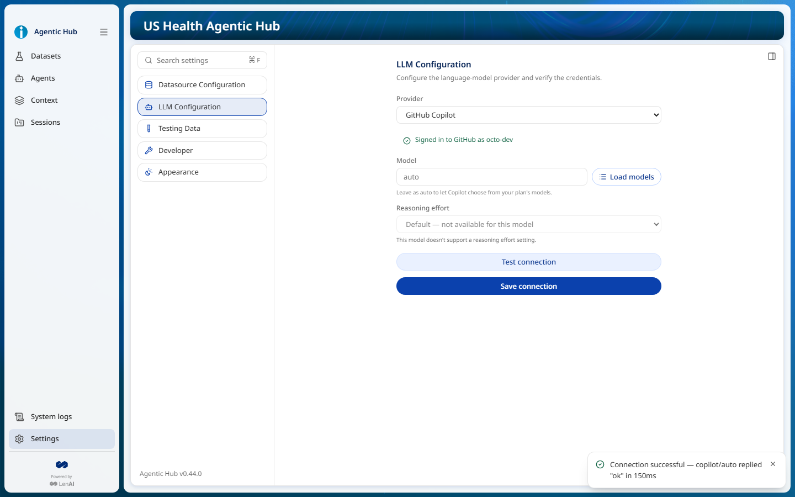

# 1.10.3 — GitHub Copilot as an LLM provider (BA-159)

A fifth LLM provider, **GitHub Copilot**, on the official `@github/copilot-sdk` (ADR-0037). The developer picks it in Settings → LLM Configuration and every agent runs on their own Copilot seat, signed in with the GitHub login already on the machine, with no API key. Spec: [llm-settings](../../specs/capabilities/llm-settings/spec.md) R55–R66 and the Feature "GitHub Copilot connection".

Target: web. Desktop not run (no desktop-only scenario). The installers and the npm package were not built; that is story 1.10.4.

Demo artifact: https://claude.ai/artifact/3mMmBUs1DtfRaTjP91gBDh (the demo video and this story's roadmap, changelog and gate results on one page; private until shared from its Share menu). Source: [demo-page.html](demo-page.html).

## Acceptance gate (step 9)

- [tests.md](tests.md): `node scripts/qa.mjs 1.10.3 --gate`, final run after the R66 fix. Build, backend lint and `check-specs` passed; the five step-6 Playwright specs passed, 59 tests and 0 failures (`llm-copilot` 8, `llm-settings`, `llm-custom-endpoint`, `agent-editor`, `navigation`). The two unit steps are marked failed by failures that are not this change's: see [unit-baseline.txt](unit-baseline.txt) (backend: the same 10 suites and 43 tests fail on `main`, the branch adds 71 passing tests; frontend: flaky `UiPreferencesService` timing tests in an untouched service, 505/505 on re-run).
- [demo.webm](demo.webm): the story's `@demo` scenario, "Configures GitHub Copilot by testing and saving with model auto", recorded with captions by `qa.mjs 1.10.3 --fast`.
- [e2e-impact.md](e2e-impact.md): the step-6 decisions.
- [evals.md](evals.md): the World Cup assistant evals. Existing custom endpoint 100% (no regression). GitHub Copilot on a Free seat: the first round found the model writing a tool's arguments as its message (fixed as llm-settings R66); after the fix 32/36, no raw tool JSON, the rest answer quality of the auto-routed model, documented and accepted by the user. **Not 100% for Copilot.**

## E2E against a stub of the Copilot runtime

`frontend/e2e/llm-copilot.spec.ts` covers all eight scenarios of the Feature, R66 included. The backend's Copilot SDK spawns `frontend/e2e/helpers/copilot-runtime-stub.js` in place of the real runtime through the SDK's own `COPILOT_CLI_PATH` variable, so production code has no test hook. The stub speaks the runtime's Content-Length framed JSON-RPC: `connect`, `auth.getStatus`, `models.list`, `session.create`, `session.send`, `session.tools.handlePendingToolCall`, `session.detach`, and the events `assistant.message_delta`, `assistant.message`, `assistant.usage`, `external_tool.requested`, `session.idle`. Their shapes come from a trace of the real runtime 1.0.108, recorded through a logging proxy while the app ran the status check, the model list, the connection test and a chat turn with two tool calls on a real seat. The stub logs every request, so the tests check what the app sent: no model for `auto`, the named model otherwise, a structured-output probe, the app's tools offered to the turn's session, and the tool result sent back after `run_readonly_sql` ran against the World Cup database.

`llm-copilot-tested.png`: the provider chosen, the sign-in line ("Signed in to GitHub as octo-dev", from the stub), no key, base URL or API style fields, the model `auto`, the reasoning effort unavailable for `auto`, and the passed test.

## Real seat, by hand (fast loop, 2026-11-10)

On a Copilot Free seat (`free_limited_copilot`, signed in through the GitHub CLI), on a copy of the data dir:

- `GET /llm/copilot/status` → `{"signedIn":true,"method":"gh-cli","message":"Signed in to GitHub as <login>"}`.
- `POST /llm/models` with `copilot` → `{"ok":true,"models":[]}`: a Free seat lists no models and Copilot picks.
- Test connection → `Connection successful — copilot/auto replied "ok" in 2971ms`.
- Saved GitHub Copilot and asked "Which team scored the most goals in the 2022 World Cup?" in a World Cup Core session: the answer streamed (47–73 text deltas per turn), ran real SQL through the app's tools and read "Argentina … 8. France … 7."
- The user tested the Settings flow by hand in the app built from the branch and accepted it.

## Known limits

- A turn stopped while its tool calls run keeps that Copilot session open until the 10-minute timeout (R63); stopping while the model writes closes it at once.
- A Free seat ignores the model name and auto-routes; its model list is empty.
- The npm package now installs the SDK's platform runtime package (about 184 MB on Windows) as an optional dependency of `@github/copilot-sdk`. Bundling and checking it in the installers and the npm package is story 1.10.4.
