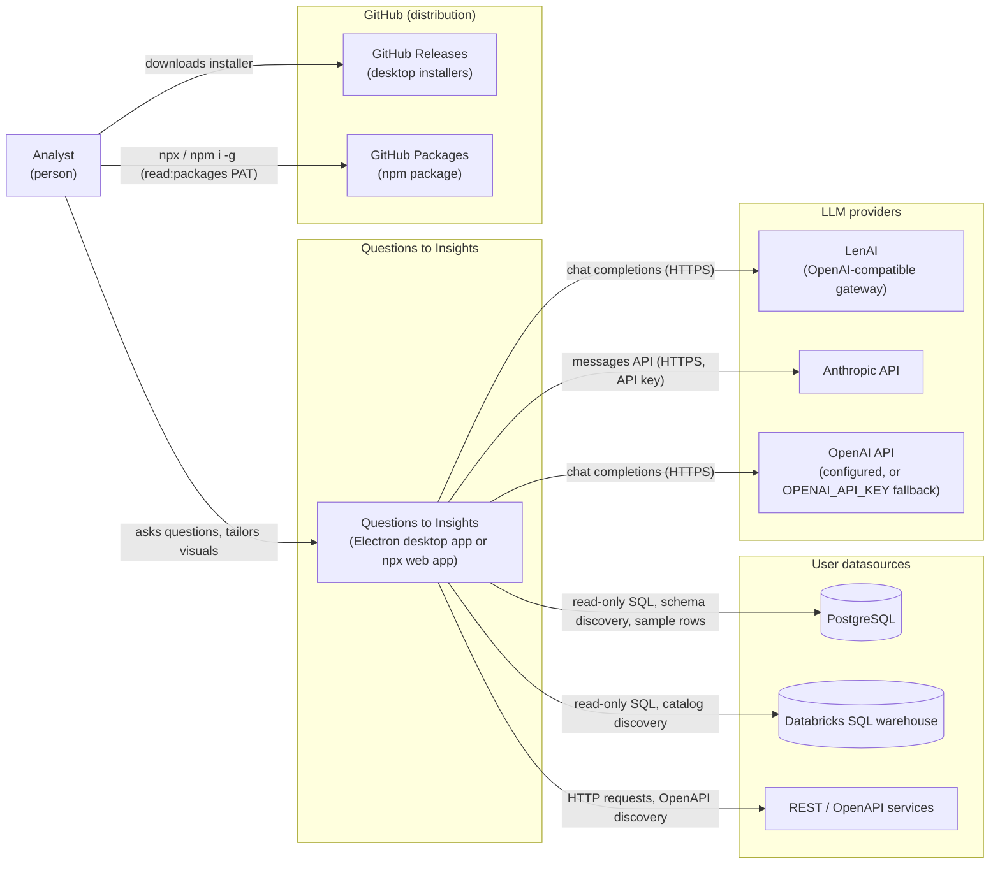
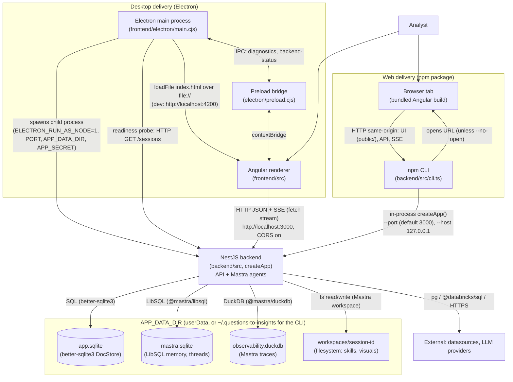
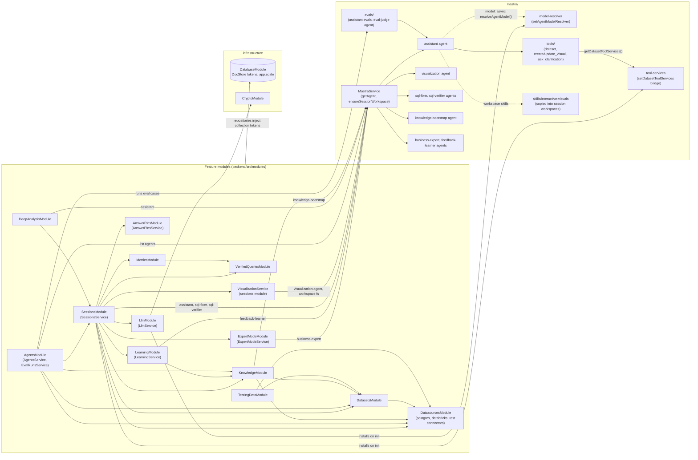
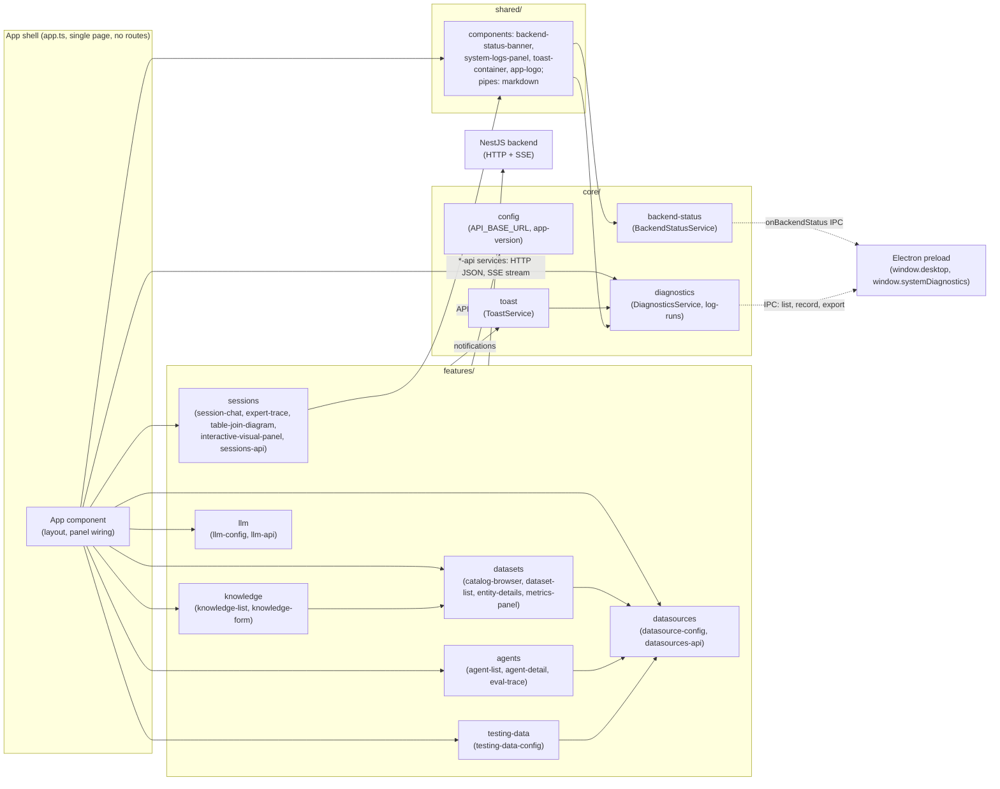
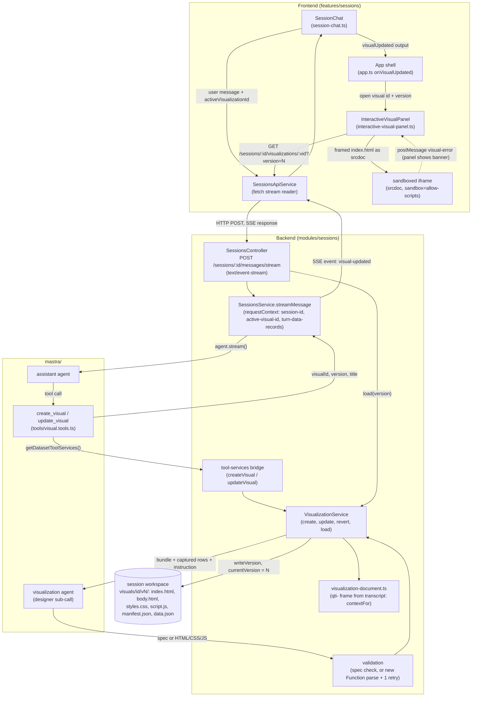

# Architecture

Architectural decisions recorded against the [C4 model](https://c4model.com/) (System Context → Containers → Components → Code). See *Architecture convention* in [CLAUDE.md](../../CLAUDE.md). This file describes the current implementation; see *Stack neutrality* in [specs/README.md](../README.md). ADRs are never edited in substance — supersede them with a new ADR.

ADR template:

```
#### ADR-NNNN — <Title>
- **Status:** Proposed | Accepted | Superseded by ADR-NNNN
- **Date:** YYYY-MM-DD
- **Context:**
- **Decision:**
- **Consequences:**
```

The ADRs below marked *retroactive* document decisions already in place when this file was created. Their operational detail lives in the other system specs: [tech-stack.md](tech-stack.md), [delivery.md](delivery.md), [data-model.md](data-model.md), [agents.md](agents.md) and [api.md](api.md).

## Level 1 — System Context



*System context: the analyst uses Questions to Insights, which queries the user's datasources (PostgreSQL, Databricks, REST/OpenAPI), calls the configured LLM provider, and is distributed through GitHub Releases and GitHub Packages.*


The user asks questions of their data in plain language; Questions to Insights answers with SQL, results, and interactive visuals. External systems: the user's datasources (PostgreSQL, Databricks SQL, REST/OpenAPI), an LLM provider (OpenAI-compatible / LenAI, Anthropic, OpenAI), GitHub (releases, GitHub Packages).

## Level 2 — Containers



*Containers: the two delivery modes (Electron spawning the backend as a child process, or the npm CLI serving backend + bundled UI to a browser) share one NestJS backend and its on-disk stores under `APP_DATA_DIR`.*


- **Electron main process** (`frontend/electron/main.cjs`) — window shell; spawns and kills the backend.
- **Angular renderer** (`frontend/src/`) — the UI.
- **NestJS backend** (`backend/src/`) — API, Mastra agents, SQLite app store, per-session workspaces.
- **npm CLI** (`backend/src/cli.ts`) — serves the same backend + bundled UI in a browser.

#### ADR-0001 — Electron desktop app with an Angular renderer and a NestJS child-process backend *(retroactive)*
- **Status:** Accepted
- **Date:** 2026-10-01
- **Context:** A single installable app is needed with no system Node dependency.
- **Decision:** Electron main spawns the NestJS backend with `ELECTRON_RUN_AS_NODE=1` on port 3000; the renderer talks to it over HTTP.
- **Consequences:** Packaging must stage backend `node_modules` as `extraResources`; native modules (better-sqlite3) must match Electron's ABI.

#### ADR-0002 — Ship the same app as an npm package served in the browser *(retroactive)*
- **Status:** Accepted
- **Date:** 2026-10-01
- **Context:** Developers want to run the app without installing a desktop build.
- **Decision:** The backend is the npm package; it bundles the Angular build and serves it same-origin via `createApp()` with a SPA fallback.
- **Consequences:** Separate default data dir (`~/.questions-to-insights`) to avoid SQLite lock contention with the desktop app; `API_BASE_URL` differs by runtime.

## Level 3 — Components

**Backend**



*Backend components: NestJS feature modules and their constructor-level dependencies, the `DocStore` behind every repository, and the `mastra/` harness reached only through `MastraService` plus the two DI bridges (`tool-services`, `model-resolver`) installed on module init. `SessionsModule` imports the business-expert, learning and answer-pin modules, never the reverse, so there is no dependency cycle.*

**Frontend**



*Frontend components: a single-page shell (`app.ts`, no routes) composes every feature directly; features call the backend through their own `*-api` services using `core/config`, and `core` services talk to Electron via the preload bridge.*


#### ADR-0003 — SQLite document store behind a `DocStore<T>` interface *(retroactive)*
- **Status:** Accepted
- **Date:** 2026-10-01
- **Context:** Small embedded persistence with flexible documents.
- **Decision:** One better-sqlite3 table per collection, JSON documents, injection token per collection (`database.module.ts`).
- **Consequences:** Renaming collections or persisted fields needs explicit migrations (`LEGACY_TABLE_NAMES`, `LEGACY_DOC_FIELDS`).

#### ADR-0004 — Mastra as the agentic harness *(retroactive)*
- **Status:** Accepted
- **Date:** 2026-10-01
- **Context:** Agents need tools, memory, and a provider-agnostic model layer.
- **Decision:** Standalone Mastra instance wrapped by `MastraService`; models resolved at call time from persisted LLM settings; LibSQL memory; one filesystem workspace per session.
- **Consequences:** The rest of the backend stays Mastra-agnostic; provider quirks are handled in `model-compat.ts`.

#### ADR-0005 — Visuals as versioned conversation participants *(retroactive)*
- **Status:** Accepted
- **Date:** 2026-10-01
- **Context:** Users tailor visuals iteratively from the chat.
- **Decision:** `create_visual` / `update_visual` tools drive a designer sub-agent; each edit writes a new `v<N>` directory; revert moves a pointer; a fixed, transcript-derived frame provides readable context.
- **Consequences:** Readability does not depend on designer-model output; storage grows per version.

ADR-0006 and ADR-0007 are used on the unmerged BA-2 branch ([epics/BA-2](../epics/BA-2/spec.md)), so the decisions below continue at ADR-0008.

#### ADR-0008 — Reasoning-trace confidence is measured by the system, never reported by the model
- **Status:** Accepted
- **Date:** 2026-09-29
- **Context:**
  - Business expert mode shows a reviewer a confidence for each step of an answer, and the mode is judged on two numbers: how well that confidence ranks right answers above wrong ones (AUROC), and whether "high" is right at least 90 % of the time.
  - Verbalized LLM confidence clusters at 80–100 % regardless of difficulty, so a self-reported score would rank nothing and label wrong answers "high".
  - A reader also needs to see why a block scored low, not just that it did.
  - The careful-mode verifier re-derived SQL without the curated knowledge, so on any question that depends on a default filter or a term it disagreed with correct answers. Its verdict measured knowledge-following inverted.
- **Decision:**
  - The `business-expert` agent writes only the trace's prose and structure, plus one 0–1 self-estimate per block.
  - The backend computes every confidence deterministically, as a weighted mean of named, measured signals: schema and join grounding read off the SQL that ran, knowledge coverage of the claims, the execution outcome, the independent cross-check, a verified-query match and the assumption load. The self-estimate is one signal at weight 0.10.
  - A signal that cannot be measured is omitted, never scored 0. A disagreeing cross-check caps the answer at 0.5, and a verified-query match floors it at 0.85.
  - Claims citing curated sources are checked against the context the turn was actually given. Tables, joins and SQL are taken from what ran.
  - Expert mode always runs the cross-check. The verifier now receives the same curated knowledge and metric definitions as the answer, while still never seeing its SQL.
  - One band definition (0.80 / 0.55) is shared by backend and renderer.
- **Consequences:**
  - Confidence is reproducible from the same inputs and explainable signal by signal.
  - An expert answer costs one extra model call plus the cross-check.
  - The trace is a contract duplicated in a backend entity and a frontend model that must change together.
  - Weights are tuned against the HR suite from the CLI harness only; the in-app Evals tab cannot run expert mode.
  - Careful mode's verdicts change for every question that relies on curated knowledge.

#### ADR-0009 — Learn from reviewer feedback through curated knowledge, not fine-tuning
- **Status:** Accepted
- **Date:** 2026-09-30
- **Context:**
  - What a reviewer teaches is a fact about the data or the business, such as a fiscal calendar or what "net revenue" means. It must fix every related question, take effect on the next turn, and stay visible and reversible.
  - For knowledge injection, retrieval has beaten unsupervised fine-tuning by a wide margin (Ovadia et al., arXiv:2312.05934). Fine-tuning on unfamiliar facts tends to increase hallucination (Gekhman et al., arXiv:2405.05904).
  - The models in use (GPT-5, the o-series) are not offered for supervised fine-tuning, and a handful of notes is far below any training set.
- **Decision:**
  - A note on a reasoning block is distilled by a new `feedback-learner` agent into 0–3 general lessons, never the answer itself. One retry is allowed, then a deterministic verbatim fallback.
  - Each lesson is stored as an ordinary knowledge snippet with `source: "feedback"` and its provenance, enabled at once and scoped to the session's datasets. The reviewer writing the note is the review gate; the Knowledge screen is the after-the-fact review.
  - The curated-knowledge budget grows from 2,000 to 8,000 characters. It orders default filters first and lessons second, and skips an entry that does not fit instead of stopping, so a lesson is never crowded out.
- **Consequences:**
  - Lessons reach the assistant, the cross-check verifier and the explainer with no new plumbing, and every eval run sees them too.
  - Lessons can be edited, disabled or deleted like any snippet, but editing the note again re-derives its lessons and discards hand edits.
  - Lesson quality rests on one model call per note.
  - A note that only says "wrong" teaches nothing.
  - Every new lesson moves the answer-pin fingerprint of each lineage on its datasets (ADR-0010).
  - Snippets gain a third source and an optional provenance. Older data needs no migration.

#### ADR-0010 — Consistent answers by replaying pinned answers, verified live
- **Status:** Accepted
- **Date:** 2026-09-30
- **Context:**
  - Users expect the same question to get the same answer, but hosted LLM inference is not deterministic even at temperature 0: kernels are not batch-invariant, and runs under "deterministic" settings vary widely (He et al., Thinking Machines Lab, 2025; Atil et al., arXiv:2408.04667).
  - Vendors' verified-query features guide generation but do not guarantee an exact replay.
  - Learning (ADR-0009) must still be able to change an answer, and changed data must never be hidden behind a stored answer.
- **Decision:**
  - A new `answer_pins` collection holds one pin per lineage: the normalised question, the datasets, the chain of earlier questions and the mode.
  - Each pin carries a fingerprint of everything that legitimately changes the answer: the knowledge given, the metrics and verified-query blocks, the schema, and the model with its effort.
  - Before any model call, a pinnable turn replays its pin only when the fingerprint matches and the pinned SQL, re-run live, returns identical rows. Otherwise it is answered afresh, and a stabiliser keeps the old wording when the rows held (`kept`) or marks the answer `updated`.
  - A thumbs-up approves a pin and a thumbs-down rejects it.
  - Pinning is on at the HTTP chat endpoint and off by default in the turn service, so eval harnesses never replay.
  - A replayed exchange never reaches the agent, so the next real turn catches its memory up.
- **Consequences:**
  - A repeated question costs one database query and no model call, and is byte-identical.
  - Replays are exact-question only: a paraphrase, a different conversation history or another mode is a new lineage.
  - Any context change on a dataset forces one re-derivation per lineage, and the stabiliser hides the churn when the numbers held.
  - Pins are kept apart from sessions and are not cascaded when a session or dataset is deleted.
  - Chat and evals deliberately differ: evals measure the engine, chat measures consistency.

## Level 4 — Code



*Visual tailoring loop: a chat turn's `create_visual`/`update_visual` tool call runs the designer agent through `VisualizationService`, writes a new `visuals/<id>/v<N>/` version in the session workspace, and the `visual-updated` SSE event makes the panel reload it into a sandboxed iframe that reports runtime errors back via `postMessage`.*


<!-- Code-level decisions (patterns, conventions with architectural weight) go here. -->
