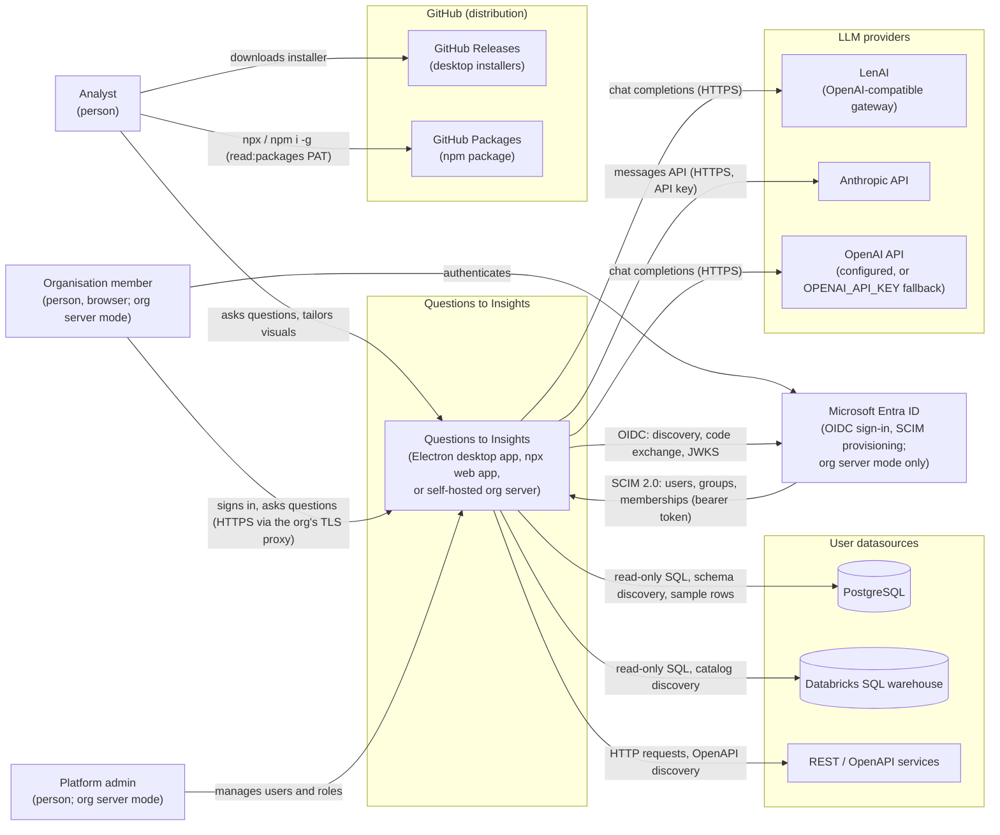
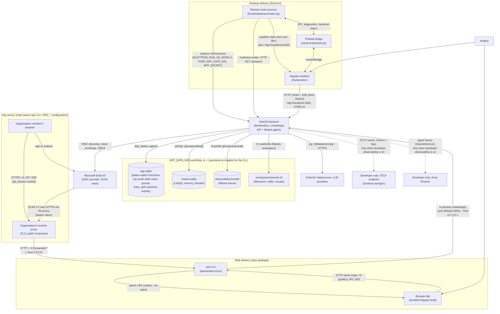
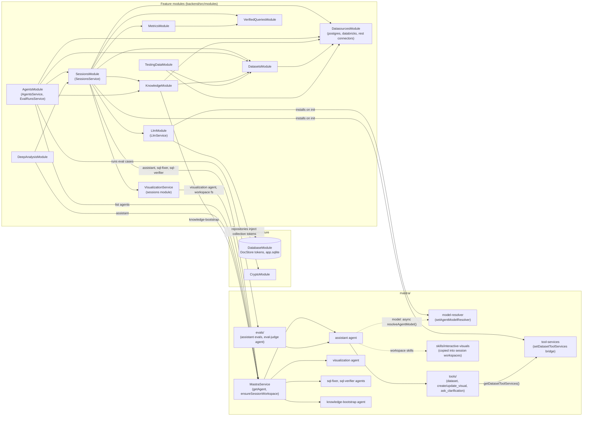
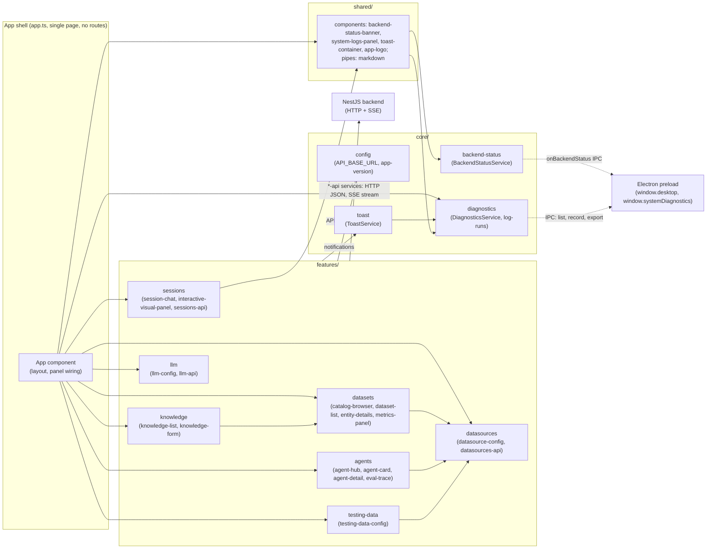
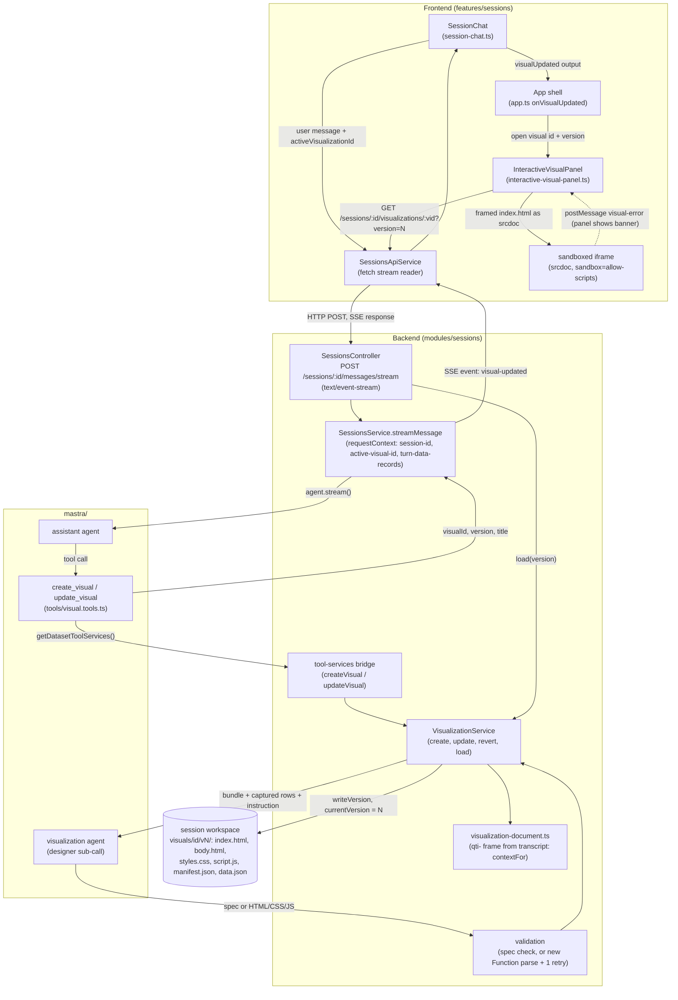

# Architecture

Architectural decisions recorded against the [C4 model](https://c4model.com/) (System Context → Containers → Components → Code). See *Architecture convention* in [CLAUDE.md](../../CLAUDE.md). This file describes the current implementation; see *Stack neutrality* in [specs/README.md](../README.md). ADRs are never edited in substance — supersede them with a new ADR.

ADR template:

```
#### ADR-NNNN — <Title>
- **Status:** Proposed | Accepted | Superseded by ADR-NNNN
- **Date:** YYYY-MM-DD
- **Context:**
- **Decision:**
- **Consequences:**
```

The ADRs below marked *retroactive* document decisions already in place when this file was created. Their operational detail lives in the other system specs: [tech-stack.md](tech-stack.md), [delivery.md](delivery.md), [data-model.md](data-model.md), [agents.md](agents.md) and [api.md](api.md).

## Level 1 — System Context



*System context: the analyst uses Questions to Insights, which queries the user's datasources (PostgreSQL, Databricks, REST/OpenAPI), calls the configured LLM provider, and is distributed through GitHub Releases and GitHub Packages. In org server mode, organisation members reach a self-hosted server from a browser and sign in with Microsoft Entra ID, which also pushes the directory to the server through SCIM.*


The user asks questions of their data in plain language; Questions to Insights answers with SQL, results, and interactive visuals. External systems: the user's datasources (PostgreSQL, Databricks SQL, REST/OpenAPI), an LLM provider (OpenAI-compatible / LenAI, Anthropic, OpenAI), GitHub (releases, GitHub Packages), and in org server mode the identity provider (Microsoft Entra ID, for OpenID Connect sign-in and SCIM 2.0 provisioning). Two modes run the same build (ADR-0010): **local mode**, one machine with five seeded personas to sign in as, without a password (ADR-0012; the desktop app always, the npx web app by default), and **org server mode**, many users of one organisation on a server it hosts.

## Level 2 — Containers



*Containers: the two delivery modes (Electron spawning the backend as a child process, or the npm CLI serving backend + bundled UI to a browser) share one NestJS backend and its on-disk stores under `APP_DATA_DIR`. In org server mode the same CLI runs behind the organisation's TLS proxy, and the backend talks to Entra ID for sign-in and receives SCIM pushes from it.*


- **Electron main process** (`frontend/electron/main.cjs`) — window shell; spawns and kills the backend.
- **Angular renderer** (`frontend/src/`) — the UI.
- **NestJS backend** (`backend/src/`) — API, Mastra agents, SQLite app store, per-session workspaces.
- **npm CLI** (`backend/src/cli.ts`) — serves the same backend + bundled UI in a browser. With the `ORG_*` configuration it is the **org server** (ADR-0010): no new container, the backend gains an auth module (OIDC sign-in, SCIM, roles, owner scoping; ADR-0011) and is reached through the organisation's reverse proxy. How to run it: [delivery.md](delivery.md) section 4.1.

#### ADR-0001 — Electron desktop app with an Angular renderer and a NestJS child-process backend *(retroactive)*
- **Status:** Accepted
- **Date:** 2026-10-01
- **Context:** A single installable app is needed with no system Node dependency.
- **Decision:** Electron main spawns the NestJS backend with `ELECTRON_RUN_AS_NODE=1` on port 3000; the renderer talks to it over HTTP.
- **Consequences:** Packaging must stage backend `node_modules` as `extraResources`; native modules (better-sqlite3) must match Electron's ABI.

#### ADR-0002 — Ship the same app as an npm package served in the browser *(retroactive)*
- **Status:** Accepted
- **Date:** 2026-10-01
- **Context:** Developers want to run the app without installing a desktop build.
- **Decision:** The backend is the npm package; it bundles the Angular build and serves it same-origin via `createApp()` with a SPA fallback.
- **Consequences:** Separate default data dir (`~/.questions-to-insights`) to avoid SQLite lock contention with the desktop app; `API_BASE_URL` differs by runtime.

#### ADR-0006 — Opt-in developer observability through OpenTelemetry, Arize Phoenix and Grafana `otel-lgtm`
- **Status:** Accepted
- **Date:** 2026-10-05
- **Context:**
  - Agent traces only reach `observability.duckdb`, which has no viewer. Nest and agent logs are two unlinked streams, and HTTP, Postgres and connector calls aren't traced at all. Developers need a local view of all of it ([BA-111](https://halo-powered.atlassian.net/browse/BA-111)).
  - End-user installs must not change: no new exporters, no network traffic, the same embedded stores.
  - OpenTelemetry auto-instrumentation only patches modules loaded after the SDK starts. `APP_DATA_DIR` is already read at import time.
- **Decision:**
  - Two new external systems, used only on a developer's machine: **Arize Phoenix** for agent and LLM traces, and **Grafana `otel-lgtm`** (OTLP collector, Tempo, Loki, Prometheus) for HTTP, NestJS, Postgres and connector traces, metrics and logs. Both run from an opt-in `observability` Docker Compose profile.
  - A **Developer observability** setting (enabled flag, Phoenix endpoint, OTLP endpoint), off by default and edited in a "Developer" Settings section. It is stored as a JSON file under `APP_DATA_DIR`, not in `app.sqlite`, so the entry points can read it synchronously before any app module loads.
  - The backend entry points (`main.ts`, `cli.ts`) read the file first. Only when it is enabled do they start the OpenTelemetry Node SDK with auto-instrumentation. Then they dynamically import the app. When it is off, no OpenTelemetry or exporter module is imported.
  - When it is enabled, the Mastra `Observability` config adds a Phoenix exporter **next to** `MastraStorageExporter`, so `observability.duckdb` keeps receiving every trace.
  - Changes apply on the next backend start. The desktop app's Restart respawns the backend child process; the npm CLI asks the developer to restart it.
  - Logs go through one pino stream with trace ids. They are exported over OTLP only when the setting is on.
- **Consequences:**
  - Each export path is behind one flag read at startup, so "off" is easy to verify: no module is loaded and no request is made.
  - `main.ts` stops importing the app statically. Load order becomes a contract that the entry points own.
  - Live switching isn't possible; the UI must make the restart explicit.
  - The developer-settings file is a new persisted shape under `APP_DATA_DIR` that the data model must record. A new dependency set (OpenTelemetry SDK, Phoenix exporter, `nestjs-pino`) ships in the package but stays unloaded by default.
  - Unreachable endpoints must never fail startup or requests. Exporters drop data instead.

#### ADR-0010 — Multi-user org server mode with Entra ID sign-in and server-enforced roles
- **Status:** Accepted; local mode amended by ADR-0012
- **Date:** 2026-10-10
- **Context:**
  - The vision used to rule out multi-user use ("no login, no roles and no shared server"). The Admin Panel epic ([BA-161](https://halo-powered.atlassian.net/browse/BA-161)) reverses that, from the Figma board "Agent Hub — E2E lifecycle (proposed)", section *Admin panel (draft)*.
  - Decisions taken with the user on 2026-10-10:
    - the organisation self-hosts the server, and Halo operates nothing;
    - today's single-user local mode stays;
    - only datasources and datasets are shared across users, plus one org-wide LLM configuration set by Platform admins;
    - the server keeps SQLite.
  - The backend already runs as a standalone web server through the npm CLI (ADR-0002) and stores everything behind `DocStore<T>` (ADR-0003). Neither has a notion of a user.
  - ADR-0008 tied a user agent's owner to "this machine" and deferred any sharing that needs a new container or sync format.
- **Decision:**
  - **Two modes, one build.** The same backend and renderer run in either mode, chosen at startup.
    - **Local mode** is the default and today's behaviour: no sign-in, and one implicit local user who holds every permission. The desktop app always runs in local mode.
    - **Org server mode** is enabled by server configuration: the identity provider's issuer, client id and secret, the public base URL, and the SCIM token. It is started through the npm CLI or its container image.
  - **No new container.** The org server is the existing web-mode backend, which serves the UI and the API from one origin. TLS and the public hostname are the organisation's reverse proxy's job. Users reach the org server from a browser. A desktop app connecting to a remote org server is out of scope for BA-161.
  - **Identity: OpenID Connect against Microsoft Entra ID**, authorization code flow with PKCE, run by the backend.
    - The backend issues its own session as an `HttpOnly`, `Secure`, `SameSite=Lax` cookie. No tokens are held in the renderer.
    - Generic OIDC is used, so another provider can follow without a new ADR.
  - **Directory: SCIM 2.0 inbound.** The backend exposes `/scim/v2/Users` and `/scim/v2/Groups`, protected by a bearer token, and Entra ID's provisioning service pushes to them.
    - A user who signs in before being provisioned is created just in time from their ID token claims.
    - Groups from the directory are read-only in the app.
  - **Authorization: roles and permissions in the backend.**
    - Five built-in roles: User, Maker, Data owner (scoped to one datasource), Approver and Platform admin. A fixed permission matrix maps roles to permissions.
    - A user's roles are the union of direct assignments and group-to-role mappings.
    - Every route declares the permission it needs, and one global guard checks it. The renderer reads the caller's permissions only to show or hide controls.
  - **Data ownership.**
    - Private documents gain an `ownerId`: sessions, visuals and their workspaces, memory threads, agents, knowledge, verified queries, metrics and eval runs. Repositories scope every read and write to the caller.
    - Datasources and datasets are org-wide, with no owner filter.
    - In local mode, every document belongs to the local user, so existing data needs no rewrite: a missing `ownerId` reads as the local user.
  - **Storage stays SQLite (ADR-0003).** New collections hold users, groups, group memberships, role assignments, group-to-role mappings, sign-in sessions and activity events. Activity events feed the admin overview's active-user counts and recent activity.
- **Consequences:**
  - ADR-0008's "owner is this machine" becomes "owner is a user". Agent ownership can be transferred. Sharing agents beyond their owner stays out of scope, for a later Requests/Registry epic.
  - Every repository must apply the owner scope. A missed one leaks one user's data to another, so an API test per collection must prove isolation between two users.
  - SQLite has a single writer, which limits concurrency. That is acceptable for one organisation's server at expected team sizes. Moving to PostgreSQL behind `DocStore<T>` would need its own ADR.
  - The server now accepts traffic beyond `127.0.0.1`, so the web-mode binding (non-functional N3) gains an org-server setting. CSRF protection and secure cookies become requirements.
  - The agent memory store (Mastra) must also be scoped per user. In org server mode the LLM configuration is org-wide and only Platform admins can change it, coordinated with [BA-159](https://halo-powered.atlassian.net/browse/BA-159).
  - The E2E harness needs a local OIDC stub and a SCIM client to drive org server mode without a real Entra ID tenant.

#### ADR-0011 — Backend-run OIDC with `openid-client`, an opaque session cookie and an Origin check
- **Status:** Accepted
- **Date:** 2026-10-10
- **Context:**
  - ADR-0010 puts sign-in in the backend, and Entra ID is the first provider.
  - The backend compiles to CommonJS and Jest can't load ESM-only packages (see the BA-152 retrospective).
  - The renderer calls the API with `HttpClient` and with raw `fetch` for streams. It sends no custom header today.
  - `openid-client@5` is already present through `@databricks/sql`, but that version is maintenance-only.
- **Decision:**
  - **OIDC client:** `openid-client@6`, imported lazily (`await import()`), the same way `cli.ts` and `main.ts` load ESM. It sits behind an `OidcClient` interface so unit tests mock it. The flow is the authorization code flow with PKCE, `state` and `nonce`, held during the round trip in a short-lived `HttpOnly` cookie.
  - **Session:**
    - The backend keeps no JWT. A session is an opaque 32-byte random id stored in an `auth_sessions` collection (SQLite, ADR-0003) and sent as an `HttpOnly; SameSite=Lax; Path=/` cookie.
    - The cookie is `Secure` unless the public base URL is `http://` (development and E2E only).
    - Behind the organisation's TLS proxy the app sets `trust proxy`.
  - **CSRF:** `SameSite=Lax`, plus a check that every non-GET request in org mode carries an `Origin` (or `Referer`) matching the public base URL. SCIM is exempt, because it uses a bearer token and no cookie.
  - **SCIM:** a hand-written controller covering the subset Entra ID's provisioning service sends. No library.
  - **Current user:** propagated with `AsyncLocalStorage`, so tool calls, SSE streams and background jobs started inside a request run as the caller without request-scoped providers.
- **Consequences:**
  - One new runtime dependency (`openid-client`). The E2E tests use a hand-rolled OIDC stub on `node:http` and `node:crypto` instead of a full provider.
  - A session can be revoked at once by deleting its document. Every request in org mode costs one store read.
  - Background jobs must capture the owner when they start, and re-enter it if they outlive the request.

#### ADR-0012 — Local mode signs in as one of five seeded personas, with a bearer-token auth session
- **Status:** Accepted
- **Date:** 2026-10-11
- **Context:**
  - ADR-0010 kept local mode as "no sign-in, and one implicit local user who holds every permission". So local mode and the desktop app had no roles, no owner scoping and no Admin area: nobody could try what a User, a Maker or an Approver sees without standing up an org server.
  - In local mode no document carried an `ownerId`, and owner scoping was skipped ("a missing `ownerId` reads as the local user").
  - The desktop renderer is loaded from `file://`, so ADR-0011's `SameSite=Lax` session cookie set by `http://localhost:3000` never reaches the backend on its requests.
  - The user delegated the decisions on 2026-10-11, after PR #69 shipped the org server: local and org mode should behave the same.
- **Decision:**
  - **Five seeded personas.** In local mode the backend ensures five directory users with fixed ids: Demo User (`local`), Uma User (`local-uma`), Mark Maker (`local-mark`), Dana Data Owner (`local-dana`) and Avery Approver (`local-avery`). Mark, Avery and Dana get their roles once; Dana is Data owner of every datasource. Demo User is always a Platform admin, as a bootstrap admin.
  - **A sign-in page without a password.** It lists the active directory users; choosing one starts an auth session. There's no automatic sign-in.
  - **Same session, different transport.** Local auth sessions are the same `auth_sessions` documents as on an org server, but the token is answered in the sign-in response, kept in browser storage and sent as `Authorization: Bearer <token>`. The cookie is org-only, and local mode has no `Origin` check. A local session has no idle timeout and ends at Sign out or 30 days after sign-in.
  - **Same enforcement.** Roles, the permission guard and owner scoping apply in local mode exactly as on an org server. Migration M13 gives every ownerless document to Demo User (`ownerId: "local"`), so existing data stays with the user who had it.
  - **One mechanism for desktop and web.** The desktop app and the npx web app in local mode sign in the same way, so the web E2E suite covers the desktop path. The desktop app's readiness probe becomes `GET /me`, ready on 200 or 401.
- **Consequences:**
  - Local mode is not a security boundary: anyone who can reach the local backend can sign in as any persona. It's a way to see each role, not to protect data (non-functional N78).
  - `GET /me` answers 401 when nobody is signed in, in both modes. For Demo User it reports Platform admin with source `bootstrap`.
  - Nothing runs as the local user by default any more. Code outside a request, such as the eval CLI, must run as Demo User explicitly.
  - A data folder used in local mode and then opened by an org server shows none of its private items there: they belong to `local`, which is no org user.

## Level 3 — Components

**Backend**



*Backend components: NestJS feature modules and their constructor-level dependencies, the `DocStore` behind every repository, and the `mastra/` harness reached only through `MastraService` plus the two DI bridges (`tool-services`, `model-resolver`) installed on module init.*

**Frontend**



*Frontend components: a single-page shell (`app.ts`, no routes) composes every feature directly; features call the backend through their own `*-api` services using `core/config`, and `core` services talk to Electron via the preload bridge.*


#### ADR-0003 — SQLite document store behind a `DocStore<T>` interface *(retroactive)*
- **Status:** Accepted
- **Date:** 2026-10-01
- **Context:** Small embedded persistence with flexible documents.
- **Decision:** One better-sqlite3 table per collection, JSON documents, injection token per collection (`database.module.ts`).
- **Consequences:** Renaming collections or persisted fields needs explicit migrations (`LEGACY_TABLE_NAMES`, `LEGACY_DOC_FIELDS`).

#### ADR-0004 — Mastra as the agentic harness *(retroactive)*
- **Status:** Accepted
- **Date:** 2026-10-01
- **Context:** Agents need tools, memory, and a provider-agnostic model layer.
- **Decision:** Standalone Mastra instance wrapped by `MastraService`; models resolved at call time from persisted LLM settings; LibSQL memory; one filesystem workspace per session.
- **Consequences:** The rest of the backend stays Mastra-agnostic; provider quirks are handled in `model-compat.ts`.

#### ADR-0005 — Visuals as versioned conversation participants *(retroactive)*
- **Status:** Accepted
- **Date:** 2026-10-01
- **Context:** Users tailor visuals iteratively from the chat.
- **Decision:** `create_visual` / `update_visual` tools drive a designer sub-agent; each edit writes a new `v<N>` directory; revert moves a pointer; a fixed, transcript-derived frame provides readable context.
- **Consequences:** Readability does not depend on designer-model output; storage grows per version.

#### ADR-0007 — Themeable renderer: semantic design tokens, a bundled webfont and a System / Light / Dark preference
- **Status:** Accepted; its *Preference* storage and default superseded by ADR-0009
- **Date:** 2026-10-09
- **Context:**
  - The renderer is dark-only. Its colours are hardcoded per component as Tailwind arbitrary values (`bg-[#232323]`, `zinc-*`), and it has no theme file and no CSS variables ([ui.md](ui.md) §6).
  - The Agentic Hub look and feel ([BA-141](https://halo-powered.atlassian.net/browse/BA-141)) needs a light theme and a navy dark theme derived from it, switchable at runtime. With hardcoded values, each theme would need a second class on every element.
  - The renderer loads over `file://` in the desktop app and must work offline, so it can't fetch fonts from a CDN.
- **Decision:**
  - **Semantic tokens.** Colours, radii and shadows become CSS custom properties named by role (surface, card, text, border, primary, status), not by value. A `data-theme="light" | "dark"` attribute on the root element selects one of two token sets. The tokens are mapped into Tailwind v4 through `@theme`, so components use role utilities (`bg-surface`, `text-muted`), never hex values or palette shades.
  - **Preference.** System (the default), Light or Dark, stored on the renderer like the right-panel width. System follows `prefers-color-scheme` and updates live when the OS changes. The resolved theme is set before first paint, so there is no flash of the wrong theme. The Electron window background matches the resolved theme.
  - **Webfont.** One open-licence sans-serif family is bundled with the renderer as local assets and loaded with `@font-face`. The system font stack stays as the fallback.
- **Consequences:**
  - Every component that uses hardcoded colours must move to tokens. The BA-141 stories do this screen by screen, and finished screens must have no arbitrary colour values left.
  - Both themes have to pass the axe scan, and visual baselines are captured per theme.
  - The renderer bundle grows by the font files.
  - The theme preference is a new persisted renderer key that [data-model.md](data-model.md) must record.
  - The theme is per renderer origin, so the desktop app and the npm CLI's browser tab can hold different preferences.

#### ADR-0008 — User-built agents are stored configurations of the assistant
- **Status:** Accepted
- **Date:** 2026-10-09
- **Context:**
  - The Agent Hub ([BA-150](https://halo-powered.atlassian.net/browse/BA-150)) lets users build their own agents: a name, a description, instructions, datasets, starter questions and an optional model override. Each one is drafted, published and chatted with.
  - Mastra agents are registered in code at startup (ADR-0004, `src/mastra/index.ts`). Registering an agent per user definition at runtime would mean re-registering on every edit and would bypass the assistant's tools, memory and guards.
  - The assistant's safety comes from code that must hold whatever the prompt says: the read-only SQL guard, grounding checks, SQL repair and trust signals. Its prompt must still start with the fixed identity line, and an E2E asserts this.
  - The app is local-first with no accounts, so "owner" can only mean "this machine".
- **Decision:**
  - A user agent is a **document** in a new `agents` collection, not a Mastra agent. Each document holds a `draft` and an optional `live` version of the configuration, plus `pinned`. Pin state for the built-in agents is stored separately, keyed by registry key.
  - A session started from an agent stores the agent id. Each turn runs the existing `assistant` and applies the agent's **Live** configuration:
    - its instructions as an extra, labelled per-turn system context block after the base prompt and the knowledge block;
    - its datasets as the session's datasets;
    - its model or reasoning-effort override through the turn's request context, read by `resolveAgentModel()`.
  - A preview chat applies the **draft** the same way, against a thread that is not stored as a session.
  - The built-in agents stay in the code registry. The hub merges them (Official: `assistant`; System: the helpers) with the user agents from the collection.
- **Consequences:**
  - User agents inherit every assistant tool, guard and fix automatically. They can't add tools or relax the guard.
  - Editing a Live agent never changes a running session until it is published. Deleting an agent leaves sessions pointing at a missing id, so they fall back to the plain assistant.
  - Adds a collection, and an optional field on `sessions` (no migration: absent means the plain assistant).
  - Sharing across machines, teams and owners would need a new container or a sync format. That is deferred and would supersede the "this machine" ownership here.


#### ADR-0009 — UI preferences live in the backend, with a browser cache for the first paint
- **Status:** Accepted; on an org server the document is per user (ADR-0010, [data-model.md](data-model.md) 3.2.1)
- **Date:** 2026-10-10
- **Context:**
  - ADR-0007 stored the theme choice in the renderer's browser storage, defaulting to System, and the navigation drawer was never remembered (app-shell R2).
  - The user wants the app to open in the Light theme with the drawer expanded, and any change the user makes to either to be stored in the database ([BA-168](https://halo-powered.atlassian.net/browse/BA-168)).
  - Browser storage is per renderer origin and per port, so the desktop app, a CLI tab on another port and a fresh browser profile each lose the choice.
  - The theme must still apply before the first paint (app-shell R42), which a backend round trip can't guarantee.
- **Decision:**
  - **Source of truth.** One `ui-preferences` document in the existing `settings` collection holds the theme choice and the drawer state, read and written through `GET` / `PUT /ui-preferences`. It belongs to the data directory, so every renderer on that data shares it.
  - **Defaults.** Nothing stored means Light and an expanded drawer. System stays a choice, no longer the default.
  - **First-paint cache.** The renderer keeps a browser-storage copy of the theme (and of the drawer state) and applies it before boot, then reconciles with the backend once it answers; the backend wins.
  - **One-time move.** A theme chosen before this change, found in browser storage while the backend has none, is written to the backend once.
- **Consequences:**
  - A new `settings` key and two endpoints; no new collection and no table migration.
  - A renderer whose cache disagrees with the backend (another renderer changed the choice) shows its cached theme for one frame, then switches.
  - Existing users who never chose a theme move from System to Light.

#### ADR-0015 — Golden dataset as data files with one reference query per dialect; Databricks as a register-only fixture kind
- **Status:** Accepted (2026-10-13, with the BA-9 epic spec)
- **Date:** 2026-10-12
- **Context:**
  - Three eval harnesses exist, each with its own format: the in-app suite (30 cases written as TypeScript in `backend/src/mastra/evals/assistant.evals.ts`), the golden set (`backend/eval/golden-set.json`, 9 cases, `npm run eval`) and the answer-quality gate (`backend/scripts/check-answers.ts`, 4 checks). They give no shared number and carry no category; adding a question is a code change; a wrong reference query is found only during a run that has already spent model tokens ([research 2.1](../../docs/research/BA-9.md#21-what-exists-on-main-at-v0300)).
  - The same questions must run on PostgreSQL, Databricks SQL and SQLite (the REST connector's engine), so that a regression on one datasource kind shows as that kind's regression. Today a case holds one reference query, the REST set swaps in SQLite references for 5 of its 10 cases, and the dataset preflight rejects a Databricks datasource.
  - A Databricks warehouse is external and billed per second; Docker Compose cannot start it the way it starts the World Cup PostgreSQL. The REST fixture already solves the same problem: it is register-only and names a setup script ([BA-9](https://halo-powered.atlassian.net/browse/BA-9), plan in [docs/plans/BA-9.md](../../docs/plans/BA-9.md)).
- **Decision:**
  - **Cases are data, not code.** One file per question set under `backend/src/mastra/evals/sets/`, loaded by the suite. A case is `{ id, category, tags, question, intent, checks: [{ type, args, criterion }], judgeRubric, expectedSql: { postgres, databricks, sqlite }, resultSetOptions, knowledge, turns }`, plus its dev or held-out split. The loader refuses a case without a category, or one missing a reference for a dialect its set supports.
  - **One reference query per dialect**, each run on its fixture by a validator (`npm run eval:validate`) with no model call, before it is committed.
  - **Databricks is a fixture kind.** `SampleFixture.datasourceKind` gains `'databricks'`. Like REST, the fixture is register-only: the Testing Data panel refuses to load it and names the setup script, `backend/scripts/setup-fixture-databricks.ts`, which loads a fixture's rows into `<catalog>.<schema>` and registers the datasource and dataset in a running backend. The eval preflight accepts the kind.
  - **One source of truth per fixture, the same rows on every kind** (added 2026-10-13). World Cup, finance and marketing analytics each run on PostgreSQL, Databricks and REST. The fixture's seeded PostgreSQL generator writes the rows; a dump script exports the schema to JSON; the local REST server serves that dump (`--fixture <name>`, with the same behaviour switches) and the Databricks loader, `backend/scripts/setup-fixture-databricks.ts --fixture <name>` in place of a World Cup-only script, loads it into `<catalog>.<schema>`.
- **Consequences:**
  - A question is added and reviewed in a pull request without reading code, and a broken reference fails in seconds at no token cost.
  - Every case needs up to three reference queries; a set declares which dialects it supports, and the validator holds it to that.
  - A difference between kinds on the same question points at the connector or the dialect, not at the data, because the rows are identical by construction. Every domain fixture costs a dump and a reference per dialect.
  - Databricks runs depend on a workspace, warehouse, token and catalog outside the repository, and stay on demand rather than in the nightly CI because of cost.
  - The case shape and the new run fields are recorded in [data-model.md](data-model.md) when they land; runs made before them compare on verdicts only, as today.
  - `npm run eval` and `backend/eval/` are removed when the cases move; `check-answers.ts` retires once runs have repeats.
  - Cases stored as inputs plus expectations keep an export to Databricks Genie benchmarks or MLflow evaluation datasets possible later.
## Level 4 — Code



*Visual tailoring loop: a chat turn's `create_visual`/`update_visual` tool call runs the designer agent through `VisualizationService`, writes a new `visuals/<id>/v<N>/` version in the session workspace, and the `visual-updated` SSE event makes the panel reload it into a sandboxed iframe that reports runtime errors back via `postMessage`.*


<!-- Code-level decisions (patterns, conventions with architectural weight) go here. -->
